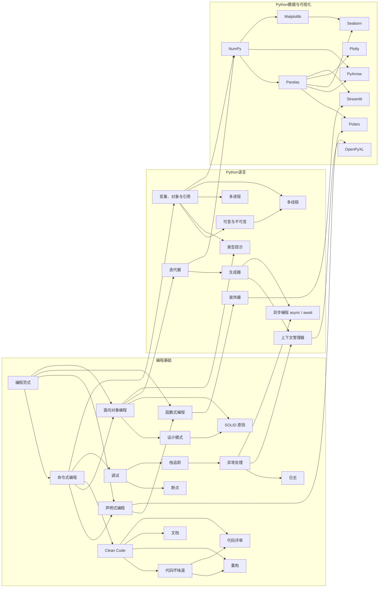
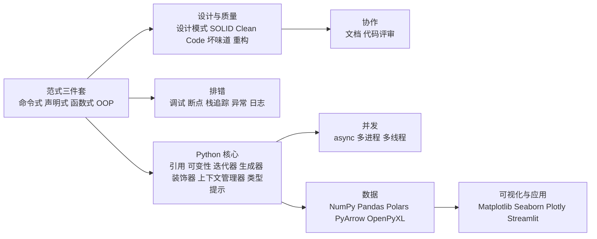

# K1 目录：编程基础 · Python 语言 · Python 数据与可视化

> **免责声明**：本批为“河洛序”知识图谱 K1 批次**初稿**，由 AI 辅助整理，仅供学习参考，不构成任何承诺。版本信息截至 2026-10-13。标注说明：**【有据可查】**附官方/原始来源；**【社区共识】**为业界普遍做法；**【待考察/推测】**为未能核实或推断。

## 本批概况

- 节点数：**36**（编程基础 17 · Python 语言 10 · Python 数据与可视化 9），**一个知识点一篇，未合并**。
- 每篇结构：YAML front matter（id / title / domain / prerequisites / related / tags）→ 一句话定义 → 为什么重要 → 原理/图解 → 可运行示例 → 常见误区 → 与 AI 开发的关系 → 延伸阅读 → 无法核实/待考察点。
- 文中 `[[k1.xxx]]` 是图谱内部链接，指向对应 id 的节点；front matter 中的 prerequisites / related 只引用本批已存在的 id（已脚本校验）。
- 所有示例代码在 `examples/` 下，**均已实际运行**，文中输出为真实结果（保存在 `examples/out/`）。一键重跑：`examples/run_all.sh`。
- 配图在 `img/`：`matplotlib-demo.png`、`seaborn-demo.png`、`plotly-demo.png`（交互原文件 `plotly-demo.html`），均由示例代码生成。
- 难以查到可靠资料的问题，见 [待补查清单.md](待补查清单.md)。

## 运行环境（实测）

| 用途 | 解释器 / 库版本 |
|---|---|
| 01–27 语言与编程基础示例 | CPython 3.15.0（2026-10-09 发布） |
| 27 多线程对比 | CPython 3.15.0 默认构建 + 3.15.0 自由线程构建（python3.15t） |
| 28–36 库示例 | CPython 3.13.5 + numpy 2.5.4、pandas 3.0.6、polars 2.0.0、openpyxl 3.1.5、pyarrow 25.0.1、matplotlib 3.11.2、seaborn 0.13.2、plotly 7.1.0、streamlit 1.65.0 |
| 24 静态类型检查 | mypy 2.4.0 |

## 节点列表

| # | 文件 | id | 领域 | 前置节点 |
|---|---|---|---|---|
| 1 | [编程范式（Programming Paradigm）](01-编程范式.md) | `k1.prog.paradigm` | 编程基础 | — |
| 2 | [命令式编程（Imperative Programming）](02-命令式编程.md) | `k1.prog.imperative` | 编程基础 | `k1.prog.paradigm` |
| 3 | [声明式编程（Declarative Programming）](03-声明式编程.md) | `k1.prog.declarative` | 编程基础 | `k1.prog.paradigm`、`k1.prog.imperative` |
| 4 | [函数式编程（Functional Programming）](04-函数式编程.md) | `k1.prog.functional` | 编程基础 | `k1.prog.paradigm`、`k1.prog.declarative` |
| 5 | [面向对象编程（OOP）](05-面向对象编程.md) | `k1.prog.oop` | 编程基础 | `k1.prog.paradigm`、`k1.prog.imperative` |
| 6 | [设计模式（Design Patterns）](06-设计模式.md) | `k1.prog.design-patterns` | 编程基础 | `k1.prog.oop` |
| 7 | [SOLID 原则](07-SOLID原则.md) | `k1.prog.solid` | 编程基础 | `k1.prog.oop`、`k1.prog.design-patterns` |
| 8 | [Clean Code（整洁代码）](08-Clean-Code.md) | `k1.prog.clean-code` | 编程基础 | `k1.prog.imperative` |
| 9 | [代码坏味道（Code Smell）](09-代码坏味道.md) | `k1.prog.code-smell` | 编程基础 | `k1.prog.clean-code` |
| 10 | [重构（Refactoring）](10-重构.md) | `k1.prog.refactoring` | 编程基础 | `k1.prog.code-smell`、`k1.prog.clean-code` |
| 11 | [文档（Documentation）](11-文档.md) | `k1.prog.documentation` | 编程基础 | `k1.prog.clean-code` |
| 12 | [代码评审（Code Review）](12-代码评审.md) | `k1.prog.code-review` | 编程基础 | `k1.prog.clean-code`、`k1.prog.code-smell` |
| 13 | [调试（Debugging）](13-调试.md) | `k1.prog.debugging` | 编程基础 | `k1.prog.imperative` |
| 14 | [断点（Breakpoint）与交互式调试器](14-断点.md) | `k1.prog.breakpoint` | 编程基础 | `k1.prog.debugging` |
| 15 | [栈追踪（Stack Trace / Traceback）](15-栈追踪.md) | `k1.prog.stack-trace` | 编程基础 | `k1.prog.debugging` |
| 16 | [异常处理（Exception Handling）](16-异常处理.md) | `k1.prog.exception-handling` | 编程基础 | `k1.prog.stack-trace` |
| 17 | [日志（Logging）](17-日志.md) | `k1.prog.logging` | 编程基础 | `k1.prog.exception-handling` |
| 18 | [变量、对象与引用（Names, Objects and References）](18-变量对象与引用.md) | `k1.py.object-reference` | Python语言 | `k1.prog.imperative` |
| 19 | [可变与不可变（Mutable vs Immutable）](19-可变与不可变.md) | `k1.py.mutability` | Python语言 | `k1.py.object-reference` |
| 20 | [迭代器（Iterator）与可迭代对象](20-迭代器.md) | `k1.py.iterator` | Python语言 | `k1.prog.oop` |
| 21 | [生成器（Generator）](21-生成器.md) | `k1.py.generator` | Python语言 | `k1.py.iterator` |
| 22 | [装饰器（Decorator）](22-装饰器.md) | `k1.py.decorator` | Python语言 | `k1.prog.functional` |
| 23 | [上下文管理器（Context Manager）与 with 语句](23-上下文管理器.md) | `k1.py.context-manager` | Python语言 | `k1.prog.exception-handling`、`k1.py.generator` |
| 24 | [类型提示（Type Hints）](24-类型提示.md) | `k1.py.type-hints` | Python语言 | `k1.prog.oop`、`k1.py.object-reference` |
| 25 | [异步编程 async / await](25-async-await.md) | `k1.py.async-await` | Python语言 | `k1.py.generator`、`k1.prog.exception-handling` |
| 26 | [多进程（Multiprocessing）](26-多进程.md) | `k1.py.multiprocessing` | Python语言 | `k1.py.object-reference` |
| 27 | [多线程（Threading）、GIL 与自由线程 Python](27-多线程.md) | `k1.py.threading` | Python语言 | `k1.py.object-reference`、`k1.py.mutability` |
| 28 | [NumPy：数值计算的地基](28-NumPy.md) | `k1.lib.numpy` | Python数据与可视化 | `k1.py.object-reference`、`k1.py.iterator` |
| 29 | [Pandas：表格数据分析（3.x）](29-Pandas.md) | `k1.lib.pandas` | Python数据与可视化 | `k1.lib.numpy` |
| 30 | [Polars：高性能 DataFrame（2.x）](30-Polars.md) | `k1.lib.polars` | Python数据与可视化 | `k1.lib.pandas`、`k1.prog.declarative` |
| 31 | [OpenPyXL：读写 Excel 文件](31-OpenPyXL.md) | `k1.lib.openpyxl` | Python数据与可视化 | `k1.py.context-manager` |
| 32 | [PyArrow：列式内存格式与 Parquet](32-PyArrow.md) | `k1.lib.pyarrow` | Python数据与可视化 | `k1.lib.numpy`、`k1.lib.pandas` |
| 33 | [Matplotlib：Python 绘图的底层标准](33-Matplotlib.md) | `k1.lib.matplotlib` | Python数据与可视化 | `k1.lib.numpy` |
| 34 | [Seaborn：统计可视化](34-Seaborn.md) | `k1.lib.seaborn` | Python数据与可视化 | `k1.lib.matplotlib`、`k1.lib.pandas` |
| 35 | [Plotly：交互式图表（7.x）](35-Plotly.md) | `k1.lib.plotly` | Python数据与可视化 | `k1.lib.pandas` |
| 36 | [Streamlit：用纯 Python 快速做数据应用](36-Streamlit.md) | `k1.lib.streamlit` | Python数据与可视化 | `k1.lib.pandas`、`k1.py.decorator` |

## 前置关系图

箭头表示“先学 A 再学 B”（仅画 prerequisites，不画 related）。

## 建议学习路线

## 合并说明

本批 36 个节点**全部独立成篇，没有合并**。原因：每个节点都有官方文档或经典著作可引用，且都能写出可独立运行、能体现该知识点本质的示例（如“断点”可用 pdb 条件断点单独演示，“栈追踪”可用异常链单独演示），资料量足以支撑单篇。
相近节点之间的边界处理：命令式/声明式/函数式/OOP 由“编程范式”统领并互相 related；调试—断点—栈追踪—异常—日志 形成前置链；async/多进程/多线程各篇都有同一张“三种并发怎么选”的对照，避免重复展开。

## 修订记录

- 2026-10-13：K1 初稿（36 篇）。
