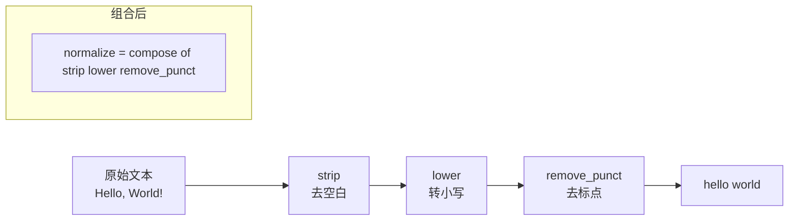

# 函数式编程（Functional Programming）

> **免责声明**：本文是“河洛序”知识图谱 K1 批次的**初稿**，由 AI 辅助整理，仅供学习参考，不构成任何承诺或保证。版本信息截至 2026-10-13；文中示例已在 Python 3.15.0（语言类）或 Python 3.13.5 + 所列库版本（库类）下**实际运行**，输出为真实结果，但换机器、换版本时数字（尤其是耗时）会不同。
>
> 标注说明：**【有据可查】** 附官方文档 / 原始出处链接；**【社区共识】** 为业界普遍做法，没有唯一权威出处；**【待考察/推测】** 为未能核实或作者推断，请勿当作定论。

## 一句话定义

函数式编程把程序看成**一串“输入→输出”的纯函数组合**：函数不偷偷修改外部状态，数据创建后不再改动，需要变化就生成新数据。

## 为什么重要

- **纯函数最好测**：同样的输入永远得到同样的输出，测试不需要准备“世界状态”。
- **天然适合并行和缓存**：没有共享可变状态，就没有竞态条件；结果只依赖输入，就可以放心缓存（见 [[k1.py.decorator]] 里的 `functools.cache`）。
- **数据流水线思维**：数据清洗、特征工程、ETL 都是“一步步变换”，函数式是最自然的表达。

## 原理 / 图解

核心概念四件套：

| 概念 | 含义 | Python 中的体现 |
|---|---|---|
| 纯函数 | 无副作用、结果只依赖参数 | 不读写全局变量、不修改入参 |
| 不可变数据 | 创建后不改，改就生成新值 | `tuple`、`frozenset`、`frozen=True` 的 dataclass、3.15 新增的 `frozendict` |
| 一等函数 / 高阶函数 | 函数可以当参数、返回值 | `map`、`filter`、`sorted(key=...)`、装饰器 |
| 组合 | 小函数拼成大函数 | `compose(f, g, h)`、方法链 |



【有据可查】Python 3.15（2026-10-09 发布）新增内建 `frozendict`（PEP 814），它可哈希（当键值都可哈希时），进一步补齐了不可变数据结构：<https://docs.python.org/3.15/whatsnew/3.15.html> 、<https://peps.python.org/pep-0814/>

## 可运行示例

```python
# 文件：examples/04_functional.py
# 函数式：纯函数、不可变数据、函数作为一等公民、组合
from functools import reduce, partial

def compose(*fs):
    return lambda x: reduce(lambda acc, f: f(acc), fs, x)

strip = str.strip
lower = str.lower
def remove_punct(s): return "".join(c for c in s if c.isalnum() or c.isspace())

normalize = compose(strip, lower, remove_punct)
print(repr(normalize("  Hello, World!  ")))

# 纯函数 vs 有副作用的函数
counter = 0
def impure_add(x):
    global counter
    counter += x          # 修改外部状态 = 副作用
    return counter
def pure_add(acc, x):
    return acc + x        # 只依赖输入
print("不纯:", impure_add(1), impure_add(1))   # 同样输入，不同输出
print("纯:", pure_add(0, 1), pure_add(0, 1))     # 同样输入，同样输出

# 不可变数据：返回新对象而不是改旧对象
from dataclasses import dataclass, replace
@dataclass(frozen=True)
class User:
    name: str
    level: int
u1 = User("ann", 1)
u2 = replace(u1, level=2)
print(u1, u2)

# 高阶函数与偏函数
power = lambda base, exp: base ** exp
square = partial(power, exp=2)
print(list(map(square, [1, 2, 3])))
```

输出（Python 3.15.0）：

```text
'hello world'
不纯: 1 2
纯: 1 1
User(name='ann', level=1) User(name='ann', level=2)
[1, 4, 9]
```

看第二、三行：`impure_add(1)` 调两次结果不同（1、2），因为它偷偷改了全局 `counter`；`pure_add(0, 1)` 永远是 1。这就是“副作用”的直观含义。

## 常见误区

- **“用了 map/lambda 就是函数式”**：关键在于**没有副作用**，而不是语法。一个在 `map` 里写日志、改全局字典的 lambda 依然是命令式。
- **在 Python 里追求“纯粹函数式”**：Python 没有尾递归优化（深递归会触发 `RecursionError`），列表推导式通常比 `map(lambda…)` 更易读。【有据可查】Python 官方 HOWTO 也推荐推导式与生成器表达式：<https://docs.python.org/3/howto/functional.html>
- **“不可变 = 慢”**：小对象创建很便宜；真正的大数据（数组、表格）由 NumPy/Polars 在底层高效处理，接口层保持不可变语义反而更安全（参见 [[k1.lib.pandas]] 的 Copy-on-Write）。
- **完全消灭副作用**：程序总要写文件、发请求。正确做法是**把副作用推到边缘**，核心逻辑保持纯净（“函数式核心，命令式外壳”）。【社区共识】

## 与 AI 开发的关系

- **JAX 要求纯函数**：`jax.jit`、`jax.grad` 只对纯函数行为正确，函数内修改全局变量的结果不可预期。【有据可查】<https://docs.jax.dev/en/latest/notebooks/Common_Gotchas_in_JAX.html>
- **数据预处理流水线**（Hugging Face `datasets.map`、Polars 表达式）都鼓励“输入一行/一列、输出新的一行/一列”的函数式写法，便于并行和缓存。
- **工具函数（Tool / Function Calling）**：给 LLM 调用的工具越接近纯函数（参数明确、无隐藏状态），Agent 行为越可预测、越容易重放和评估。【社区共识】

## 延伸阅读

- Python《Functional Programming HOWTO》：<https://docs.python.org/3/howto/functional.html>
- `functools` 模块文档：<https://docs.python.org/3/library/functools.html>
- Gary Bernhardt 的演讲 *Boundaries*（“函数式核心、命令式外壳”概念的常见出处）：<https://www.destroyallsoftware.com/talks/boundaries>

## 无法核实 / 待考察点

- 【待考察/推测】“函数式核心，命令式外壳（Functional Core, Imperative Shell）”一般归于 Gary Bernhardt，但最早出处的确切时间未核实。
