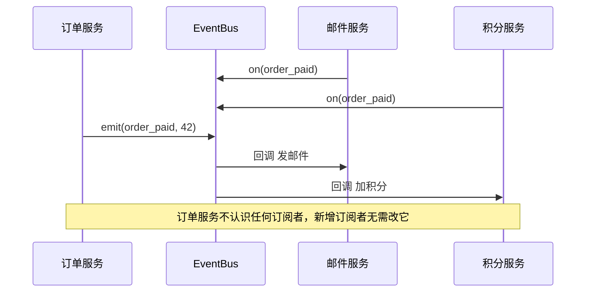

# 设计模式（Design Patterns）

> **免责声明**：本文是“河洛序”知识图谱 K1 批次的**初稿**，由 AI 辅助整理，仅供学习参考，不构成任何承诺或保证。版本信息截至 2026-10-13；文中示例已在 Python 3.15.0（语言类）或 Python 3.13.5 + 所列库版本（库类）下**实际运行**，输出为真实结果，但换机器、换版本时数字（尤其是耗时）会不同。
>
> 标注说明：**【有据可查】** 附官方文档 / 原始出处链接；**【社区共识】** 为业界普遍做法，没有唯一权威出处；**【待考察/推测】** 为未能核实或作者推断，请勿当作定论。

## 一句话定义

设计模式是**针对软件设计中反复出现的问题、被总结出来的可复用解决方案模板**——它不是代码，而是“这类问题通常这样拆”的经验命名。

## 为什么重要

- **共同语言**：说一句“这里用观察者”，团队立刻明白是“发布事件、多方订阅”，省去大段解释。
- **读懂框架源码**：Django 信号是观察者，PyTorch 的 hook 是观察者，LangChain 的各种 Runnable 是组合/策略。
- **避免重复造错轮子**：很多“自创”设计其实是某个模式的劣化版本。

## 原理 / 图解

【有据可查】经典来源是 Gamma、Helm、Johnson、Vlissides 合著的 *Design Patterns: Elements of Reusable Object-Oriented Software*（1994，“四人帮/GoF”），收录 23 个模式，分三类：创建型、结构型、行为型。可参考 Refactoring.Guru 的整理：<https://refactoring.guru/design-patterns>

| 类别 | 解决的问题 | 常见模式（Python 里最常见的加粗） |
|---|---|---|
| 创建型 | 怎么创建对象 | **工厂**、建造者、**单例**、原型 |
| 结构型 | 对象怎么组合 | **适配器**、**装饰器**、外观、代理、组合 |
| 行为型 | 对象怎么协作 | **策略**、**观察者**、命令、**迭代器**、模板方法、状态 |

以观察者为例：



【社区共识】在 Python 中，**很多 GoF 模式被语言特性“吸收”了**：函数是一等对象，所以策略模式常常就是“传一个函数”；迭代器模式内建在 `for` 循环里（见 [[k1.py.iterator]]）；装饰器模式有 `@` 语法（见 [[k1.py.decorator]]，注意 Python 装饰器与 GoF 装饰器模式并不完全相同）。Peter Norvig 1996 年的演讲指出动态语言中 23 个模式里有 16 个“变得不可见或更简单”：<https://norvig.com/design-patterns/>

## 可运行示例

用 Pythonic 写法实现三个最常用模式（Python 3.15.0 实际运行）：

```python
# 文件：examples/06_patterns.py
# 三个最常用的设计模式：策略、观察者、工厂（Pythonic 写法）
from typing import Callable

# 策略模式：把"算法"作为可替换的参数
def no_discount(p): return p
def vip_discount(p): return p * 0.8
def checkout(price: float, strategy: Callable[[float], float]) -> float:
    return round(strategy(price), 2)
print("策略:", checkout(100, no_discount), checkout(100, vip_discount))

# 观察者模式：事件发布/订阅
class EventBus:
    def __init__(self): self._subs = {}
    def on(self, event, fn): self._subs.setdefault(event, []).append(fn)
    def emit(self, event, **data):
        for fn in self._subs.get(event, []): fn(**data)
bus = EventBus()
bus.on("order_paid", lambda order_id: print(f"观察者-发邮件: 订单 {order_id}"))
bus.on("order_paid", lambda order_id: print(f"观察者-加积分: 订单 {order_id}"))
bus.emit("order_paid", order_id=42)

# 工厂模式：根据配置创建对象，调用方不关心具体类
class OpenAIClient:
    def name(self): return "openai"
class OllamaClient:
    def name(self): return "ollama"
REGISTRY = {"openai": OpenAIClient, "ollama": OllamaClient}
def make_client(kind: str):
    try:
        return REGISTRY[kind]()
    except KeyError:
        raise ValueError(f"未知客户端: {kind}") from None
print("工厂:", make_client("ollama").name())
```

输出：

```text
策略: 100 80.0
观察者-发邮件: 订单 42
观察者-加积分: 订单 42
工厂: ollama
```

- **策略**：`checkout` 不关心折扣怎么算，传什么函数就用什么规则。
- **观察者**：`emit` 一次，两个订阅者都收到通知；以后加“发短信”只需再 `on` 一次。
- **工厂**：通过注册表 `REGISTRY` 按名字创建客户端，调用方不 `import` 具体类。

## 常见误区

- **为了用模式而用模式**：小脚本里套三层工厂 + 抽象工厂是“过度设计”。【社区共识】先写直白代码，出现重复和变化点时再重构到模式（见 [[k1.prog.refactoring]]）。
- **照搬 Java 写法**：在 Python 里写 `class Strategy(ABC)` + 三个子类，往往不如三个函数清楚。
- **单例滥用**：单例本质上是全局状态，会让测试互相污染。Python 中模块本身就是天然单例。
- **把模式当成“标准答案”**：模式是权衡（trade-off），每个模式的“适用性”和“后果”章节同样重要。

## 与 AI 开发的关系

- **策略模式**：切换不同 LLM 提供商、不同检索器、不同重排序器——把它们做成同一接口的可替换策略。
- **观察者 / 回调**：训练框架的 callback（早停、记录指标、保存检查点）就是观察者模式。【有据可查】Hugging Face Transformers 的 `TrainerCallback`：<https://huggingface.co/docs/transformers/main_classes/callback>
- **工厂 + 注册表**：`AutoModel.from_pretrained("名字")` 根据配置自动选择模型类，是工厂模式的大规模应用。【有据可查】<https://huggingface.co/docs/transformers/model_doc/auto>
- **让 AI 生成代码时**，点名模式（“用策略模式让检索器可替换”）能显著提高结构一致性。【社区共识】

## 延伸阅读

- Refactoring.Guru 设计模式图解（有中文版）：<https://refactoring.guru/design-patterns>
- Brandon Rhodes, *Python Design Patterns*（Python 视角的 GoF 解读）：<https://python-patterns.guide/>
- Peter Norvig, *Design Patterns in Dynamic Languages*（1996）：<https://norvig.com/design-patterns/>

## 无法核实 / 待考察点

- 【待考察/推测】Norvig 的“16/23”结论针对 Dylan/Lisp 等动态语言，直接推广到 Python 属于类比，未见严格论证。
