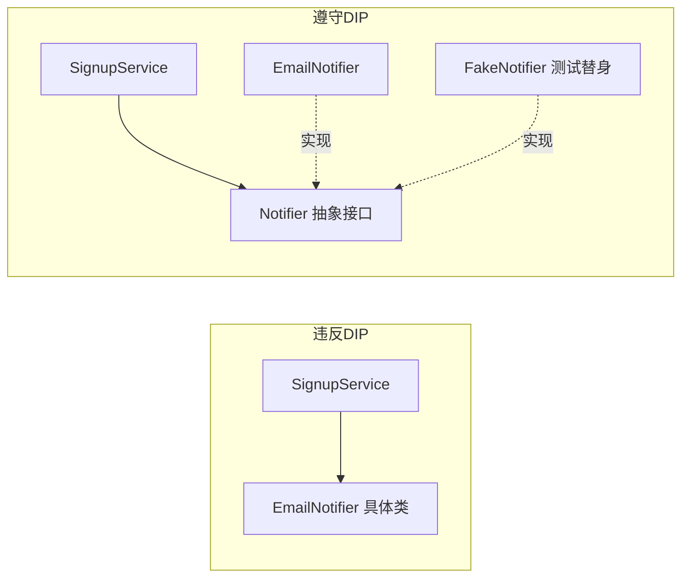

# SOLID 原则

> **免责声明**：本文是“河洛序”知识图谱 K1 批次的**初稿**，由 AI 辅助整理，仅供学习参考，不构成任何承诺或保证。版本信息截至 2026-10-13；文中示例已在 Python 3.15.0（语言类）或 Python 3.13.5 + 所列库版本（库类）下**实际运行**，输出为真实结果，但换机器、换版本时数字（尤其是耗时）会不同。
>
> 标注说明：**【有据可查】** 附官方文档 / 原始出处链接；**【社区共识】** 为业界普遍做法，没有唯一权威出处；**【待考察/推测】** 为未能核实或作者推断，请勿当作定论。

## 一句话定义

SOLID 是五条面向对象设计原则的首字母缩写，目标只有一个：**让代码在需求变化时，改动少、影响小、容易测试**。

## 为什么重要

- **需求一定会变**。SOLID 帮你预先把“容易变的部分”和“稳定的部分”隔开。
- **可测试性**：遵守依赖倒置的代码，可以轻松用假对象替换数据库、邮件、LLM API 来做单元测试。
- **代码评审的共同标尺**：评审意见“这个类职责太多了（违反 SRP）”比“我觉得不好”更有说服力。

## 原理 / 图解

| 字母 | 原则 | 一句话 | 违反时的症状 |
|---|---|---|---|
| S | 单一职责 SRP | 一个模块只因一个理由而修改 | 改发邮件逻辑要动注册逻辑 |
| O | 开闭 OCP | 对扩展开放，对修改关闭 | 每加一种支付方式都要改一个大 `if/elif` |
| L | 里氏替换 LSP | 子类必须能替换父类而不破坏预期 | 正方形继承长方形后行为怪异 |
| I | 接口隔离 ISP | 不强迫使用者依赖它用不到的方法 | 一个接口二十个方法，实现者被迫写空方法 |
| D | 依赖倒置 DIP | 高层依赖抽象，不依赖具体实现 | 业务代码里直接 `import smtplib` |



【有据可查】这些原则由 Robert C. Martin 在 2000 年前后的文章 *Design Principles and Design Patterns* 中系统阐述；里氏替换原则源自 Barbara Liskov 1987 年的主题演讲；“SOLID”这个缩写的组合一般归于 Michael Feathers。概览见：<https://en.wikipedia.org/wiki/SOLID>

## 可运行示例

演示 SRP + DIP 如何让测试变简单，以及一个经典的 LSP 反例（Python 3.15.0 实际运行）：

```python
# 文件：examples/07_solid.py
# SOLID 中最常用的两条：单一职责(S) + 依赖倒置(D)，并演示它们让测试变容易
from typing import Protocol

class Notifier(Protocol):              # 抽象（接口）
    def send(self, to: str, msg: str) -> None: ...

class EmailNotifier:
    def send(self, to, msg): print(f"[真实邮件] -> {to}: {msg}")

class FakeNotifier:                    # 测试替身
    def __init__(self): self.sent = []
    def send(self, to, msg): self.sent.append((to, msg))

class SignupService:
    """单一职责：只负责注册流程；通知方式由外部注入（依赖倒置）"""
    def __init__(self, notifier: Notifier):
        self.notifier = notifier
        self.users = set()
    def signup(self, email: str):
        if email in self.users:
            raise ValueError("已注册")
        self.users.add(email)
        self.notifier.send(email, "欢迎!")

SignupService(EmailNotifier()).signup("a@example.com")

fake = FakeNotifier()
svc = SignupService(fake)
svc.signup("b@example.com")
assert fake.sent == [("b@example.com", "欢迎!")]
print("测试通过：无需真的发邮件就能验证行为")

# 里氏替换(L)反例：正方形继承长方形会破坏"可替换性"
class Rect:
    def __init__(self, w, h): self.w, self.h = w, h
    def set_w(self, w): self.w = w
    def area(self): return self.w * self.h
class Square(Rect):
    def set_w(self, w): self.w = self.h = w
def stretch(r: Rect):
    r.set_w(10); return r.area()
print("Rect(2,5) 拉宽后面积:", stretch(Rect(2, 5)), " Square(5) 拉宽后面积:", stretch(Square(5, 5)), "← 调用方的预期被打破")
```

输出：

```text
[真实邮件] -> a@example.com: 欢迎!
测试通过：无需真的发邮件就能验证行为
Rect(2,5) 拉宽后面积: 50  Square(5) 拉宽后面积: 100 ← 调用方的预期被打破
```

- 用 `FakeNotifier` 替换真实邮件，测试**不发任何真实邮件**就验证了“注册后会通知”。这正是依赖倒置的实际收益。
- `stretch(Square(5,5))` 得到 100 而不是调用方预期的 50：**语法上是合法的继承，语义上破坏了替换性**。

## 常见误区

- **教条化拆分**：为了“单一职责”把 20 行代码拆成 8 个类，可读性反而下降。【社区共识】原则是用来对抗“变化带来的痛苦”的，没有变化压力的地方不必强求。
- **以为 SOLID 只适用于 Java**：在 Python 中，DIP 往往只需要“把依赖作为参数传进来”，`typing.Protocol` 提供静态检查（见 [[k1.py.type-hints]]），不需要复杂的依赖注入框架。
- **把 OCP 理解为“永远不改旧代码”**：OCP 的意思是常见的扩展（加一种策略）不应修改核心流程，不是禁止修 bug。
- **LSP 只看方法签名**：LSP 关注的是**行为契约**（前置条件、后置条件、不变量），签名一致不代表可替换。

## 与 AI 开发的关系

- **DIP 让 LLM 应用可测试**：把模型调用抽象成 `LLM` 协议，测试时注入返回固定文本的假模型，避免每次跑测试都花钱、都不确定。【社区共识】
- **ISP 与工具设计**：给 Agent 的工具应小而专，一个工具做一件事，模型更容易选对工具。【社区共识】
- **OCP 与插件化**：向量库、嵌入模型、重排序器做成可注册的插件，新增一种无需改动检索主流程（见 [[k1.prog.design-patterns]] 的工厂 + 注册表）。

## 延伸阅读

- 维基百科 SOLID（含原始文献列表）：<https://en.wikipedia.org/wiki/SOLID>
- Robert C. Martin,《架构整洁之道》（*Clean Architecture*, 2017）第 7～11 章
- Barbara Liskov, Jeannette Wing, *A Behavioral Notion of Subtyping*（1994）：<https://dl.acm.org/doi/10.1145/197320.197383>

## 无法核实 / 待考察点

- 【待考察/推测】“SOLID 缩写由 Michael Feathers 约在 2004 年提出”出自二手资料，未找到 Feathers 本人的原始出处。
- 【待考察/推测】Robert C. Martin 原文 PDF 的官方托管地址多次变更，本文未给出直接链接。
