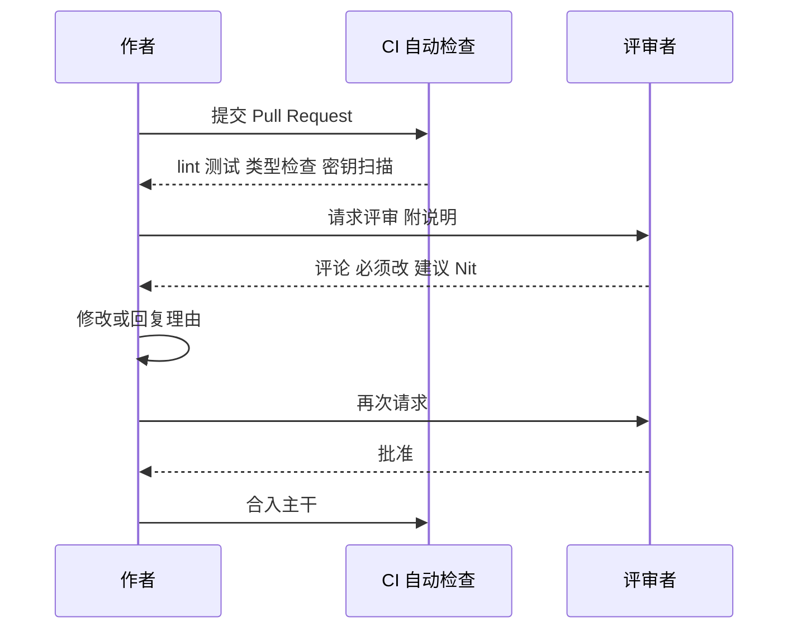

# 代码评审（Code Review）

> **免责声明**：本文是“河洛序”知识图谱 K1 批次的**初稿**，由 AI 辅助整理，仅供学习参考，不构成任何承诺或保证。版本信息截至 2026-10-13；文中示例已在 Python 3.15.0（语言类）或 Python 3.13.5 + 所列库版本（库类）下**实际运行**，输出为真实结果，但换机器、换版本时数字（尤其是耗时）会不同。
>
> 标注说明：**【有据可查】** 附官方文档 / 原始出处链接；**【社区共识】** 为业界普遍做法，没有唯一权威出处；**【待考察/推测】** 为未能核实或作者推断，请勿当作定论。

## 一句话定义

代码评审是**代码合入主干之前，由作者以外的人（或工具）检查改动**的过程，目的是发现问题、保持代码健康、传播知识。

## 为什么重要

- **第二双眼睛**：作者对自己的代码有“盲区”，评审能发现逻辑错误、边界遗漏、安全隐患。
- **知识传播**：评审者了解了新代码，作者学到了新技巧，团队不再依赖“只有某个人懂”的模块。
- **AI 时代的关键防线**：AI 生成代码的速度远超人工，评审成为保证质量和安全的主要环节。

## 原理 / 图解

【有据可查】Google 公开的工程实践中，评审的最高原则是：**只要改动确实提升了代码整体健康度，即使不完美，评审者也应倾向于批准**；纯属润色的建议加“Nit:”前缀表示可不改。来源：<https://google.github.io/eng-practices/review/reviewer/standard.html>



评审看什么（参考 Google 的 *What to look for in a code review*：<https://google.github.io/eng-practices/review/reviewer/looking-for.html>）：

| 优先级 | 关注点 |
|---|---|
| 最高 | 设计是否合理、功能是否正确、是否有安全问题 |
| 高 | 复杂度、测试是否充分、错误处理 |
| 中 | 命名、注释、文档 |
| 交给工具 | 格式、导入顺序、简单的风格问题 |

## 可运行示例

一个迷你“预审机器人”：在人看之前，先用正则和 `ast` 拦下机械性问题（Python 3.15.0 实际运行；示例中的 key 是伪造的）：

```python
# 文件：examples/12_code_review.py
# 一个迷你"自动审查机器人"：在人工 Code Review 之前先拦下机械性问题
import ast, re, textwrap

DIFF_NEW_CODE = textwrap.dedent('''
import os
API_KEY = "sk-1234567890abcdef"
def load(path):
    try:
        return open(path).read()
    except:
        pass
def run(cmd):
    os.system(cmd)  # TODO: 以后再改
''')

findings = []
if re.search(r"sk-[A-Za-z0-9]{16,}", DIFF_NEW_CODE):
    findings.append(("阻断", "疑似硬编码 API Key"))
tree = ast.parse(DIFF_NEW_CODE)
for node in ast.walk(tree):
    if isinstance(node, ast.ExceptHandler) and node.type is None:
        findings.append(("必须修改", f"第 {node.lineno} 行: 裸 except 会吞掉所有异常"))
    if isinstance(node, ast.Call) and getattr(node.func, "attr", "") == "system":
        findings.append(("必须修改", f"第 {node.lineno} 行: os.system 存在命令注入风险，改用 subprocess.run([...])"))
    if isinstance(node, ast.Call) and getattr(node.func, "id", "") == "open":
        findings.append(("建议", f"第 {node.lineno} 行: open() 未用 with，且未指定 encoding"))
for i, line in enumerate(DIFF_NEW_CODE.splitlines(), 1):
    if "TODO" in line:
        findings.append(("讨论", f"第 {i} 行: TODO 需要关联 issue 或在本次解决"))

for level, msg in findings:
    print(f"[{level}] {msg}")
print(f"共 {len(findings)} 条；机械问题交给机器，人专注于设计与业务逻辑")
```

输出：

```text
[阻断] 疑似硬编码 API Key
[必须修改] 第 7 行: 裸 except 会吞掉所有异常
[必须修改] 第 10 行: os.system 存在命令注入风险，改用 subprocess.run([...])
[建议] 第 6 行: open() 未用 with，且未指定 encoding
[讨论] 第 10 行: TODO 需要关联 issue 或在本次解决
共 5 条；机械问题交给机器，人专注于设计与业务逻辑
```

真实项目中对应的工具：Ruff（裸 except `E722`、`S605` 命令注入）、Bandit（安全）、gitleaks / GitHub secret scanning（密钥），一般配置在 pre-commit 或 CI 中。【有据可查】GitHub secret scanning 说明：<https://docs.github.com/en/code-security/secret-scanning/introduction/about-secret-scanning>

## 常见误区

- **评审变成“找茬比赛”**：评论应针对代码而非人，并说明理由。【社区共识】
- **一次提交几千行**：大 PR 没人能认真审。【有据可查】Google 指南建议提交小而独立的改动：<https://google.github.io/eng-practices/review/developer/small-cls.html>
- **只看 diff，不看上下文**：很多 bug 出在改动与未改动代码的交互处。
- **人工检查格式**：浪费评审精力，应交给格式化工具。
- **“AI 审过了”就不再人审**：AI 评审能发现大量表面问题，但对业务意图、架构取舍的判断仍不可靠。

## 与 AI 开发的关系

- **AI 辅助评审**已成为常见做法（各大代码托管平台和编程工具都提供 AI 评审功能），适合作为人工评审前的第一道筛子。【社区共识】
- **审查 AI 生成代码的重点清单**【社区共识】：
  1. 是否调用了**不存在的 API / 包**（幻觉依赖，还可能被“抢注同名恶意包”利用）；
  2. 是否硬编码了密钥、关闭了 TLS 校验；
  3. 异常是否被宽泛吞掉；
  4. 是否“顺手”改了与任务无关的代码；
  5. 测试是否真的断言了行为，而不是只为了“跑绿”。
- **Prompt / 配置也要评审**：系统提示词、Agent 工具权限的改动，影响可能比代码更大。

## 延伸阅读

- Google Engineering Practices：<https://google.github.io/eng-practices/>
- Ruff 规则：<https://docs.astral.sh/ruff/rules/>
- pre-commit 框架：<https://pre-commit.com/>
- Conventional Comments（评论分级约定）：<https://conventionalcomments.org/>

## 无法核实 / 待考察点

- 【待考察/推测】“AI 评审能发现多少比例的真实缺陷”各厂商数据口径不一，缺少独立第三方评估。
- 【待考察/推测】“幻觉包名被抢注”（slopsquatting）已有安全研究报道，但实际攻击规模的可靠统计未核实。
