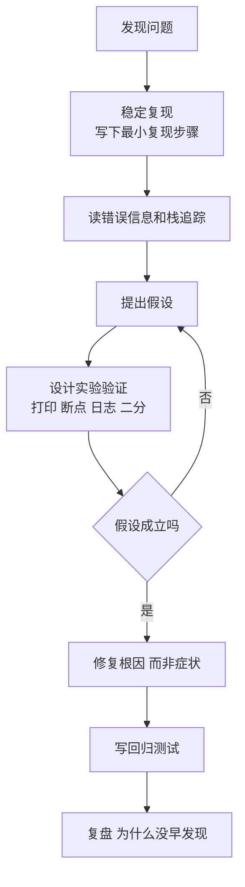

# 调试（Debugging）

> **免责声明**：本文是“河洛序”知识图谱 K1 批次的**初稿**，由 AI 辅助整理，仅供学习参考，不构成任何承诺或保证。版本信息截至 2026-10-13；文中示例已在 Python 3.15.0（语言类）或 Python 3.13.5 + 所列库版本（库类）下**实际运行**，输出为真实结果，但换机器、换版本时数字（尤其是耗时）会不同。
>
> 标注说明：**【有据可查】** 附官方文档 / 原始出处链接；**【社区共识】** 为业界普遍做法，没有唯一权威出处；**【待考察/推测】** 为未能核实或作者推断，请勿当作定论。

## 一句话定义

调试是**找出程序“实际行为”与“预期行为”不一致的原因并修复它**的过程，本质上是一次小型科学实验：观察 → 假设 → 验证。

## 为什么重要

- **程序员相当一部分时间花在调试上**。调试能力的差距，往往比写代码速度的差距更大。
- **调试方法可以学习**：高手不是靠直觉，而是靠系统的方法（复现、缩小范围、二分、对比）。
- **AI 代码让调试更常见**：AI 生成的代码“看起来对”，问题常藏在边界条件和数据类型里。

## 原理 / 图解



常用技巧：

| 技巧 | 说明 |
|---|---|
| 最小复现 | 删掉一切无关代码和数据，直到问题仍然出现的最小版本 |
| 二分法 | 在数据、代码版本（`git bisect`）、配置上对半缩小范围 |
| 打印探针 | `print(repr(x), type(x))`——朴素但有效；Python 3.8+ 可用 `f"{x=}"` |
| 断点调试 | 停在现场查看所有变量（见 [[k1.prog.breakpoint]]） |
| 读栈追踪 | 从最后一行异常类型读起，再找自己代码的那一帧（见 [[k1.prog.stack-trace]]） |
| 小黄鸭调试 | 把代码逐行讲给别人（或一只橡皮鸭）听，常常讲着讲着就发现问题 |
| 对比法 | 能跑的版本 vs 不能跑的版本，差异在哪 |

【有据可查】`git bisect` 用二分查找定位引入 bug 的提交：<https://git-scm.com/docs/git-bisect>

## 可运行示例

一个“平均分算错”的完整调试过程：复现 → 打印类型验证假设 → 二分定位坏数据 → 修复 → 回归测试（Python 3.15.0 实际运行）：

```python
# 文件：examples/13_debugging.py
# 调试的科学方法：复现 → 假设 → 验证 → 修复 → 回归测试
def average_scores(records):
    total = 0
    for r in records:
        total += r["score"]
    return total / len(records)

data = [{"name": "a", "score": 90}, {"name": "b", "score": "85"}, {"name": "c", "score": 70}]

# 1) 复现
try:
    average_scores(data)
except TypeError as e:
    print("复现成功:", e)

# 2) 假设：某条记录的 score 不是数字。3) 验证：打印类型（最朴素也最有效的探针）
for r in data:
    print(f"  {r['name']}: {r['score']!r} -> {type(r['score']).__name__}")

# 二分法定位：在大数据里找第一条坏记录
def first_bad(rows):
    lo, hi = 0, len(rows)
    while lo < hi:
        mid = (lo + hi) // 2
        if all(isinstance(r["score"], (int, float)) for r in rows[: mid + 1]):
            lo = mid + 1
        else:
            hi = mid
    return lo
print("二分定位到第一条坏记录下标:", first_bad(data))

# 4) 修复：在边界处做类型规整  5) 回归测试
def average_scores_fixed(records):
    if not records:
        return 0.0
    return sum(float(r["score"]) for r in records) / len(records)
assert average_scores_fixed(data) == (90 + 85 + 70) / 3
assert average_scores_fixed([]) == 0.0
print("修复并通过回归测试:", round(average_scores_fixed(data), 2))
```

输出：

```text
复现成功: unsupported operand type(s) for +=: 'int' and 'str'
  a: 90 -> int
  b: '85' -> str
  c: 70 -> int
二分定位到第一条坏记录下标: 1
修复并通过回归测试: 81.67
```

根因不是“求平均的算法错了”，而是**上游数据把分数存成了字符串 `'85'`**。修复放在数据进入函数的边界处（统一转 `float`），并顺手处理了空列表除零这一隐藏 bug。

## 常见误区

- **不复现就改**：看到报错就凭感觉改，改完“好像好了”，其实只是没触发。
- **修症状不修根因**：用 `try/except: pass` 把异常吞掉，问题会在更远的地方以更怪的方式出现。
- **一次改多处**：同时改三个地方，好了也不知道是哪处起作用。
- **不写回归测试**：同一个 bug 三个月后又回来。
- **把整段报错丢给 AI 却不给上下文**：AI 只能猜。应同时提供最小复现、预期与实际结果、环境版本。

## 与 AI 开发的关系

- **AI 项目的特殊 bug**：张量形状不匹配、dtype 不一致、设备不一致（CPU/GPU）、数据泄漏、随机性导致结果不可复现。调试时先固定随机种子、打印 `shape/dtype/device`。【社区共识】
- **LLM 应用的“bug”常常不是代码问题**：而是提示词、检索结果或模型版本变化。要用日志记录完整的输入输出（见 [[k1.prog.logging]]），才能复现。
- **让 AI 帮你调试的正确姿势**：给出最小复现 + 完整栈追踪 + 你已经验证过的假设，请它列出“可能原因及验证方法”，而不是直接要补丁。【社区共识】
- **Python 3.15 新增采样分析器 Tachyon**（`profiling.sampling`），可附加到运行中的进程排查性能问题。【有据可查】<https://docs.python.org/3.15/whatsnew/3.15.html>

## 延伸阅读

- Andreas Zeller,《The Debugging Book》（在线免费，Python 实现）：<https://www.debuggingbook.org/>
- Python `pdb` 文档：<https://docs.python.org/3/library/pdb.html>
- `git bisect`：<https://git-scm.com/docs/git-bisect>
- David J. Agans,《调试九法》（*Debugging: The 9 Indispensable Rules*, 2002）

## 无法核实 / 待考察点

- 【待考察/推测】“程序员 X% 的时间用于调试”的各类统计（常见 35%～50%）来源与方法差异大，本文不引用具体数字。
