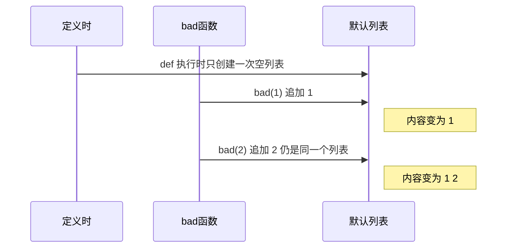

# 可变与不可变（Mutable vs Immutable）

> **免责声明**：本文是“河洛序”知识图谱 K1 批次的**初稿**，由 AI 辅助整理，仅供学习参考，不构成任何承诺或保证。版本信息截至 2026-10-13；文中示例已在 Python 3.15.0（语言类）或 Python 3.13.5 + 所列库版本（库类）下**实际运行**，输出为真实结果，但换机器、换版本时数字（尤其是耗时）会不同。
>
> 标注说明：**【有据可查】** 附官方文档 / 原始出处链接；**【社区共识】** 为业界普遍做法，没有唯一权威出处；**【待考察/推测】** 为未能核实或作者推断，请勿当作定论。

## 一句话定义

**可变对象创建后可以原地修改内容（list、dict、set），不可变对象一旦创建就不能改（int、str、tuple、frozenset、frozendict）**——想“改”不可变对象，只能创建一个新的。

## 为什么重要

- **决定对象能不能做字典的键、集合的元素**：只有可哈希（通常意味着不可变）的对象才行。
- **决定共享是否安全**：不可变对象可以放心在函数、线程之间共享；可变对象共享就要小心。
- **Python 最著名的坑之一——可变默认参数**——就源于此。

## 原理 / 图解

| 类型 | 可变？ | 可哈希？ | 备注 |
|---|---|---|---|
| `int` `float` `bool` `str` `bytes` | 否 | 是 | “修改”其实是创建新对象 |
| `tuple` | 否 | 仅当所有元素可哈希 | 元组里装列表 → 不可哈希 |
| `frozenset` | 否 | 是 | 不可变集合 |
| `frozendict`（3.15 新增） | 否 | 仅当键值都可哈希 | PEP 814 |
| `list` `dict` `set` `bytearray` | 是 | 否 | |
| 自定义类实例 | 默认是 | 默认按身份哈希 | `@dataclass(frozen=True)` 可变成不可变 |

【有据可查】Python 3.15（2026-10-09 发布）新增内建 `frozendict`：不是 `dict` 的子类、保持插入顺序但比较时不考虑顺序、键值都可哈希时可哈希：<https://docs.python.org/3.15/whatsnew/3.15.html#pep-814-add-frozendict-built-in-type>

**可变默认参数陷阱**的原理：



【有据可查】Python 官方教程专门警告：“默认值只计算一次。当默认值是列表、字典等可变对象时，这会造成差异”：<https://docs.python.org/3/tutorial/controlflow.html#default-argument-values>

## 可运行示例

```python
# 文件：examples/19_mutability.py
# 可变 vs 不可变；以及最经典的坑：可变默认参数
import sys
print("Python", sys.version.split()[0])

s = "abc"
try:
    s[0] = "z"
except TypeError as e:
    print("str 不可变:", e)

t = (1, [2, 3])           # 元组不可变，但里面的列表可变
t[1].append(4)
print("元组里的列表被改了:", t)
try:
    hash(t)
except TypeError as e:
    print("因此这个元组不可哈希:", e)

# 经典坑：默认参数只在函数定义时求值一次
def bad(item, bucket=[]):
    bucket.append(item); return bucket
def good(item, bucket=None):
    bucket = [] if bucket is None else bucket
    bucket.append(item); return bucket
print("bad :", bad(1), bad(2))
print("good:", good(1), good(2))

# 不可变带来的好处：可作为字典键、可安全共享
cache = {(3, 4): 5.0}
print("元组做键:", cache[(3, 4)])

# Python 3.15 新增内置 frozendict（PEP 814）：不可变、可哈希的字典
if sys.version_info >= (3, 15):
    fd = frozendict(model="deepseek", temperature=0.2)
    print("frozendict:", fd, "| 可哈希:", hash(fd) == hash(frozendict(temperature=0.2, model="deepseek")))
    try:
        fd["model"] = "x"
    except TypeError as e:
        print("frozendict 不可修改:", e)
```

输出（Python 3.15.0）：

```text
Python 3.15.0
str 不可变: 'str' object does not support item assignment
元组里的列表被改了: (1, [2, 3, 4])
因此这个元组不可哈希: unhashable type: 'list'
bad : [1, 2] [1, 2]
good: [1] [2]
元组做键: 5.0
frozendict: frozendict({'model': 'deepseek', 'temperature': 0.2}) | 可哈希: True
frozendict 不可修改: 'frozendict' object does not support item assignment
```

注意 `bad : [1, 2] [1, 2]`：两次调用返回的是**同一个列表对象**，所以打印时两个都显示 `[1, 2]`。

## 常见误区

- **“元组不可变，所以元组里的东西都不能变”**：元组只保证“装的是哪几个对象”不变，对象本身如果可变仍可修改。
- **`s += "x"` 修改了字符串**：实际上创建了新字符串并重新绑定名字。循环里大量拼接字符串应使用 `"".join(...)`。
- **用 `None` 以外的可变对象作默认参数**：统一使用 `None` 再在函数体内创建。Ruff 规则 `B006` 能检测这一问题：<https://docs.astral.sh/ruff/rules/mutable-argument-default/>
- **以为 `frozen=True` 的 dataclass 完全不可变**：它的字段如果是列表，列表本身仍可变（与元组同理）。

## 与 AI 开发的关系

- **缓存需要不可变的键**：`functools.cache` 要求参数可哈希。把配置做成 `frozendict` 或元组，才能用作缓存键（例如缓存某组生成参数下的模型输出）。
- **Pandas 3.0 的 Copy-on-Write**：从“到处都可能原地修改”转向“看起来不可变、按需复制”的语义，减少了意外修改原数据（见 [[k1.lib.pandas]]）。
- **多线程 / free-threaded Python**：去掉 GIL 后，共享可变对象的并发修改风险更直接暴露，不可变数据在并发中更安全（见 [[k1.py.threading]]）。
- **Agent 状态管理**：LangGraph 等框架通常以“每步返回新状态 / 状态更新”的方式管理状态，背后就是减少共享可变状态的思想。【待考察/推测】具体框架实现细节各异，未逐一核实。

## 延伸阅读

- Python 数据模型（可变性与可哈希）：<https://docs.python.org/3/reference/datamodel.html>
- 术语表 hashable：<https://docs.python.org/3/glossary.html#term-hashable>
- PEP 814 – frozendict：<https://peps.python.org/pep-0814/>

## 无法核实 / 待考察点

- 【待考察/推测】`frozendict` 在主流第三方库（Pydantic、JSON 序列化库等）中的支持进度尚未核实；标准库 `json`、`copy`、`pickle` 等已支持（据 3.15 What's New）。
