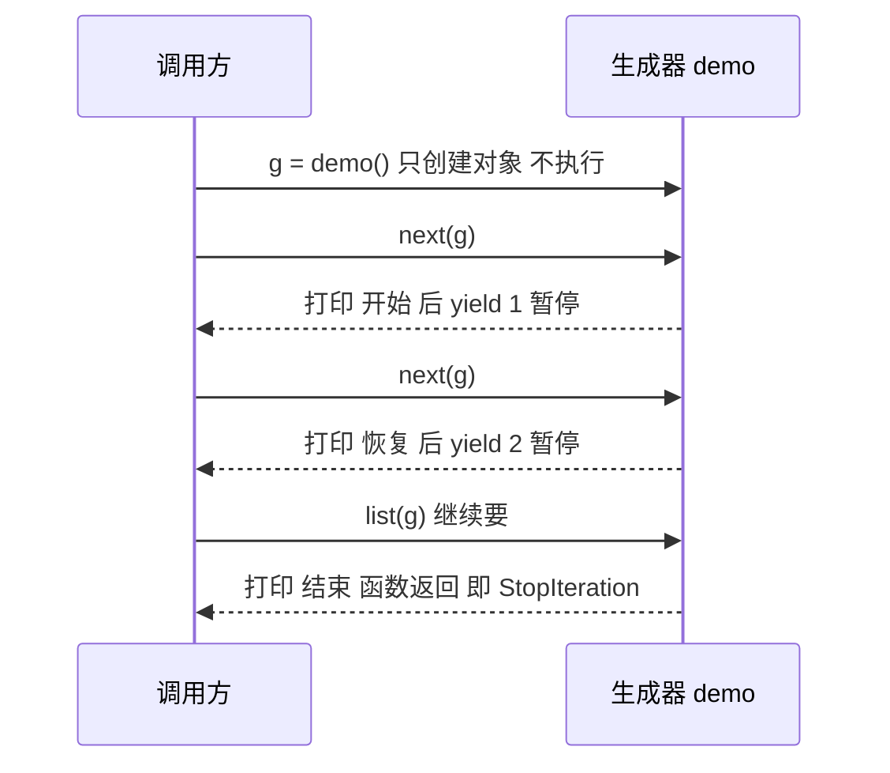
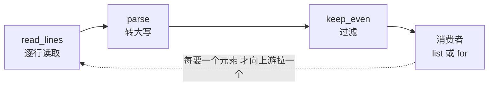

# 生成器（Generator）

> **免责声明**：本文是“河洛序”知识图谱 K1 批次的**初稿**，由 AI 辅助整理，仅供学习参考，不构成任何承诺或保证。版本信息截至 2026-10-13；文中示例已在 Python 3.15.0（语言类）或 Python 3.13.5 + 所列库版本（库类）下**实际运行**，输出为真实结果，但换机器、换版本时数字（尤其是耗时）会不同。
>
> 标注说明：**【有据可查】** 附官方文档 / 原始出处链接；**【社区共识】** 为业界普遍做法，没有唯一权威出处；**【待考察/推测】** 为未能核实或作者推断，请勿当作定论。

## 一句话定义

生成器是**用 `yield` 写成的“会暂停的函数”**：每次被要下一个值时，它运行到下一个 `yield` 交出一个值并原地暂停，下次从暂停处接着跑——是写迭代器最简单的方式。

## 为什么重要

- **省内存**：一次只产生一个元素，处理 100GB 日志和处理 100 行用的内存差不多。
- **代码简洁**：几行生成器替代几十行带 `__iter__`/`__next__` 的迭代器类。
- **流式处理的基础**：数据管道、LLM 流式输出、大文件逐行处理、`contextlib.contextmanager`、早期的协程，都建立在生成器之上。

## 原理 / 图解

【有据可查】生成器由 PEP 255 引入（Python 2.2），`send()` 等增强见 PEP 342，`yield from` 见 PEP 380：<https://peps.python.org/pep-0255/> 、<https://peps.python.org/pep-0342/> 、<https://peps.python.org/pep-0380/>

调用生成器函数**不会执行函数体**，只返回一个生成器对象；每次 `next()` 才推进：



生成器管道（像 Unix 的 `cat | grep | sort`）：



## 可运行示例

```python
# 文件：examples/21_generator.py
# 生成器：用 yield 写的"惰性迭代器"，按需产出，内存友好
import sys

def read_lines(n):
    for i in range(n):
        yield f"line {i}"            # 每次 next() 运行到这里暂停

lst = [f"line {i}" for i in range(100_000)]
gen = (f"line {i}" for i in range(100_000))
print("列表占用字节:", sys.getsizeof(lst), "| 生成器对象占用字节:", sys.getsizeof(gen))

# 生成器管道：像 Unix 管道一样逐条处理（AI 场景：流式处理大语料）
def parse(lines):
    for line in lines:
        yield line.upper()
def keep_even(lines):
    for line in lines:
        if int(line.split()[-1]) % 2 == 0:
            yield line
pipeline = keep_even(parse(read_lines(7)))
print("管道结果:", list(pipeline))

# 观察暂停/恢复
def demo():
    print("  → 开始"); yield 1
    print("  → 恢复"); yield 2
    print("  → 结束")
g = demo()
print("next:", next(g)); print("next:", next(g))
print("剩余:", list(g))

# yield from 委托；send 双向通信
def inner(): yield "a"; yield "b"
def outer(): yield from inner(); yield "c"
print("yield from:", list(outer()))

def running_avg():
    total, count, avg = 0, 0, None
    while True:
        x = yield avg
        total, count = total + x, count + 1
        avg = total / count
ra = running_avg(); next(ra)
print("send 求滑动平均:", [ra.send(v) for v in [10, 20, 60]])
```

输出（Python 3.15.0）：

```text
列表占用字节: 800984 | 生成器对象占用字节: 216
管道结果: ['LINE 0', 'LINE 2', 'LINE 4', 'LINE 6']
  → 开始
next: 1
  → 恢复
next: 2
  → 结束
剩余: []
yield from: ['a', 'b', 'c']
send 求滑动平均: [10.0, 15.0, 30.0]
```

- 10 万个元素的列表约 800KB，而生成器对象只有约 200 字节——**无论要生成多少个元素都一样大**。
- “开始 / 恢复 / 结束”交替出现，直观展示了“暂停—恢复”。
- `send` 让调用方可以往生成器里“传值”，实现了一个保留状态的滑动平均器。

## 常见误区

- **生成器只能消费一次**：和迭代器一样，用完就空（见 [[k1.py.iterator]]）。
- **对生成器用 `len()` 或下标**：不支持。需要就先 `list()`，但这样也失去了省内存的优势。
- **以为调用生成器函数就执行了代码**：函数体在第一次 `next()` 时才开始执行，因此其中的错误也会“延迟”出现。
- **在生成器里打开资源却不关闭**：如果消费者中途停止，生成器可能一直不被清理。配合 `with` 使用，或在生成器中使用 `try/finally`。
- **用列表推导式处理超大数据**：`[f(x) for x in huge]` 会一次性占满内存，改用生成器表达式 `(f(x) for x in huge)` 或直接 `sum(f(x) for x in huge)`。

## 与 AI 开发的关系

- **LLM 流式输出**：Web 框架（FastAPI 的 `StreamingResponse`、Streamlit 的 `st.write_stream`）都接受生成器，把模型逐 token 产生的文本逐块推给前端。【有据可查】Streamlit `st.write_stream`：<https://docs.streamlit.io/develop/api-reference/write-magic/st.write_stream>
- **大语料预处理**：逐行读取 JSONL、清洗、分词、写出，全程不把语料完整装入内存。
- **自定义 PyTorch `IterableDataset`**：`__iter__` 通常写成生成器。【有据可查】<https://docs.pytorch.org/docs/stable/data.html#iterable-style-datasets>
- **Agent 的事件流**：很多 Agent 框架用（异步）生成器逐步产出“思考—工具调用—结果”事件，供前端实时展示。【社区共识】

## 延伸阅读

- 术语表 generator：<https://docs.python.org/3/glossary.html#term-generator>
- 函数式 HOWTO·生成器一节：<https://docs.python.org/3/howto/functional.html#generators>
- PEP 289 – 生成器表达式：<https://peps.python.org/pep-0289/>

## 无法核实 / 待考察点

- 【待考察/推测】`sys.getsizeof` 对生成器对象的返回值（本机 216 字节）依赖 CPython 版本与平台，只适合作量级对比。
