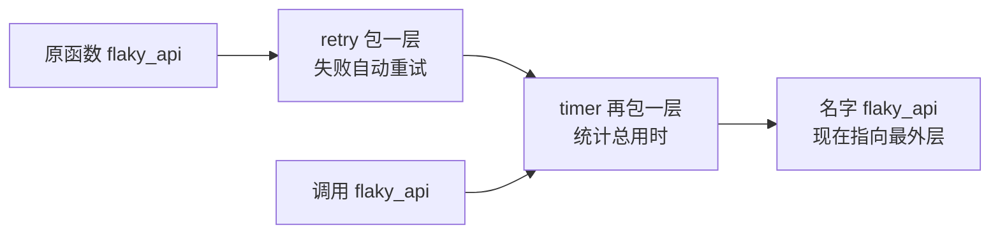

# 装饰器（Decorator）

> **免责声明**：本文是“河洛序”知识图谱 K1 批次的**初稿**，由 AI 辅助整理，仅供学习参考，不构成任何承诺或保证。版本信息截至 2026-10-13；文中示例已在 Python 3.15.0（语言类）或 Python 3.13.5 + 所列库版本（库类）下**实际运行**，输出为真实结果，但换机器、换版本时数字（尤其是耗时）会不同。
>
> 标注说明：**【有据可查】** 附官方文档 / 原始出处链接；**【社区共识】** 为业界普遍做法，没有唯一权威出处；**【待考察/推测】** 为未能核实或作者推断，请勿当作定论。

## 一句话定义

装饰器是**一个“接收函数、返回增强版函数”的函数**，用 `@名字` 写在函数定义上方，就能在不改原函数代码的情况下给它加上计时、重试、缓存、权限检查等功能。

## 为什么重要

- **消除横切关注点的重复**：计时、日志、重试、鉴权这类逻辑到处都需要，用装饰器写一次、到处 `@` 一下。
- **框架的通用语言**：Flask/FastAPI 的 `@app.get`、pytest 的 `@pytest.fixture`、Streamlit 的 `@st.cache_data`、`@dataclass`、`@property` 全都是装饰器。
- **读懂框架代码的门槛**：不理解装饰器，就不明白为什么加一行 `@` 函数行为就变了。

## 原理 / 图解

【有据可查】函数装饰器由 PEP 318 引入（Python 2.4）。`@deco` 写在 `def f` 上面，完全等价于 `f = deco(f)`：<https://peps.python.org/pep-0318/> ；术语表：<https://docs.python.org/3/glossary.html#term-decorator>



多个装饰器**从下往上**应用（离函数最近的先包），调用时**从外往内**执行。

| 写法 | 本质 | 层数 |
|---|---|---|
| `@timer` | `f = timer(f)` | 两层函数（装饰器 + wrapper） |
| `@retry(times=3)` | `f = retry(times=3)(f)` | 三层函数（工厂 + 装饰器 + wrapper） |
| `@functools.wraps(fn)` | 把原函数的 `__name__`、`__doc__` 等复制到 wrapper | 必备 |

【有据可查】`functools.wraps` 与 `functools.cache`：<https://docs.python.org/3/library/functools.html>

## 可运行示例

```python
# 文件：examples/22_decorator.py
# 装饰器 = 接收函数、返回新函数的函数；@ 只是语法糖
import functools, time

def timer(fn):
    @functools.wraps(fn)                     # 保留原函数名与文档
    def wrapper(*args, **kwargs):
        t0 = time.perf_counter()
        result = fn(*args, **kwargs)
        print(f"[timer] {fn.__name__} 用时 {(time.perf_counter() - t0) * 1000:.1f} ms")
        return result
    return wrapper

def retry(times=3, exceptions=(Exception,)):  # 带参数的装饰器 = 三层函数
    def deco(fn):
        @functools.wraps(fn)
        def wrapper(*args, **kwargs):
            for attempt in range(1, times + 1):
                try:
                    return fn(*args, **kwargs)
                except exceptions as e:
                    print(f"[retry] 第 {attempt} 次失败: {e}")
                    if attempt == times:
                        raise
        return wrapper
    return deco

calls = {"n": 0}
@timer
@retry(times=3, exceptions=(ConnectionError,))
def flaky_api():
    """模拟前两次失败的 API 调用"""
    calls["n"] += 1
    time.sleep(0.01)
    if calls["n"] < 3:
        raise ConnectionError("网络抖动")
    return "成功"

print(flaky_api(), "| 函数名仍是:", flaky_api.__name__, "| 文档:", flaky_api.__doc__)

# 标准库自带的装饰器
@functools.cache
def fib(n): return n if n < 2 else fib(n - 1) + fib(n - 2)
print("fib(80) =", fib(80), "| 缓存信息:", fib.cache_info())

# 等价写法：@timer 就是 f = timer(f)
def hello(): return "hi"
hello = timer(hello); hello()
```

输出（Python 3.15.0）：

```text
[retry] 第 1 次失败: 网络抖动
[retry] 第 2 次失败: 网络抖动
[timer] flaky_api 用时 30.4 ms
成功 | 函数名仍是: flaky_api | 文档: 模拟前两次失败的 API 调用
fib(80) = 23416728348467685 | 缓存信息: CacheInfo(hits=78, misses=81, maxsize=None, currsize=81)
[timer] hello 用时 0.0 ms
```

- 前两次失败被 `retry` 自动重试，`timer` 统计的是**包括重试在内的总时间**（因为 timer 在最外层）。
- 有 `functools.wraps`，`flaky_api.__name__` 仍是原名，文档字符串也保留了。
- `fib(80)` 如果不加缓存，递归调用次数是天文数字；加了 `@functools.cache` 后只计算了 81 次。

## 常见误区

- **忘了 `functools.wraps`**：调试时栈追踪和 `help()` 里全是 `wrapper`，一些依赖函数签名的框架也会出错。
- **装饰器顺序写反**：`@timer @retry` 与 `@retry @timer` 含义不同——前者统计总时间，后者统计每一次尝试。
- **对方法用 `@functools.cache`**：缓存会持有 `self` 引用，可能导致对象无法被回收；Ruff 规则 `B019` 会提示这一风险。【有据可查】<https://docs.astral.sh/ruff/rules/cached-instance-method/>
- **把 Python 装饰器与 GoF“装饰器模式”混为一谈**：二者思想相近（包装增强），但 Python 装饰器是作用于函数/类定义的语法机制。【有据可查】PEP 318 也专门说明了名字的来历与区别。
- **装饰器内部吞掉异常**：如重试装饰器在最后一次失败后不 `raise`，调用方就以为成功了。

## 与 AI 开发的关系

- **LLM API 重试**：对超时和限流做指数退避重试，通常用 `tenacity` 库的 `@retry` 装饰器。【有据可查】<https://tenacity.readthedocs.io/>
- **工具注册**：许多 Agent 框架用装饰器把普通函数注册成模型可调用的工具，并从函数签名和 docstring 自动生成工具描述（例如 MCP Python SDK 的 `@mcp.tool()`）。【有据可查】<https://github.com/modelcontextprotocol/python-sdk>
- **PyTorch 中的装饰器**：`@torch.no_grad()` 关闭梯度计算、`@torch.compile` 编译加速。【有据可查】<https://docs.pytorch.org/docs/stable/generated/torch.no_grad.html>
- **Streamlit 缓存**：`@st.cache_data` / `@st.cache_resource` 避免每次交互都重新加载数据或模型（见 [[k1.lib.streamlit]]）。

## 延伸阅读

- PEP 318 – 函数与方法装饰器：<https://peps.python.org/pep-0318/>
- PEP 3129 – 类装饰器：<https://peps.python.org/pep-3129/>
- `functools` 文档：<https://docs.python.org/3/library/functools.html>

## 无法核实 / 待考察点

- 【待考察/推测】各 Agent 框架“从 docstring 自动生成工具描述”的具体规则（参数说明格式等）各不相同，本文未逐一核实。
