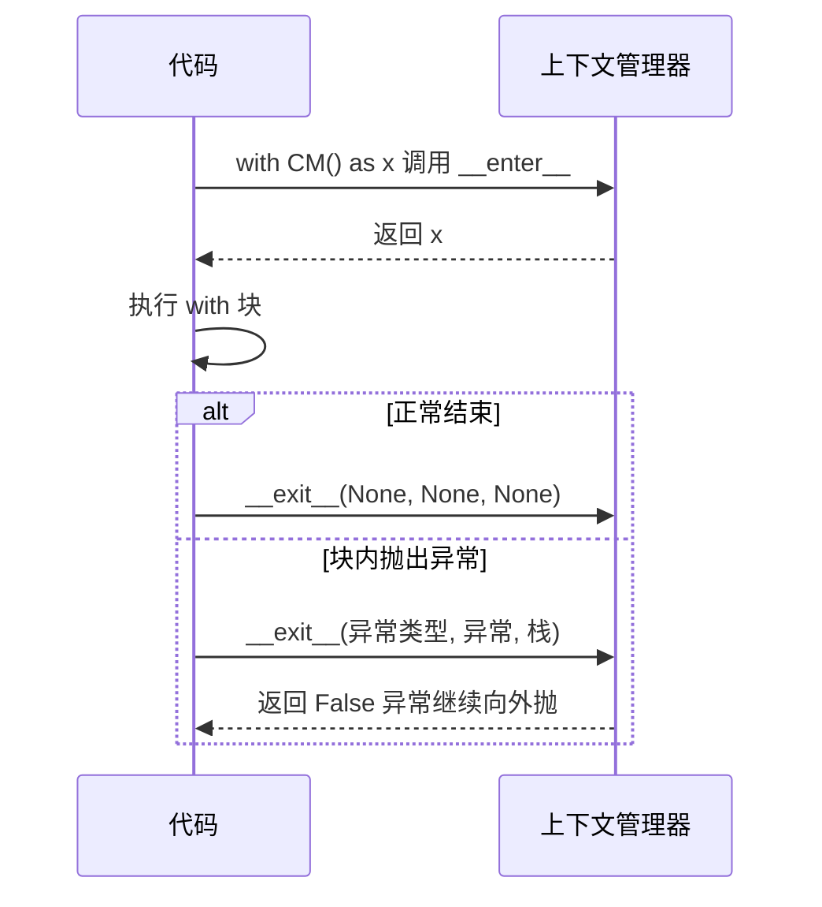

# 上下文管理器（Context Manager）与 with 语句

> **免责声明**：本文是“河洛序”知识图谱 K1 批次的**初稿**，由 AI 辅助整理，仅供学习参考，不构成任何承诺或保证。版本信息截至 2026-10-13；文中示例已在 Python 3.15.0（语言类）或 Python 3.13.5 + 所列库版本（库类）下**实际运行**，输出为真实结果，但换机器、换版本时数字（尤其是耗时）会不同。
>
> 标注说明：**【有据可查】** 附官方文档 / 原始出处链接；**【社区共识】** 为业界普遍做法，没有唯一权威出处；**【待考察/推测】** 为未能核实或作者推断，请勿当作定论。

## 一句话定义

上下文管理器是**保证“开始动作”和“收尾动作”一定成对执行的对象**，配合 `with` 语句使用：进入时打开/获取，离开时关闭/释放——哪怕中间抛了异常。

## 为什么重要

- **资源泄漏的克星**：文件句柄、数据库连接、网络连接、锁、GPU 显存……忘了释放就会越积越多。
- **比 `try/finally` 更简洁、更不容易写错**。
- **表达“临时状态”**：临时切换目录、临时设置环境变量、临时关闭梯度计算，离开 `with` 自动恢复。

## 原理 / 图解

【有据可查】`with` 语句由 PEP 343 引入；协议是 `__enter__()` 与 `__exit__(exc_type, exc, tb)`，`__exit__` 返回真值会**吞掉**异常：<https://peps.python.org/pep-0343/> 、<https://docs.python.org/3/reference/datamodel.html#context-managers>



写上下文管理器的两种方式：

| 方式 | 适合 |
|---|---|
| 类：实现 `__enter__` / `__exit__` | 需要保存较多状态、需要被复用或继承 |
| `@contextlib.contextmanager` + 生成器 | 简短的“前置—yield—后置”逻辑 |

`contextlib` 中还有：`ExitStack`（动态管理数量不定的资源）、`suppress`（忽略指定异常）、`nullcontext`、`chdir`（3.11+）、异步版本 `asynccontextmanager`。【有据可查】<https://docs.python.org/3/library/contextlib.html>

## 可运行示例

```python
# 文件：examples/23_context_manager.py
# 上下文管理器：保证"进入"与"退出"成对执行，哪怕中间抛异常
import contextlib, time, os, tempfile

class Timer:
    def __enter__(self):
        self.t0 = time.perf_counter(); return self
    def __exit__(self, exc_type, exc, tb):
        self.elapsed = time.perf_counter() - self.t0
        print(f"[Timer] 用时 {self.elapsed * 1000:.1f} ms, 异常: {exc_type.__name__ if exc_type else None}")
        return False              # False = 不吞掉异常

with Timer():
    sum(range(1_000_00))

try:
    with Timer():
        raise ValueError("中途出错")
except ValueError:
    print("异常照常抛出，但 __exit__ 已执行")

# contextlib.contextmanager：用生成器写上下文管理器
@contextlib.contextmanager
def temp_env(key, value):
    old = os.environ.get(key)
    os.environ[key] = value
    try:
        yield
    finally:                      # 无论如何都恢复
        if old is None: os.environ.pop(key)
        else: os.environ[key] = old

with temp_env("MODEL", "test-model"):
    print("块内 MODEL =", os.environ["MODEL"])
print("块外 MODEL =", os.environ.get("MODEL"))

# 文件：with 自动关闭
path = os.path.join(tempfile.gettempdir(), "cm_demo.txt")
with open(path, "w", encoding="utf-8") as f:
    f.write("hello")
print("文件已关闭:", f.closed)

# ExitStack：动态管理多个资源；suppress：有意忽略某类异常
with contextlib.ExitStack() as stack:
    files = [stack.enter_context(open(path, encoding="utf-8")) for _ in range(3)]
    print("同时打开", len(files), "个文件")
print("全部已关闭:", all(f.closed for f in files))
with contextlib.suppress(FileNotFoundError):
    os.remove("/不存在的文件")
print("suppress 忽略了 FileNotFoundError")
```

输出（Python 3.15.0）：

```text
[Timer] 用时 0.6 ms, 异常: None
[Timer] 用时 0.0 ms, 异常: ValueError
异常照常抛出，但 __exit__ 已执行
块内 MODEL = test-model
块外 MODEL = None
文件已关闭: True
同时打开 3 个文件
全部已关闭: True
suppress 忽略了 FileNotFoundError
```

第二个 `Timer` 演示了关键特性：块内抛出 `ValueError`，`__exit__` 仍然执行并打印了用时，然后异常照常传给外层的 `except`。

## 常见误区

- **`@contextmanager` 里不写 `try/finally`**：如果 `with` 块抛异常，`yield` 之后的清理代码就不会执行。
- **`__exit__` 随手 `return True`**：会悄悄吞掉所有异常。
- **以为 `with open(...)` 后变量就没了**：`with` 不创建新作用域，`f` 在块外仍可访问，只是文件已关闭。
- **同时打开不定数量的文件时写嵌套 `with`**：用 `ExitStack` 更清晰。

## 与 AI 开发的关系

- **PyTorch**：`with torch.no_grad():` 推理时关闭梯度、`with torch.autocast("cuda"):` 混合精度。【有据可查】<https://docs.pytorch.org/docs/stable/amp.html>
- **客户端资源**：HTTP 客户端（`httpx.Client`）、数据库会话、LLM SDK 客户端都推荐用 `with` 管理连接池生命周期。【有据可查】httpx 文档：<https://www.python-httpx.org/advanced/clients/>
- **实验追踪**：如 `with mlflow.start_run():`，离开块自动结束一次实验记录。【有据可查】<https://mlflow.org/docs/latest/ml/tracking/>
- **测试中临时替换**：`unittest.mock.patch` 既可以作装饰器也可以作上下文管理器，用来临时把真实 LLM 调用替换成假响应。
- **Python 3.15**：【有据可查】`contextmanager()` 作为装饰器用于生成器/协程函数时，现在会在整个迭代/await 期间保持上下文打开（此前创建对象后就退出了）：<https://docs.python.org/3.15/whatsnew/3.15.html#contextlib>

## 延伸阅读

- PEP 343 – with 语句：<https://peps.python.org/pep-0343/>
- `contextlib` 文档：<https://docs.python.org/3/library/contextlib.html>
- 数据模型·上下文管理器：<https://docs.python.org/3/reference/datamodel.html#context-managers>

## 无法核实 / 待考察点

- 【待考察/推测】MLflow 文档 URL 结构近年多次调整，链接可能失效时请从 mlflow.org 首页进入 Tracking 章节。
