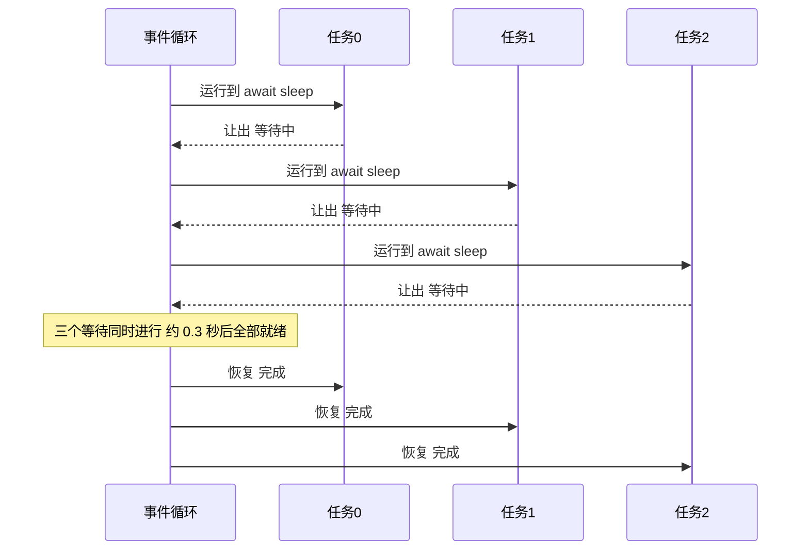

# 异步编程 async / await

> **免责声明**：本文是“河洛序”知识图谱 K1 批次的**初稿**，由 AI 辅助整理，仅供学习参考，不构成任何承诺或保证。版本信息截至 2026-10-13；文中示例已在 Python 3.15.0（语言类）或 Python 3.13.5 + 所列库版本（库类）下**实际运行**，输出为真实结果，但换机器、换版本时数字（尤其是耗时）会不同。
>
> 标注说明：**【有据可查】** 附官方文档 / 原始出处链接；**【社区共识】** 为业界普遍做法，没有唯一权威出处；**【待考察/推测】** 为未能核实或作者推断，请勿当作定论。

## 一句话定义

async/await 是 Python 的**单线程并发**写法：当一个任务在“等”（等网络、等磁盘）时，主动把控制权让出来，让同一个线程去推进别的任务——就像一个服务员同时照看多桌客人，而不是站在一桌旁边等菜。

## 为什么重要

- **I/O 密集场景的效率利器**：同时发 100 个 HTTP 请求，同步写法要排队等，异步写法几乎是同时等。
- **现代 Python Web 与 AI 服务的主流**：FastAPI、各家 LLM SDK 的异步客户端、Agent 框架大量使用 asyncio。
- **比多线程更可控**：任务只在 `await` 处切换，竞态条件更少（但不是没有）。

## 原理 / 图解

【有据可查】`async`/`await` 语法由 PEP 492 引入（Python 3.5）；`asyncio.TaskGroup` 与 `asyncio.timeout` 自 Python 3.11 起提供：<https://peps.python.org/pep-0492/> 、<https://docs.python.org/3/library/asyncio-task.html>



三种并发方式的选择：

| 方式 | 适合 | 不适合 | 本批对应文章 |
|---|---|---|---|
| asyncio | 大量 I/O 等待（API、数据库、爬虫） | CPU 密集计算（会卡住整个循环） | 本文 |
| 多线程 | I/O 等待；调用不支持 async 的库 | GIL 构建下的纯 Python CPU 计算 | [[k1.py.threading]] |
| 多进程 | CPU 密集计算 | 需要大量共享数据的场景 | [[k1.py.multiprocessing]] |

## 可运行示例

```python
# 文件：examples/25_async.py
# async/await：单线程内并发处理大量"等待型"任务（网络请求、模型 API）
import asyncio, time

async def call_model(name: str, delay: float) -> str:
    await asyncio.sleep(delay)          # 模拟网络等待；await 时让出控制权
    return f"{name} 完成({delay}s)"

async def sequential():
    return [await call_model(f"任务{i}", 0.3) for i in range(3)]

async def concurrent():
    return await asyncio.gather(*(call_model(f"任务{i}", 0.3) for i in range(3)))

async def with_taskgroup_and_timeout():
    results = []
    async with asyncio.TaskGroup() as tg:                 # Python 3.11+ 结构化并发
        tasks = [tg.create_task(call_model(f"TG{i}", 0.1 * i)) for i in range(1, 4)]
    results = [t.result() for t in tasks]
    try:
        async with asyncio.timeout(0.2):                  # Python 3.11+ 超时
            await call_model("慢任务", 1.0)
    except TimeoutError:
        results.append("慢任务超时被取消")
    return results

async def limited(n_tasks=6, limit=2):
    sem = asyncio.Semaphore(limit)                        # 限制并发数（对付 API 限流）
    async def one(i):
        async with sem:
            await asyncio.sleep(0.1)
            return i
    t0 = time.perf_counter()
    await asyncio.gather(*(one(i) for i in range(n_tasks)))
    return time.perf_counter() - t0

for fn in (sequential, concurrent):
    t0 = time.perf_counter()
    out = asyncio.run(fn())
    print(f"{fn.__name__:10s} 用时 {time.perf_counter() - t0:.2f}s -> {out}")
print(asyncio.run(with_taskgroup_and_timeout()))
print(f"6 个任务、并发上限 2，用时约 {asyncio.run(limited()):.2f}s（≈3 批 × 0.1s）")
```

输出（Python 3.15.0）：

```text
sequential 用时 0.90s -> ['任务0 完成(0.3s)', '任务1 完成(0.3s)', '任务2 完成(0.3s)']
concurrent 用时 0.30s -> ['任务0 完成(0.3s)', '任务1 完成(0.3s)', '任务2 完成(0.3s)']
['TG1 完成(0.1s)', 'TG2 完成(0.2s)', 'TG3 完成(0.30000000000000004s)', '慢任务超时被取消']
6 个任务、并发上限 2，用时约 0.30s（≈3 批 × 0.1s）
```

- 顺序 `await` 三个 0.3 秒任务用了 0.9 秒；`gather` 并发只用 0.3 秒。
- `TaskGroup` 等组内三个任务全部完成后才离开 `async with`；`asyncio.timeout(0.2)` 让 1 秒的慢任务到点被**自动取消**，并以 `TimeoutError` 通知。
- `Semaphore(2)` 把并发数限制为 2：6 个 0.1 秒任务分 3 批，约 0.3 秒——这正是调用有速率限制的 API 时需要的。
- `TG3` 显示 `0.30000000000000004s`：这是浮点数相加的精度表现（0.1×3），不是 bug。

## 常见误区

- **在 async 函数里调用阻塞函数**：`time.sleep()`、`requests.get()`、同步数据库驱动会卡住整个事件循环，所有任务一起停。应使用 `await asyncio.sleep()`、`httpx.AsyncClient`，或 `await asyncio.to_thread(阻塞函数)`。
- **忘了 `await`**：`fetch()` 只创建协程对象而不执行，Python 会警告 “coroutine was never awaited”。
- **以为 async 能加速 CPU 计算**：单线程就是单线程，CPU 密集任务请用多进程。
- **无限制并发**：一次发出上万个请求会被服务端限流或耗尽本地连接，应使用 `Semaphore` 等方式限流。
- **`create_task` 之后不保存引用**：任务可能被垃圾回收。优先使用 `TaskGroup`。【有据可查】官方文档的提醒：<https://docs.python.org/3/library/asyncio-task.html#asyncio.create_task>

## 与 AI 开发的关系

- **批量调用 LLM**：评测集上千条样本、批量生成嵌入，用异步客户端 + `Semaphore` 控制并发，能把总耗时从小时级降到分钟级（前提是遵守服务商的速率限制）。
- **流式响应**：异步生成器 `async for chunk in stream` 逐块接收模型输出，FastAPI 用它推送给前端。
- **Agent 并行工具调用**：模型一次请求多个工具时，用 `TaskGroup` 并行执行，其中某个失败会以 `ExceptionGroup` 抛出（见 [[k1.prog.exception-handling]]）。
- **MCP 等协议的 Python SDK 基于 asyncio**。【有据可查】<https://github.com/modelcontextprotocol/python-sdk>
- **Python 3.15**：【有据可查】新增 `TaskGroup.cancel()`，可在目标达成时提前结束整个任务组（如多个检索源“谁先返回用谁”）：<https://docs.python.org/3.15/whatsnew/3.15.html#asyncio>

## 延伸阅读

- asyncio 文档：<https://docs.python.org/3/library/asyncio.html>
- 协程与任务：<https://docs.python.org/3/library/asyncio-task.html>
- 开发者常见问题（asyncio-dev）：<https://docs.python.org/3/library/asyncio-dev.html>

## 无法核实 / 待考察点

- 【待考察/推测】示例中的“速度提升”来自 `asyncio.sleep` 模拟；真实 API 的加速取决于服务端并发限制与网络状况。
