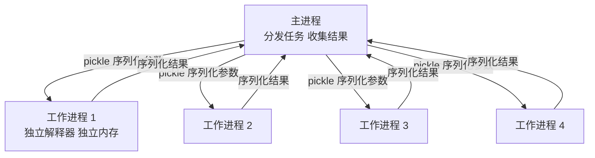

# 多进程（Multiprocessing）

> **免责声明**：本文是“河洛序”知识图谱 K1 批次的**初稿**，由 AI 辅助整理，仅供学习参考，不构成任何承诺或保证。版本信息截至 2026-10-13；文中示例已在 Python 3.15.0（语言类）或 Python 3.13.5 + 所列库版本（库类）下**实际运行**，输出为真实结果，但换机器、换版本时数字（尤其是耗时）会不同。
>
> 标注说明：**【有据可查】** 附官方文档 / 原始出处链接；**【社区共识】** 为业界普遍做法，没有唯一权威出处；**【待考察/推测】** 为未能核实或作者推断，请勿当作定论。

## 一句话定义

多进程是**同时启动多个独立的 Python 解释器进程，各自在自己的内存空间里运行**，从而让 CPU 密集任务真正利用多个 CPU 核心并行计算。

## 为什么重要

- **绕开 GIL**：在默认（带 GIL）的 CPython 中，多线程无法让纯 Python 计算并行，多进程可以。
- **隔离性好**：一个进程崩溃不会拖垮其他进程；内存互不干扰。
- **数据处理和模型训练的标配**：PyTorch `DataLoader(num_workers=N)`、批量数据预处理、超参数搜索都用到多进程。

## 原理 / 图解



**启动方式（start method）**很重要：

| 方式 | 说明 | 默认平台 |
|---|---|---|
| `spawn` | 启动全新解释器，重新导入主模块 | Windows、macOS |
| `fork` | 复制父进程（快，但与线程混用有风险） | 3.13 及以前的 Linux |
| `forkserver` | 由一个干净的服务进程 fork 出工作进程 | **3.14 起的 Linux 等 POSIX 平台** |

【有据可查】Python 3.14 起，除 macOS 与 Windows 外的平台默认启动方式由 `fork` 改为 `forkserver`：<https://docs.python.org/3/library/multiprocessing.html#contexts-and-start-methods> 。本机 Python 3.15.0 实测 `multiprocessing.get_start_method()` 返回 `forkserver`。

因为 `spawn` / `forkserver` 会在子进程中重新导入主模块，所以**脚本入口必须写 `if __name__ == "__main__":`**，否则子进程又会去创建子进程。【有据可查】官方“编程指南”的说明：<https://docs.python.org/3/library/multiprocessing.html#the-spawn-and-forkserver-start-methods>

## 可运行示例

```python
# 文件：examples/26_multiprocessing.py
# 多进程：绕开 GIL，让 CPU 密集任务真正并行（每个进程有独立解释器与内存）
import os, time
from concurrent.futures import ProcessPoolExecutor

def cpu_heavy(n: int) -> int:
    total = 0
    for i in range(n):
        total += i * i % 7
    return total

if __name__ == "__main__":                       # Windows/macOS 的 spawn 方式要求此保护
    jobs = [3_000_000] * 4
    t0 = time.perf_counter()
    serial = [cpu_heavy(n) for n in jobs]
    t_serial = time.perf_counter() - t0

    t0 = time.perf_counter()
    with ProcessPoolExecutor(max_workers=4) as pool:
        parallel = list(pool.map(cpu_heavy, jobs))
    t_par = time.perf_counter() - t0

    assert serial == parallel
    print(f"CPU 核数: {os.cpu_count()}")
    print(f"串行 {t_serial:.2f}s | 4 进程 {t_par:.2f}s | 加速比 {t_serial / t_par:.1f}x")

    # 进程间不共享普通变量
    counter = {"n": 0}
    def bump(_):
        counter["n"] += 1
        return counter["n"]
    import multiprocessing as mp
    ctx = mp.get_context("fork") if hasattr(os, "fork") else mp.get_context()
    with ctx.Pool(2) as p:
        print("子进程各自看到的计数:", p.map(bump, range(4)), "| 主进程计数仍为:", counter["n"])
```

输出（Python 3.15.0，8 核机器）：

```text
CPU 核数: 8
串行 0.54s | 4 进程 0.32s | 加速比 1.7x
子进程各自看到的计数: [1, 1, 2, 2] | 主进程计数仍为: 0
```

解读：

- 4 个进程只带来约 1.7 倍加速，而不是 4 倍：启动进程、序列化参数和结果都有开销，任务越短开销占比越大。**多进程适合“每个任务足够重”的场景。**
- 子进程各自修改的是自己那份 `counter` 副本，主进程的计数仍为 0——进程之间**不共享普通变量**，要共享必须显式使用 `Queue`、`Pipe`、`Manager`、`shared_memory` 等机制。
- 示例特意用了 `fork` 上下文：因为 `bump` 定义在 `if __name__ == "__main__":` 块里，在默认的 `forkserver` 方式下子进程重新导入主模块时**找不到它**。这是从 3.13 升级到 3.14+ 时常见的兼容问题。

## 常见误区

- **用多进程跑 I/O 任务**：等待网络时用线程或 asyncio 更轻量。
- **传递大对象**：每次调用都要 pickle 传输，大 DataFrame 来回传会比计算还慢。可以让子进程自己读取数据，或使用共享内存。
- **传 lambda 或局部函数**：在 spawn / forkserver 方式下无法 pickle，会报错。工作函数应定义在模块顶层。
- **进程数越多越快**：超过 CPU 核心数后只会增加切换开销；还要考虑内存（每个进程都有一份解释器与数据）。
- **以为 free-threaded Python 出现后多进程就没用了**：隔离性、稳定性和第三方库兼容性仍是多进程的优势。【社区共识】

## 与 AI 开发的关系

- **PyTorch `DataLoader(num_workers=N)`**：用多个工作进程并行加载与增强数据，避免 GPU 等数据。【有据可查】<https://docs.pytorch.org/docs/stable/data.html#multi-process-data-loading>
- **PyTorch 自带 `torch.multiprocessing`**，支持张量通过共享内存在进程间传递；分布式训练（DDP）也是每张 GPU 一个进程。【有据可查】<https://docs.pytorch.org/docs/stable/notes/multiprocessing.html>
- **数据预处理**：Hugging Face `datasets.map(num_proc=N)` 用多进程并行处理数据集。【有据可查】<https://huggingface.co/docs/datasets/process#multiprocessing>
- **CUDA 与 fork 不兼容**：在已初始化 CUDA 的进程中 fork 子进程会出错，需使用 spawn。【有据可查】见上方 PyTorch multiprocessing 说明。

## 延伸阅读

- `multiprocessing` 文档：<https://docs.python.org/3/library/multiprocessing.html>
- `concurrent.futures`：<https://docs.python.org/3/library/concurrent.futures.html>
- `multiprocessing.shared_memory`：<https://docs.python.org/3/library/multiprocessing.shared_memory.html>

## 无法核实 / 待考察点

- 【待考察/推测】示例加速比受机器负载、CPU 型号影响很大，1.7 倍只代表本次运行。
