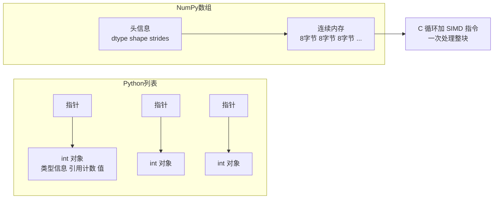

# NumPy：数值计算的地基

> **免责声明**：本文是“河洛序”知识图谱 K1 批次的**初稿**，由 AI 辅助整理，仅供学习参考，不构成任何承诺或保证。版本信息截至 2026-10-13；文中示例已在 Python 3.15.0（语言类）或 Python 3.13.5 + 所列库版本（库类）下**实际运行**，输出为真实结果，但换机器、换版本时数字（尤其是耗时）会不同。
>
> 标注说明：**【有据可查】** 附官方文档 / 原始出处链接；**【社区共识】** 为业界普遍做法，没有唯一权威出处；**【待考察/推测】** 为未能核实或作者推断，请勿当作定论。

## 一句话定义

NumPy 是 Python 的**多维数组（ndarray）与向量化数学运算库**：它把一大块同类型数字放在连续内存里，用 C 写的循环一次性处理整个数组，比纯 Python 循环快几十到几百倍。

## 为什么重要

- **整个 Python 科学计算与 AI 生态的地基**：Pandas、SciPy、scikit-learn、Matplotlib 都建立在 NumPy 之上；PyTorch 张量和 JAX 数组的 API 也大量借鉴 NumPy。
- **“数组思维”是 AI 编程的基本功**：形状（shape）、轴（axis）、广播（broadcasting）这些概念会一直伴随你进入深度学习。
- **数组接口标准**：其他库通过数组协议与 NumPy 互通。【有据可查】Python 数组 API 标准：<https://data-apis.org/array-api/latest/>

## 原理 / 图解

【有据可查】NumPy 官方入门：<https://numpy.org/doc/stable/user/absolute_beginners.html> ；本文使用 NumPy 2.5.4（PyPI 发布于 2026-10-10）。NumPy 2.0（2024 年 6 月）是 2006 年以来首个大版本，调整了类型提升规则并清理了大量 API：<https://numpy.org/doc/stable/numpy_2_0_migration_guide.html>

**为什么快**：



**广播规则**：从最后一个维度开始对齐，每个维度要么相等、要么其中一个为 1（会被“拉伸”），否则报错。【有据可查】<https://numpy.org/doc/stable/user/basics.broadcasting.html>

| 形状 A | 形状 B | 结果 |
|---|---|---|
| (3, 4) | (4,) | (3, 4)：B 被复制到每一行 |
| (3, 1) | (1, 4) | (3, 4)：两边都被拉伸 |
| (3, 4) | (3,) | 报错：最后一维 4 与 3 不匹配 |

## 可运行示例

```python
# 文件：examples/28_numpy.py
# NumPy：n 维数组 + 向量化运算 + 广播
import time
import numpy as np
print("NumPy", np.__version__)

a = np.arange(12).reshape(3, 4)
print("数组:\n", a, "\n形状", a.shape, "类型", a.dtype)
print("按列求和:", a.sum(axis=0), "| 按行均值:", a.mean(axis=1))
print("布尔索引 (>5):", a[a > 5])

# 广播：形状 (3,4) 与 (4,) 自动对齐
col_mean = a.mean(axis=0)
print("每列减去列均值:\n", a - col_mean)

# 向量化 vs Python 循环
x = np.random.default_rng(0).random(1_000_000)
t0 = time.perf_counter(); s1 = sum(v * v for v in x); t_loop = time.perf_counter() - t0
t0 = time.perf_counter(); s2 = float(np.dot(x, x)); t_vec = time.perf_counter() - t0
print(f"循环 {t_loop * 1000:.0f} ms | 向量化 {t_vec * 1000:.1f} ms | 结果一致: {np.isclose(s1, s2)}")

# AI 里最常见的操作：余弦相似度（embedding 检索的核心）
emb = np.random.default_rng(1).normal(size=(5, 8))
q = emb[2] + 0.01
sims = emb @ q / (np.linalg.norm(emb, axis=1) * np.linalg.norm(q))
print("与查询最相似的向量下标:", int(np.argmax(sims)), "相似度", sims.round(3))

# 视图与拷贝
b = a[:, :2]; b[0, 0] = 999
print("切片是视图，原数组被改:", a[0, 0], "| 共享内存:", np.shares_memory(a, b))
```

输出（Python 3.13.5 + NumPy 2.5.4）：

```text
NumPy 2.5.4
数组:
 [[ 0  1  2  3]
 [ 4  5  6  7]
 [ 8  9 10 11]] 
形状 (3, 4) 类型 int64
按列求和: [12 15 18 21] | 按行均值: [1.5 5.5 9.5]
布尔索引 (>5): [ 6  7  8  9 10 11]
每列减去列均值:
 [[-4. -4. -4. -4.]
 [ 0.  0.  0.  0.]
 [ 4.  4.  4.  4.]]
循环 108 ms | 向量化 0.4 ms | 结果一致: True
与查询最相似的向量下标: 2 相似度 [-0.093 -0.087  1.     0.286 -0.093]
切片是视图，原数组被改: 999 | 共享内存: True
```

- 100 万个数的平方和：Python 循环约 108 ms，`np.dot` 约 0.4 ms，**快两百多倍**（具体倍数因机器而异）。
- 余弦相似度那几行就是向量检索（RAG）最核心的计算：查询向量与所有文档向量做一次矩阵乘法。
- 最后一行：切片 `a[:, :2]` 是**视图**，修改它会改到原数组。【有据可查】<https://numpy.org/doc/stable/user/basics.copies.html>

## 常见误区

- **在 NumPy 数组上写 Python for 循环**：失去了全部速度优势。先想“能不能用整个数组的运算表达”。
- **搞混 `axis`**：`axis=0` 是“沿着行的方向压缩”（结果是每列一个值），初学者常常理解反。
- **以为切片会复制**：NumPy 基本切片返回视图（与 Python 列表切片相反）；需要独立副本时用 `.copy()`。花式索引（布尔/整数数组索引）则返回副本。
- **dtype 溢出**：`int8`、`uint8` 等小整数类型会静默溢出（例如图像像素相加超过 255）。
- **用 `np.random.seed` 全局种子**：推荐使用 `np.random.default_rng(seed)` 生成器对象。【有据可查】<https://numpy.org/doc/stable/reference/random/index.html>

## 与 AI 开发的关系

- **嵌入向量与相似度检索**：小规模 RAG 原型完全可以只用 NumPy 做暴力检索；规模变大再换 FAISS 或向量数据库。
- **与 PyTorch 互转**：`torch.from_numpy(arr)` 与 `tensor.numpy()` 在 CPU 上**共享内存**，改一边另一边也变。【有据可查】<https://docs.pytorch.org/docs/stable/generated/torch.from_numpy.html>
- **数据预处理**：图像就是 `(高, 宽, 通道)` 的 uint8 数组，音频就是一维 float 数组，很多预处理都是 NumPy 运算。
- **评估指标计算**：准确率、混淆矩阵、困惑度等常用 NumPy 一行完成。

## 延伸阅读

- NumPy 入门（绝对新手版）：<https://numpy.org/doc/stable/user/absolute_beginners.html>
- 广播规则：<https://numpy.org/doc/stable/user/basics.broadcasting.html>
- 视图与副本：<https://numpy.org/doc/stable/user/basics.copies.html>
- Nicolas P. Rougier, *From Python to NumPy*（免费在线书）：<https://www.labri.fr/perso/nrougier/from-python-to-numpy/>

## 无法核实 / 待考察点

- 【待考察/推测】NumPy 2.5 系列相对 2.0 的具体新增功能本文未逐条核对，以官方 release notes 为准：<https://numpy.org/doc/stable/release.html>
