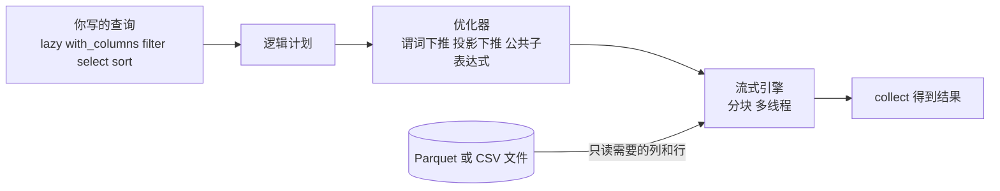

# Polars：高性能 DataFrame（2.x）

> **免责声明**：本文是“河洛序”知识图谱 K1 批次的**初稿**，由 AI 辅助整理，仅供学习参考，不构成任何承诺或保证。版本信息截至 2026-10-13；文中示例已在 Python 3.15.0（语言类）或 Python 3.13.5 + 所列库版本（库类）下**实际运行**，输出为真实结果，但换机器、换版本时数字（尤其是耗时）会不同。
>
> 标注说明：**【有据可查】** 附官方文档 / 原始出处链接；**【社区共识】** 为业界普遍做法，没有唯一权威出处；**【待考察/推测】** 为未能核实或作者推断，请勿当作定论。

## 一句话定义

Polars 是一个**用 Rust 编写、基于 Apache Arrow 内存格式的 DataFrame 库**，以“表达式 + 惰性查询”为核心，能自动优化查询并利用多核，常比 Pandas 快很多，处理超出内存的数据也更从容。

## 为什么重要

- **性能**：默认多线程执行，查询优化器自动做谓词下推、投影下推等优化。
- **声明式 API**：先描述“要什么”，由引擎决定怎么算（见 [[k1.prog.declarative]]）。
- **大数据单机化**：流式引擎可以分块处理比内存更大的数据集。
- **2026 年 10 月发布 2.0**：默认行为有重要变化。

## 原理 / 图解

【有据可查】Polars 2.0 的主要变化（升级指南与发布博客）：<https://docs.pola.rs/releases/upgrade/2/> 、<https://pola.rs/posts/release-polars-2/>
- `LazyFrame.collect()` **默认使用流式引擎**；
- `join`、`group_by`、`unpivot` 等**不再默认保证行顺序**，需要稳定顺序时传 `maintain_order=True`；
- 默认开启超出内存时的溢写到磁盘（out-of-core）；
- `read_csv` 内部转为 `scan_csv(...).collect()`；新增 `Map` 数据类型；类型检查更严格，新增 `AttributeRemovedError`、`ArgumentRemovedError` 等错误类型。

本文使用 polars 2.0.0（PyPI 发布于 2026-10-06）。

惰性查询的执行过程：



**表达式（Expression）**是 Polars 的核心：`pl.col("score").mean().alias("avg")` 描述的是“对某列做什么”，可以在 `select`、`with_columns`、`filter`、`group_by().agg()` 中复用和组合。【有据可查】<https://docs.pola.rs/user-guide/concepts/expressions-and-contexts/>

## 可运行示例

```python
# 文件：examples/30_polars.py
# Polars 2：表达式 API + 惰性查询（默认流式引擎）
import polars as pl
print("polars", pl.__version__)

df = pl.DataFrame({
    "model": ["A", "B", "A", "C", "B", "A"],
    "task":  ["code", "chat", "chat", "code", "code", "code"],
    "score": [82, 75, None, 91, 68, 88],
    "cost":  [0.12, 0.05, 0.10, 0.30, 0.04, 0.11],
})

eager = (df.filter(pl.col("score").is_not_null())
           .group_by("model", maintain_order=True)            # 需要稳定顺序时显式声明
           .agg(pl.col("score").mean().alias("avg_score"),
                pl.len().alias("runs"),
                pl.col("cost").sum().alias("total_cost"))
           .sort("avg_score", descending=True))
print(eager)

lazy = (df.lazy()
          .with_columns((pl.col("score") / pl.col("cost")).alias("score_per_cost"))
          .filter(pl.col("task") == "code")
          .select("model", "score_per_cost")
          .sort("score_per_cost", descending=True))
print("优化后的查询计划:\n", lazy.explain())
print(lazy.collect())

# 写 Parquet 再惰性扫描：只读需要的列（谓词/投影下推）
import tempfile, os
path = os.path.join(tempfile.gettempdir(), "runs.parquet")
df.write_parquet(path)
print(pl.scan_parquet(path).filter(pl.col("model") == "A").select(pl.col("cost").sum()).collect())
```

输出（Python 3.13.5 + polars 2.0.0）：

```text
polars 2.0.0
shape: (3, 4)
┌───────┬───────────┬──────┬────────────┐
│ model ┆ avg_score ┆ runs ┆ total_cost │
│ ---   ┆ ---       ┆ ---  ┆ ---        │
│ str   ┆ f64       ┆ u32  ┆ f64        │
╞═══════╪═══════════╪══════╪════════════╡
│ C     ┆ 91.0      ┆ 1    ┆ 0.3        │
│ A     ┆ 85.0      ┆ 2    ┆ 0.23       │
│ B     ┆ 71.5      ┆ 2    ┆ 0.09       │
└───────┴───────────┴──────┴────────────┘
优化后的查询计划:
 SORT BY [descending: [true]] [col("score_per_cost")]
  simple π 2/2 ["model", "score_per_cost"]
     WITH_COLUMNS:
     [(col("score").cast(Float64) / col("cost")).alias("score_per_cost")] 
      simple π 3/3 ["model", "score", "cost"]
        FILTER col("task") == "code"
        FROM
          simple π 4/4 ["model", "score", "cost", ... 1 other column]
            DF ["model", "task", "score", "cost"]; PROJECT */4 COLUMNS
shape: (4, 2)
┌───────┬────────────────┐
│ model ┆ score_per_cost │
│ ---   ┆ ---            │
│ str   ┆ f64            │
╞═══════╪════════════════╡
│ B     ┆ 1700.0         │
│ A     ┆ 800.0          │
│ A     ┆ 683.333333     │
│ C     ┆ 303.333333     │
└───────┴────────────────┘
shape: (1, 1)
┌──────┐
│ cost │
│ ---  │
│ f64  │
╞══════╡
│ 0.33 │
└──────┘
```

看查询计划（从下往上读）：我们写的顺序是“先算新列，再过滤”，但优化后的计划里 `FILTER col("task") == "code"` 被推到了 `WITH_COLUMNS` **之前**——先过滤掉不需要的行，再计算新列。这就是谓词下推。

## 常见误区

- **把 Pandas 写法直接搬过来**：Polars 没有行索引（index），也不鼓励 `df["a"][0] = ...` 这样的原地修改。思维方式是“用表达式生成新列”。
- **2.0 下默认依赖输出顺序**：`group_by` 后不排序、不加 `maintain_order=True` 时，每次运行的行顺序可能不同，测试中按顺序比对会偶发失败。
- **总是用 eager 模式**：大数据上用 `scan_*` + `lazy` 才能享受优化与流式处理。
- **在表达式里用 `map_elements` 调 Python 函数**：会退化为逐行 Python 执行，失去性能优势。
- **以为 Polars 能完全替代 Pandas**：很多库（如部分绘图、统计库）仍只接受 Pandas；可通过 `to_pandas()` 互转（经由 Arrow，见 [[k1.lib.pyarrow]]）。

## 与 AI 开发的关系

- **大规模训练数据处理**：几十 GB 的 JSONL / Parquet 语料，用 `scan_parquet` + 过滤 + 去重，单机即可完成。
- **特征工程与评测统计**：表达式 API 写出的数据变换天然适合复用和组合。
- **AI 生成 Polars 代码的风险**：Polars API 变化较快（如 `groupby` → `group_by`、`with_column` → `with_columns`，以及 2.0 的移除项），模型容易生成旧 API。【社区共识】让 AI 写 Polars 时注明版本，并在报 `AttributeRemovedError` 时对照升级指南修改。

## 延伸阅读

- Polars 用户指南：<https://docs.pola.rs/>
- 惰性 API：<https://docs.pola.rs/user-guide/lazy/>
- 2.0 升级指南：<https://docs.pola.rs/releases/upgrade/2/>
- 从 Pandas 迁移：<https://docs.pola.rs/user-guide/migration/pandas/>

## 无法核实 / 待考察点

- 【待考察/推测】流式引擎默认溢写的阈值（约 80% 内存、64GB 磁盘预算）来自 2.0 发布说明，具体是否可配置及配置方式未实测。
- 【待考察/推测】Polars 与 Pandas 3.x 的性能对比随数据规模和操作类型差异很大，本文不给出具体倍数。
