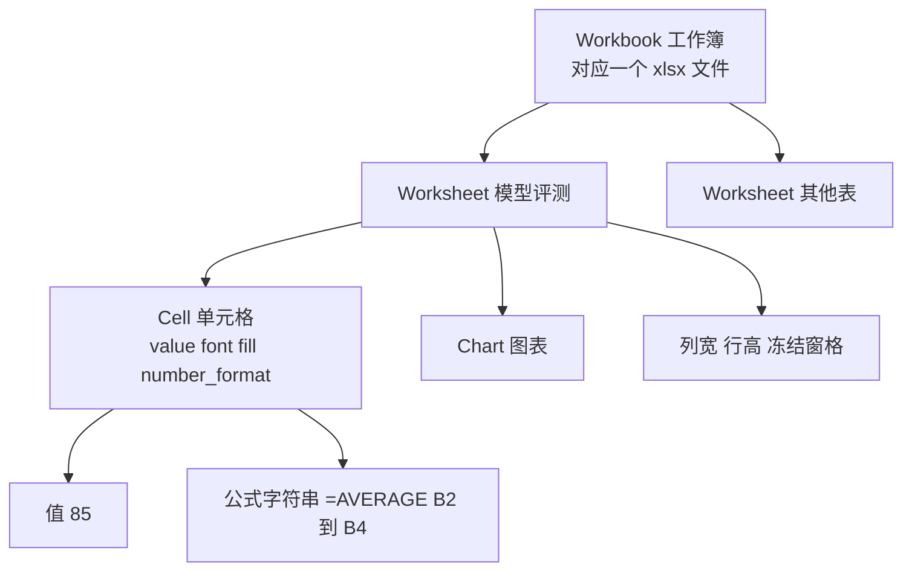

# OpenPyXL：读写 Excel 文件

> **免责声明**：本文是“河洛序”知识图谱 K1 批次的**初稿**，由 AI 辅助整理，仅供学习参考，不构成任何承诺或保证。版本信息截至 2026-10-13；文中示例已在 Python 3.15.0（语言类）或 Python 3.13.5 + 所列库版本（库类）下**实际运行**，输出为真实结果，但换机器、换版本时数字（尤其是耗时）会不同。
>
> 标注说明：**【有据可查】** 附官方文档 / 原始出处链接；**【社区共识】** 为业界普遍做法，没有唯一权威出处；**【待考察/推测】** 为未能核实或作者推断，请勿当作定论。

## 一句话定义

OpenPyXL 是一个**纯 Python 的 Excel 2010+（.xlsx/.xlsm）文件读写库**：不需要安装 Excel，就能创建工作簿、写入数据和公式、设置样式、插入图表，或读取已有表格。

## 为什么重要

- **Excel 是职场数据交换的通用格式**：报表、名单、财务表大多是 xlsx，自动化处理它们是最常见的“Python 办公”需求。
- **Pandas 读写 Excel 的默认引擎之一**：`pd.read_excel` / `to_excel` 处理 .xlsx 时常用 OpenPyXL 作为后端。【有据可查】<https://pandas.pydata.org/docs/reference/api/pandas.read_excel.html>
- **能做 Pandas 做不到的事**：精细控制单元格样式、合并单元格、条件格式、图表、冻结窗格等。

## 原理 / 图解

【有据可查】官方文档：<https://openpyxl.readthedocs.io/en/stable/> 。xlsx 文件本质上是一个 **ZIP 压缩包，里面是若干 XML 文件**（Office Open XML 格式）。



| 任务 | 选什么工具 |
|---|---|
| 批量数据分析、简单导入导出 | Pandas / Polars（底层仍可能调用 OpenPyXL 等引擎） |
| 精细格式、模板填充、图表 | OpenPyXL |
| 只需高速写出大文件 | XlsxWriter（只写不读）或 OpenPyXL 的 write-only 模式 |
| 需要真正计算公式、驱动 Excel 本身 | 需要 Excel/LibreOffice 参与，例如 xlwings（依赖已安装的 Excel） |

## 可运行示例

```python
# 文件：examples/31_openpyxl.py
# OpenPyXL：读写 .xlsx（保留格式、公式、多工作表）
import os, tempfile
from openpyxl import Workbook, load_workbook
from openpyxl.styles import Font, PatternFill
from openpyxl.chart import BarChart, Reference
import openpyxl
print("openpyxl", openpyxl.__version__)

path = os.path.join(tempfile.gettempdir(), "report.xlsx")
wb = Workbook()
ws = wb.active
ws.title = "模型评测"
ws.append(["模型", "得分", "成本"])
for row in [("A", 85, 0.12), ("B", 72, 0.05), ("C", 91, 0.30)]:
    ws.append(row)
ws["E1"], ws["E2"] = "平均分", "=AVERAGE(B2:B4)"       # 写入的是公式字符串
for cell in ws[1]:
    cell.font = Font(bold=True, color="FFFFFF")
    cell.fill = PatternFill("solid", fgColor="4472C4")
ws.column_dimensions["A"].width = 12

chart = BarChart(); chart.title = "得分"
chart.add_data(Reference(ws, min_col=2, min_row=1, max_row=4), titles_from_data=True)
chart.set_categories(Reference(ws, min_col=1, min_row=2, max_row=4))
ws.add_chart(chart, "G2")
wb.save(path)

wb2 = load_workbook(path)
ws2 = wb2["模型评测"]
for row in ws2.iter_rows(min_row=2, max_row=4, values_only=True):
    print(row[:3])
print("E2 单元格内容:", ws2["E2"].value)
wb3 = load_workbook(path, data_only=True)
print("data_only=True 读到的值:", wb3["模型评测"]["E2"].value, "← openpyxl 不计算公式，需 Excel 等打开保存后才有缓存值")
```

输出（Python 3.13.5 + openpyxl 3.1.5）：

```text
openpyxl 3.1.5
('A', 85, 0.12)
('B', 72, 0.05)
('C', 91, 0.3)
E2 单元格内容: =AVERAGE(B2:B4)
data_only=True 读到的值: None ← openpyxl 不计算公式，需 Excel 等打开保存后才有缓存值
```

关键知识点在最后两行：

- 默认读取时，公式单元格的值就是**公式字符串** `=AVERAGE(B2:B4)`。
- 用 `data_only=True` 读取时得到的是**上次由 Excel 计算并缓存的结果**；这个文件从未被 Excel 打开保存过，所以是 `None`。【有据可查】OpenPyXL 文档说明它不会计算公式：<https://openpyxl.readthedocs.io/en/stable/usage.html#using-formulae>

## 常见误区

- **以为 OpenPyXL 会计算公式**：它只读写文件，不包含计算引擎。
- **用 `data_only=True` 打开后再保存**：公式会丢失，只剩值。
- **处理超大文件内存爆炸**：可使用 `load_workbook(read_only=True)` 和 `Workbook(write_only=True)` 模式。【有据可查】<https://openpyxl.readthedocs.io/en/stable/optimized.html>
- **用它读 .xls（旧格式）**：OpenPyXL 不支持 .xls，需要其他库或先转换格式。
- **以为它是活跃快速迭代的项目**：截至 2026-10-13，PyPI 上最新版本仍是 3.1.5（2024-06-28 发布），更新节奏较慢，遇到新特性需求时需留意。

## 与 AI 开发的关系

- **AI 办公自动化的高频场景**：“把评测结果导出成带格式的 Excel 报表”“读取业务方给的 Excel 名单再调用模型批量处理”。
- **AI 生成 Excel 处理脚本**：要特别检查是否覆盖了原文件、是否用 `data_only=True` 后保存导致公式丢失。
- **表格理解与 RAG**：把 Excel 内容喂给 LLM 前，常先用 OpenPyXL/Pandas 把合并单元格、多级表头整理成规整的文本或 Markdown 表格。【社区共识】
- **安全**：处理来源不明的 .xlsm 时注意其中可能含有宏；OpenPyXL 默认不保留 VBA（可用 `keep_vba=True` 保留），但不会执行宏。【待考察/推测】处理不可信文件时，XML 解析相关的安全建议请以官方文档为准。

## 延伸阅读

- OpenPyXL 教程：<https://openpyxl.readthedocs.io/en/stable/tutorial.html>
- 性能模式（read-only / write-only）：<https://openpyxl.readthedocs.io/en/stable/optimized.html>
- 图表：<https://openpyxl.readthedocs.io/en/stable/charts/introduction.html>
- XlsxWriter：<https://xlsxwriter.readthedocs.io/>

## 无法核实 / 待考察点

- 【待考察/推测】OpenPyXL 项目的维护状态（是否有 3.2 计划）未找到官方明确说明。
- 【待考察/推测】OpenPyXL 处理不可信 XML 时是否推荐配合 `defusedxml`，未在当前官方文档中核实具体措辞。
