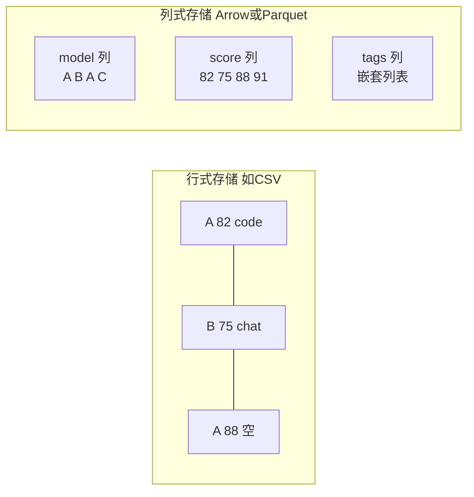

# PyArrow：列式内存格式与 Parquet

> **免责声明**：本文是“河洛序”知识图谱 K1 批次的**初稿**，由 AI 辅助整理，仅供学习参考，不构成任何承诺或保证。版本信息截至 2026-10-13；文中示例已在 Python 3.15.0（语言类）或 Python 3.13.5 + 所列库版本（库类）下**实际运行**，输出为真实结果，但换机器、换版本时数字（尤其是耗时）会不同。
>
> 标注说明：**【有据可查】** 附官方文档 / 原始出处链接；**【社区共识】** 为业界普遍做法，没有唯一权威出处；**【待考察/推测】** 为未能核实或作者推断，请勿当作定论。

## 一句话定义

PyArrow 是 **Apache Arrow 的 Python 实现**：Arrow 定义了一种跨语言通用的**列式内存数据格式**，让 Pandas、Polars、DuckDB、Spark 等工具可以几乎零成本地互相传递表格数据；PyArrow 同时也是读写 Parquet 文件的主力库。

## 为什么重要

- **数据工具之间的“普通话”**：没有统一格式时，每两个工具之间都要做一次转换；有了 Arrow，大家都说同一种内存格式。
- **Pandas 3.x 的默认字符串类型由它支撑**（见 [[k1.lib.pandas]]），Polars 的内存模型也基于 Arrow 规范。
- **Parquet 是大数据与 AI 数据集的主流存储格式**：Hugging Face 数据集等大量使用 Parquet。

## 原理 / 图解

【有据可查】Arrow 列式格式规范：<https://arrow.apache.org/docs/format/Columnar.html> ；PyArrow 文档：<https://arrow.apache.org/docs/python/> ；Parquet：<https://parquet.apache.org/docs/>

**行式 vs 列式**：



列式的好处：统计一列（如平均分）只需读这一列；同一列数据类型相同，压缩率高、适合 SIMD 向量化。

| 概念 | 说明 |
|---|---|
| Arrow（内存格式） | 进程内 / 进程间交换数据，强调零拷贝与快速计算 |
| Parquet（文件格式） | 磁盘上长期存储，强调压缩与按列、按行组读取 |
| Feather / Arrow IPC | 把 Arrow 内存格式原样写到磁盘，读写极快 |
| `pyarrow.compute` | 在 Arrow 数据上直接做计算（过滤、聚合、字符串处理） |

## 可运行示例

```python
# 文件：examples/32_pyarrow.py
# PyArrow：列式内存格式 Apache Arrow 的 Python 实现，Pandas/Polars/DuckDB 之间的"通用语"
import os, tempfile
import pyarrow as pa, pyarrow.compute as pc, pyarrow.parquet as pq
print("pyarrow", pa.__version__)

table = pa.table({
    "model": pa.array(["A", "B", "A", "C"]),
    "score": pa.array([82, 75, 88, 91], type=pa.int16()),
    "tags":  pa.array([["code"], ["chat", "zh"], [], ["code"]]),   # 嵌套类型
})
print(table.schema)
print("score 均值:", pc.mean(table["score"]).as_py())
print("过滤 score>80:", table.filter(pc.greater(table["score"], 80))["model"].to_pylist())

path = os.path.join(tempfile.gettempdir(), "arrow_demo.parquet")
pq.write_table(table, path, compression="zstd")
meta = pq.ParquetFile(path).metadata
print(f"Parquet 行数 {meta.num_rows}, 行组 {meta.num_row_groups}, 列 {meta.num_columns}")
print("只读一列:", pq.read_table(path, columns=["score"]).to_pydict())

# 与 pandas / polars 互转（多数情况零拷贝或低拷贝）
import pandas as pd, polars as pl
pdf = table.to_pandas()
pldf = pl.from_arrow(table)
print("pandas 列类型:", pdf.dtypes.to_dict())
print("polars 列类型:", pldf.schema)
```

输出（Python 3.13.5 + pyarrow 25.0.1）：

```text
pyarrow 25.0.1
model: string
score: int16
tags: list<item: string>
  child 0, item: string
score 均值: 84.0
过滤 score>80: ['A', 'A', 'C']
Parquet 行数 4, 行组 1, 列 3
只读一列: {'score': [82, 75, 88, 91]}
pandas 列类型: {'model': <StringDtype(na_value=nan)>, 'score': dtype('int16'), 'tags': dtype('O')}
polars 列类型: Schema({'model': String, 'score': Int16, 'tags': List(String)})
```

- Arrow 原生支持嵌套类型 `list<string>`，转成 Polars 后仍是 `List(String)`；转成 Pandas 后则变为 `object` 列（Python 列表）。**不同库对复杂类型的支持程度不同**，转换时要留意。
- `read_table(columns=["score"])` 只读取一列——列式文件的核心优势。

> 版本说明：本机环境安装的是 pyarrow 25.0.1；截至 2026-10-13，PyPI 最新版为 26.0.0（2026-10-09 发布），本文示例未在 26.0.0 上验证。

## 常见误区

- **把 Arrow 与 Parquet 混为一谈**：前者是内存格式，后者是文件格式；二者配合使用，但用途不同。
- **以为所有转换都是零拷贝**：数值类型、无缺失值的列通常可以零拷贝；字符串、嵌套类型、含缺失值的整数列转为 Pandas/NumPy 时往往需要复制或转换。【有据可查】<https://arrow.apache.org/docs/python/pandas.html#zero-copy-series-conversions>
- **小文件也用 Parquet 并切成海量小块**：过多小文件会拖慢读取，行组和文件大小需要合理规划。
- **用 CSV 长期存储大数据**：CSV 不保存类型信息、体积大、读取慢，适合交换不适合存储。

## 与 AI 开发的关系

- **Hugging Face Datasets 以 Arrow 为底层**：数据集被内存映射为 Arrow 表，不必完整装入内存即可随机访问。【有据可查】<https://huggingface.co/docs/datasets/about_arrow>
- **训练语料与评测数据存为 Parquet**：体积小、带类型、可按列读取，已成为数据集分发的常用格式。
- **跨工具流水线**：用 DuckDB 做 SQL 过滤 → 转 Polars 做特征 → 转 Pandas 画图，中间通过 Arrow 衔接，几乎没有转换成本。
- **向量数据**：一些向量数据库和数据湖格式（如 Lance）也基于 Arrow 生态。【待考察/推测】具体实现细节未逐一核实。

## 延伸阅读

- PyArrow 入门：<https://arrow.apache.org/docs/python/getstarted.html>
- 与 Pandas 互操作：<https://arrow.apache.org/docs/python/pandas.html>
- Parquet 读写：<https://arrow.apache.org/docs/python/parquet.html>
- Arrow 列式格式规范：<https://arrow.apache.org/docs/format/Columnar.html>

## 无法核实 / 待考察点

- 【待考察/推测】pyarrow 26.0.0 相对 25.x 的破坏性变更未核实。
