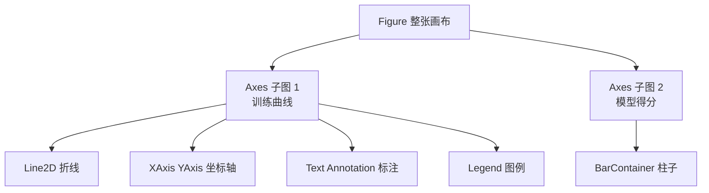
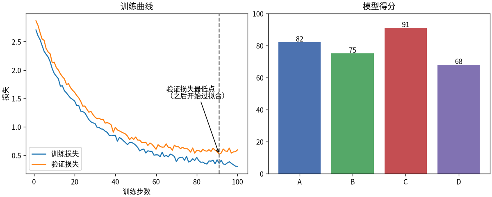

# Matplotlib：Python 绘图的底层标准

> **免责声明**：本文是“河洛序”知识图谱 K1 批次的**初稿**，由 AI 辅助整理，仅供学习参考，不构成任何承诺或保证。版本信息截至 2026-10-13；文中示例已在 Python 3.15.0（语言类）或 Python 3.13.5 + 所列库版本（库类）下**实际运行**，输出为真实结果，但换机器、换版本时数字（尤其是耗时）会不同。
>
> 标注说明：**【有据可查】** 附官方文档 / 原始出处链接；**【社区共识】** 为业界普遍做法，没有唯一权威出处；**【待考察/推测】** 为未能核实或作者推断，请勿当作定论。

## 一句话定义

Matplotlib 是 Python 最基础、最通用的**静态图表绘制库**：折线图、柱状图、散点图、直方图、热力图都能画，并能精确控制图上的每一个元素，输出 PNG、SVG、PDF 等格式。

## 为什么重要

- **生态的底座**：Seaborn、Pandas 的 `.plot()` 都基于 Matplotlib；论文插图、训练曲线大多出自它。
- **可控性最强**：坐标轴、刻度、标注、配色、布局都可以逐项调整。
- **在无界面服务器上也能出图**：选用 `Agg` 后端直接保存图片文件。

## 原理 / 图解

【有据可查】官方快速入门：<https://matplotlib.org/stable/users/explain/quick_start.html> 。本文使用 matplotlib 3.11.2（PyPI 发布于 2026-09-11）。

Matplotlib 的对象层级：



两种接口：

| 接口 | 写法 | 建议 |
|---|---|---|
| pyplot 状态机接口 | `plt.plot(...)`、`plt.title(...)` | 快速草图、交互探索 |
| 面向对象接口 | `fig, ax = plt.subplots()` 后 `ax.plot(...)` | **推荐**：多子图、脚本、可复用代码 |

【有据可查】官方推荐在复杂场景下使用显式的面向对象（Axes）接口：<https://matplotlib.org/stable/users/explain/figure/api_interfaces.html>

## 可运行示例

画一张“训练/验证损失曲线 + 模型得分柱状图”，并处理中文字体（Python 3.13.5 + matplotlib 3.11.2 实际运行）：

```python
# 文件：examples/33_matplotlib.py
# Matplotlib：Python 绘图的底层标准。推荐面向对象接口 fig, ax = plt.subplots()
import os
import matplotlib
matplotlib.use("Agg")                     # 无界面环境保存图片
import matplotlib.pyplot as plt
import numpy as np
from matplotlib import font_manager
print("matplotlib", matplotlib.__version__)

# 中文字体：选系统里已有的 CJK 字体，否则中文显示为方块
cjk = [f.name for f in font_manager.fontManager.ttflist if "CJK SC" in f.name or "YaHei" in f.name or "PingFang" in f.name]
if cjk:
    plt.rcParams["font.family"] = cjk[0]
plt.rcParams["axes.unicode_minus"] = False
print("使用字体:", cjk[0] if cjk else "默认（可能不支持中文）")

steps = np.arange(1, 101)
rng = np.random.default_rng(0)
train = 2.5 * np.exp(-steps / 25) + 0.3 + rng.normal(0, 0.03, steps.size)
val = 2.5 * np.exp(-steps / 25) + 0.45 + 0.002 * np.maximum(0, steps - 60) + rng.normal(0, 0.03, steps.size)

fig, axes = plt.subplots(1, 2, figsize=(10, 4), constrained_layout=True)
ax = axes[0]
ax.plot(steps, train, label="训练损失")
ax.plot(steps, val, label="验证损失")
ax.axvline(int(steps[np.argmin(val)]), ls="--", c="gray")
ax.annotate("验证损失最低点\n（之后开始过拟合）", xy=(steps[np.argmin(val)], val.min()),
            xytext=(65, 1.5), arrowprops=dict(arrowstyle="->"))
ax.set(title="训练曲线", xlabel="训练步数", ylabel="损失")
ax.legend()

models, scores = ["A", "B", "C", "D"], [82, 75, 91, 68]
bars = axes[1].bar(models, scores, color=["#4C72B0", "#55A868", "#C44E52", "#8172B2"])
axes[1].bar_label(bars)
axes[1].set(title="模型得分", ylim=(0, 100))

out = os.path.join(os.path.dirname(__file__), "..", "img", "matplotlib-demo.png")
fig.savefig(out, dpi=120)
print("已保存:", os.path.basename(out))
```

输出：

```text
matplotlib 3.11.2
使用字体: Noto Sans CJK SC
已保存: matplotlib-demo.png
```

生成的图片：



左图中，验证损失在约第 90 步达到最低后开始回升，而训练损失仍在下降——这是**过拟合**的典型信号，也是“早停”（early stopping）的依据。（数据为合成的演示数据。）

## 常见误区

- **中文显示成方块**：默认字体不含中文字形。需要设置系统中已安装的中文字体（如示例中自动查找 Noto Sans CJK SC），并设置 `axes.unicode_minus=False` 避免负号显示异常。
- **混用 pyplot 与面向对象接口**：在多子图场景中 `plt.title` 只作用于“当前 Axes”，容易标错位置。
- **在循环里不断画图却不关闭**：会占用越来越多内存，应 `plt.close(fig)`。
- **保存的图片模糊**：设置 `dpi`（如 120～300）或保存为矢量格式 SVG/PDF。
- **布局重叠**：使用 `constrained_layout=True` 或 `fig.tight_layout()`。

## 与 AI 开发的关系

- **训练监控**：损失曲线、学习率曲线、准确率曲线，是判断欠拟合/过拟合最直观的手段。
- **评估可视化**：混淆矩阵、ROC/PR 曲线（scikit-learn 的 `ConfusionMatrixDisplay`、`RocCurveDisplay` 基于 Matplotlib）。【有据可查】<https://scikit-learn.org/stable/visualizations.html>
- **嵌入向量可视化**：用 PCA/t-SNE/UMAP 降到二维后画散点图，观察语义聚类。
- **AI 生成画图代码**：模型很擅长写 Matplotlib 代码，但常忘记中文字体设置、在服务器上用了需要界面的后端，或混用两种接口——这些是审查重点。

## 延伸阅读

- 快速入门：<https://matplotlib.org/stable/users/explain/quick_start.html>
- 示例画廊：<https://matplotlib.org/stable/gallery/index.html>
- 速查表（cheatsheets）：<https://matplotlib.org/cheatsheets/>
- Nicolas P. Rougier, *Scientific Visualization: Python + Matplotlib*（免费书）：<https://github.com/rougier/scientific-visualization-book>

## 无法核实 / 待考察点

- 【待考察/推测】matplotlib 3.11 相对 3.10 的新特性未逐条核实，以官方 release notes 为准。
