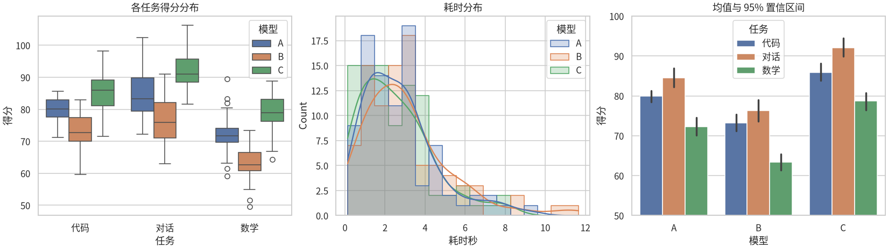

# Seaborn：统计可视化

> **免责声明**：本文是“河洛序”知识图谱 K1 批次的**初稿**，由 AI 辅助整理，仅供学习参考，不构成任何承诺或保证。版本信息截至 2026-10-13；文中示例已在 Python 3.15.0（语言类）或 Python 3.13.5 + 所列库版本（库类）下**实际运行**，输出为真实结果，但换机器、换版本时数字（尤其是耗时）会不同。
>
> 标注说明：**【有据可查】** 附官方文档 / 原始出处链接；**【社区共识】** 为业界普遍做法，没有唯一权威出处；**【待考察/推测】** 为未能核实或作者推断，请勿当作定论。

## 一句话定义

Seaborn 是**建立在 Matplotlib 之上的统计图表库**：直接接收 Pandas 表格，一行代码就能按类别分组、着色，画出箱线图、分布图、带置信区间的均值图等统计图形，并自带美观的主题。

## 为什么重要

- **少写代码就能做“分组对比”**：`hue="模型"` 一个参数就完成按模型着色分组，用纯 Matplotlib 要写循环。
- **内置统计计算**：均值的置信区间、核密度估计（KDE）、回归拟合线自动算好。
- **探索性数据分析（EDA）利器**：快速看清分布、异常值、组间差异。

## 原理 / 图解

【有据可查】官方介绍：<https://seaborn.pydata.org/tutorial/introduction.html> 。Seaborn 按图形用途分为几大函数族：关系（`relplot`）、分布（`displot`）、类别（`catplot`），每族有对应的 Axes 级函数（如 `boxplot`、`histplot`、`barplot`）。0.12 起还提供了声明式的 `seaborn.objects` 接口：<https://seaborn.pydata.org/tutorial/objects_interface.html>


**长格式（long-form / tidy）数据**是 Seaborn 的关键：每行一个观测，每列一个变量（模型、任务、得分），而不是“每个模型一列”的宽表。【有据可查】<https://seaborn.pydata.org/tutorial/data_structure.html>

| 想看什么 | 函数 |
|---|---|
| 组间分布与异常值 | `boxplot`、`violinplot` |
| 单变量分布 | `histplot`（可加 `kde=True`） |
| 组均值与不确定性 | `barplot`、`pointplot`（默认带误差线） |
| 两变量关系 | `scatterplot`、`regplot`、`lineplot` |
| 矩阵 | `heatmap` |

## 可运行示例

用模拟的“3 个模型 × 3 类任务 × 每组 30 次评测”数据画三张图（Python 3.13.5 + seaborn 0.13.2 实际运行）：

```python
# 文件：examples/34_seaborn.py
# Seaborn：基于 Matplotlib 的统计可视化，一行代码画分组/分布/相关
import os
import matplotlib
matplotlib.use("Agg")
import matplotlib.pyplot as plt
import seaborn as sns
import numpy as np, pandas as pd
from matplotlib import font_manager
print("seaborn", sns.__version__)

cjk = [f.name for f in font_manager.fontManager.ttflist if "CJK SC" in f.name]
sns.set_theme(style="whitegrid", font=cjk[0] if cjk else None, rc={"axes.unicode_minus": False})

rng = np.random.default_rng(42)
rows = []
for model, base in [("A", 80), ("B", 72), ("C", 86)]:
    for task, shift in [("代码", 0), ("对话", 5), ("数学", -8)]:
        for _ in range(30):
            rows.append({"模型": model, "任务": task,
                         "得分": rng.normal(base + shift, 6), "耗时秒": rng.gamma(2, 1.5)})
df = pd.DataFrame(rows)

fig, axes = plt.subplots(1, 3, figsize=(15, 4.2), constrained_layout=True)
sns.boxplot(data=df, x="任务", y="得分", hue="模型", ax=axes[0]); axes[0].set_title("各任务得分分布")
sns.histplot(data=df, x="耗时秒", hue="模型", kde=True, element="step", ax=axes[1]); axes[1].set_title("耗时分布")
sns.barplot(data=df, x="模型", y="得分", hue="任务", errorbar=("ci", 95), ax=axes[2]); axes[2].set_title("均值与 95% 置信区间")
axes[2].set_ylim(50, 100)
out = os.path.join(os.path.dirname(__file__), "..", "img", "seaborn-demo.png")
fig.savefig(out, dpi=110)
print("已保存:", os.path.basename(out))
print(df.groupby(["模型", "任务"])["得分"].mean().unstack().round(1))
```

输出：

```text
seaborn 0.13.2
已保存: seaborn-demo.png
任务    代码    对话    数学
模型                  
A   80.0  84.5  72.3
B   73.3  76.3  63.4
C   85.9  92.1  78.8
```

生成的图片：



- 左：箱线图显示每组的中位数、四分位范围和异常点（小圆圈）。
- 中：直方图 + KDE 曲线显示耗时呈右偏分布（多数快、少数很慢）——这正是 API 延迟的常见形态。
- 右：柱高是均值，黑色竖线是 95% 置信区间（Seaborn 通过自助法 bootstrap 计算）。**区间重叠很多的两组，差异可能并不可靠。**

## 常见误区

- **把宽表直接丢给 Seaborn**：先用 `df.melt(...)` 转成长格式。
- **只看均值柱状图**：均值会掩盖分布形态和异常值，配合箱线图或分布图一起看。
- **误读误差线**：Seaborn 0.12 起用 `errorbar=` 参数明确指定误差线含义（`"ci"`、`"sd"`、`"se"`、`"pi"`），报告中应写清楚是哪一种。【有据可查】<https://seaborn.pydata.org/tutorial/error_bars.html>
- **以为 Seaborn 在高频迭代**：截至 2026-10-13，PyPI 上最新版仍为 0.13.2（2024-01-25 发布）。它仍可正常使用，但新特性节奏较慢。
- **中文乱码**：与 Matplotlib 相同，需要在 `sns.set_theme(font=...)` 中指定中文字体。

## 与 AI 开发的关系

- **模型评测报告**：多模型 × 多任务的得分分布与置信区间，是判断“A 模型是否真的比 B 好”的基本工具——单次评测的平均分差距可能只是噪声。
- **数据集 EDA**：文本长度分布、标签分布、各来源数据量，训练前先画一遍能发现很多数据问题。
- **相关性热力图**：查看特征之间、评测指标之间的相关性（注意：随机噪声数据也可能出现看似明显的相关，需要足够样本量）。

## 延伸阅读

- Seaborn 教程：<https://seaborn.pydata.org/tutorial.html>
- 误差线说明：<https://seaborn.pydata.org/tutorial/error_bars.html>
- 数据结构（长格式与宽格式）：<https://seaborn.pydata.org/tutorial/data_structure.html>
- Hadley Wickham, *Tidy Data*（2014，长格式数据思想的经典论文）：<https://www.jstatsoft.org/article/view/v059i10>

## 无法核实 / 待考察点

- 【待考察/推测】Seaborn 是否有 0.14 / 1.0 的发布计划，未找到官方明确说明。
- 【待考察/推测】seaborn 0.13.2 与 pandas 3.x 的全部兼容性未全面测试，本文示例在 pandas 3.0.6 下运行正常。
