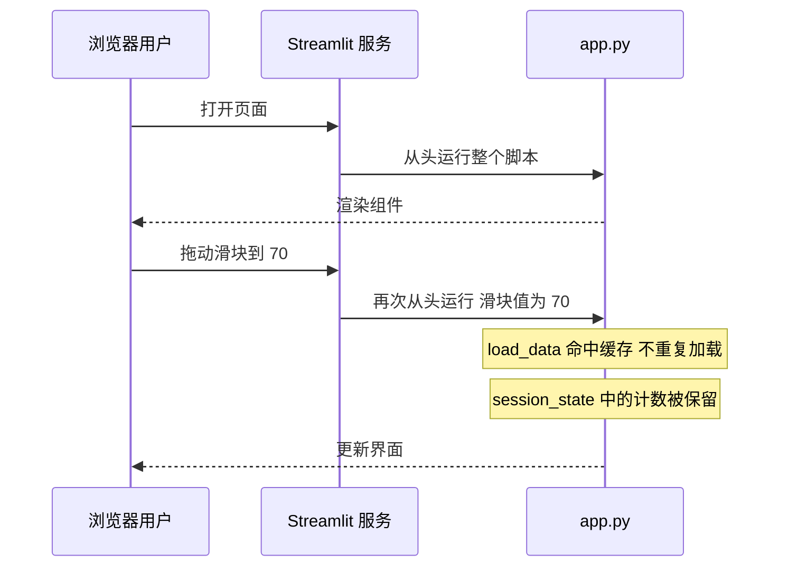

# Streamlit：用纯 Python 快速做数据应用

> **免责声明**：本文是“河洛序”知识图谱 K1 批次的**初稿**，由 AI 辅助整理，仅供学习参考，不构成任何承诺或保证。版本信息截至 2026-10-13；文中示例已在 Python 3.15.0（语言类）或 Python 3.13.5 + 所列库版本（库类）下**实际运行**，输出为真实结果，但换机器、换版本时数字（尤其是耗时）会不同。
>
> 标注说明：**【有据可查】** 附官方文档 / 原始出处链接；**【社区共识】** 为业界普遍做法，没有唯一权威出处；**【待考察/推测】** 为未能核实或作者推断，请勿当作定论。

## 一句话定义

Streamlit 是一个**只写 Python 脚本就能生成交互式网页应用**的框架：`st.slider`、`st.button`、`st.dataframe` 这样一行一个组件，不需要写 HTML/CSS/JavaScript。

## 为什么重要

- **从脚本到可分享的 Demo 只需几分钟**：数据看板、模型演示、内部小工具都很适合。
- **AI 应用原型的热门选择**：聊天界面组件（`st.chat_input`、`st.chat_message`）和流式输出（`st.write_stream`）让 LLM Demo 非常好做。
- **自带测试框架**：`AppTest` 可以无浏览器地自动化测试应用。

## 原理 / 图解

【有据可查】Streamlit 的核心执行模型：**每次用户交互，整个脚本从上到下重新运行一遍**；用缓存（`st.cache_data`、`st.cache_resource`）避免重复的耗时计算，用 `st.session_state` 在多次重跑之间保存状态：<https://docs.streamlit.io/develop/concepts/architecture/caching> 、<https://docs.streamlit.io/develop/concepts/architecture/session-state> 。本文使用 streamlit 1.65.0（PyPI 发布于 2026-10-02）。



| 机制 | 作用 | 适合放什么 |
|---|---|---|
| `@st.cache_data` | 缓存函数返回的**数据**（返回副本） | 读取的 DataFrame、API 结果 |
| `@st.cache_resource` | 缓存**全局共享资源**（不复制） | 模型对象、数据库连接、LLM 客户端 |
| `st.session_state` | 每个用户会话独立的状态字典 | 聊天历史、计数器、登录状态 |

## 可运行示例

**应用代码** `examples/streamlit_app/app.py`（用 `streamlit run app.py` 启动）：

```python
# 文件：examples/streamlit_app/app.py
# streamlit run app.py
import streamlit as st
import pandas as pd
import numpy as np

st.set_page_config(page_title="模型评测看板", layout="wide")
st.title("模型评测看板")

@st.cache_data
def load_data(seed: int) -> pd.DataFrame:
    rng = np.random.default_rng(seed)
    return pd.DataFrame({
        "模型": np.repeat(["A", "B", "C"], 50),
        "得分": np.concatenate([rng.normal(m, 5, 50) for m in (80, 72, 88)]),
    })

df = load_data(0)
models = st.multiselect("选择模型", sorted(df["模型"].unique()), default=["A", "C"])
threshold = st.slider("及格线", 50, 100, 75)

view = df[df["模型"].isin(models)]
col1, col2 = st.columns(2)
col1.metric("样本数", len(view))
col2.metric("及格率", f"{(view['得分'] >= threshold).mean():.0%}" if len(view) else "—")
st.bar_chart(view.groupby("模型")["得分"].mean())

if "clicks" not in st.session_state:
    st.session_state.clicks = 0
if st.button("点我计数"):
    st.session_state.clicks += 1
st.write("按钮被点击次数:", st.session_state.clicks)
```

**自动化测试**：用官方的 `AppTest` 无头运行上面的应用，模拟用户选择、拖动滑块、点击按钮，并检查结果：

```python
# 文件：examples/36_streamlit.py
# 用 Streamlit 官方测试工具 AppTest 无头运行 app.py，模拟用户操作并检查结果
import os
import streamlit
from streamlit.testing.v1 import AppTest
print("streamlit", streamlit.__version__)

app_path = os.path.join(os.path.dirname(__file__), "streamlit_app", "app.py")
at = AppTest.from_file(app_path).run()
print("标题:", at.title[0].value)
print("初始指标:", [(m.label, m.value) for m in at.metric])

at.multiselect[0].set_value(["B"]).run()          # 模拟用户只选模型 B
at.slider[0].set_value(70).run()                  # 把及格线拖到 70
print("只选 B、及格线 70 后:", [(m.label, m.value) for m in at.metric])

at.button[0].click().run(); at.button[0].click().run()
print("点击两次按钮后:", at.markdown[-1].value if at.markdown else [w.value for w in at.get("text")])
print("异常:", at.exception if len(at.exception) else "无")
```

输出（Python 3.13.5 + streamlit 1.65.0）：

```text
2026-10-14 11:21:07.258 WARNING streamlit.runtime.scriptrunner_utils.script_run_context: Thread 'MainThread': missing ScriptRunContext! This warning can be ignored when running in bare mode.
streamlit 1.65.0
标题: 模型评测看板
初始指标: [('样本数', '100'), ('及格率', '95%')]
只选 B、及格线 70 后: [('样本数', '50'), ('及格率', '60%')]
点击两次按钮后: 按钮被点击次数: `2`
异常: 无
```

- 第一行 `missing ScriptRunContext` 警告是在测试/裸模式下运行时的正常提示，官方说明可忽略。
- 只选模型 B、及格线 70 后，样本数从 100 变为 50，及格率变为 60%——证明交互逻辑正确。
- 点击两次按钮后计数为 2：`session_state` 在两次重跑之间保存了状态。

【有据可查】`AppTest` 文档：<https://docs.streamlit.io/develop/api-reference/app-testing>

## 常见误区

- **不知道“整个脚本会重跑”**：在脚本顶部加载大模型而不加缓存，每次点击都会重新加载，应用会极慢。
- **用普通变量保存状态**：每次重跑都会被重置，应使用 `st.session_state`。
- **用 `cache_data` 缓存模型对象**：会尝试序列化/复制，应使用 `cache_resource`。
- **把 Streamlit 当成通用 Web 框架**：复杂的多页面权限、高并发、精细的前端交互更适合 FastAPI + 前端框架或 Dash。【社区共识】
- **把 API Key 写进代码**：应使用 `st.secrets`（`.streamlit/secrets.toml`，且不要提交到仓库）或环境变量。【有据可查】<https://docs.streamlit.io/develop/concepts/connections/secrets-management>

## 与 AI 开发的关系

- **LLM 聊天 Demo**：`st.chat_message` + `st.chat_input` + `st.write_stream`（接收生成器，见 [[k1.py.generator]]）十几行就能做出流式聊天界面。【有据可查】官方教程：<https://docs.streamlit.io/develop/tutorials/chat-and-llm-apps/build-conversational-apps>
- **模型/提示词对比工具**：侧边栏选模型和参数，主区域并排展示输出，方便非技术同事参与评测。
- **RAG 调试面板**：展示检索到的片段、相似度分数和最终回答，帮助定位“是检索错了还是生成错了”。
- **模型缓存**：用 `@st.cache_resource` 只加载一次嵌入模型或本地模型，所有会话共享。
- **用 `AppTest` 做回归测试**：配合假 LLM（见 [[k1.prog.solid]] 的依赖倒置），可以在 CI 中测试界面逻辑而不调用真实模型。

## 延伸阅读

- 官方入门：<https://docs.streamlit.io/get-started>
- 缓存：<https://docs.streamlit.io/develop/concepts/architecture/caching>
- Session State：<https://docs.streamlit.io/develop/concepts/architecture/session-state>
- App testing：<https://docs.streamlit.io/develop/api-reference/app-testing>

## 无法核实 / 待考察点

- 【待考察/推测】Streamlit 1.5x～1.65 期间新增组件与行为变化未逐版核实。
- 【待考察/推测】`AppTest` 对 `st.bar_chart` 等图表元素内容的检查能力有限，本文只检查了指标与文本。
