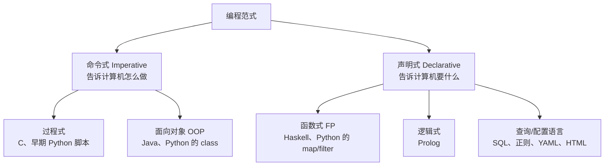

# 编程范式（Programming Paradigm）

@@DISCLAIMER@@

## 一句话定义

编程范式是**组织代码和思考问题的“风格流派”**：它规定你用什么基本单元（语句、函数、对象、规则……）来描述计算，以及这些单元之间怎样组合。

## 为什么重要

- **同一个问题，不同范式写出来的代码长得完全不一样**。看懂范式，就能看懂为什么 Pandas 链式调用、SQL、React、PyTorch 的 `nn.Module` 各有各的“味道”。
- **选对范式能少写一半的 bug**：状态多的业务适合把状态封装进对象（OOP），数据变换流水线适合函数式，查询类问题适合声明式。
- **AI 写的代码也有范式偏好**。你能说出“改成纯函数”“改成声明式配置”，AI 才能按你想要的方向改。

## 原理 / 图解

范式的分法有很多，常见的是先分成两大类：

| 范式 | 基本单元 | 关心什么 | 典型代表 |
|---|---|---|---|
| 命令式 / 过程式 | 语句、变量赋值、循环 | 每一步怎么改状态 | C、Shell 脚本 |
| 面向对象 | 对象（数据 + 方法） | 谁负责什么 | Java、C#、Python |
| 函数式 | 纯函数、不可变数据 | 输入如何变成输出 | Haskell、Clojure、Elixir |
| 声明式（广义） | 规则、查询、期望状态 | 结果长什么样 | SQL、HTML、Terraform |

【有据可查】Python 官方把自己描述为支持多种范式：其《函数式编程 HOWTO》开头就把语言分为过程式、声明式、面向对象、函数式四类，并说明 Python 是“多范式”语言。来源：<https://docs.python.org/3/howto/functional.html>

【社区共识】“范式”不是互斥的分类，而是一组**倾向**。现代主流语言（Python、JavaScript、Kotlin、Rust）几乎都是多范式的，实践中通常“对象做骨架、函数做血肉、声明式做配置”。

## 可运行示例

同一个任务——求 1..10 中偶数的平方和——用四种风格各写一遍（Python 3.15.0 实际运行）：

@@CODE:01_paradigm.py@@

输出：

@@OUT:01_paradigm@@

观察要点：

1. **命令式**版本有一个不断被修改的变量 `total`，读代码时要在脑中“模拟执行”。
2. **函数式**版本没有可变状态，但嵌套的 `lambda` 可读性未必更好——Python 更推荐的写法其实是生成器表达式 `sum(n*n for n in nums if n % 2 == 0)`，它兼具声明式的简洁。
3. **OOP** 版本对这么小的问题显得“杀鸡用牛刀”，但当规则变复杂（要缓存、要换策略）时，类会提供扩展点。
4. **SQL** 版本完全不写循环，怎么扫描、怎么求和由数据库决定。

## 常见误区

- **“函数式比面向对象高级”**：没有高低，只有适不适合。函数式擅长数据变换，OOP 擅长管理有生命周期的状态（连接、会话、设备）。
- **“Python 就是面向对象语言”**：Python 支持 OOP，但大量优秀的 Python 代码只用函数和模块，不写一个类。
- **“一个项目只能用一种范式”**：Django 项目里模型是 OOP，查询是声明式 ORM，视图函数常是过程式，三者共存很正常。
- **为了“范式纯粹”而牺牲可读性**：例如把简单循环强行改写成三层嵌套的 `reduce`。

## 与 AI 开发的关系

- **PyTorch / JAX 的分野**就是范式之争的现实版：PyTorch 的 `nn.Module` 偏 OOP（模型是带状态的对象），JAX 偏函数式（参数显式传入、纯函数 + 变换 `jit`/`grad`）。【有据可查】JAX 文档专门有“纯函数”要求的说明：<https://docs.jax.dev/en/latest/notebooks/Common_Gotchas_in_JAX.html>
- **Prompt 与 Agent 编排**正在声明式化：用 YAML/JSON 描述工作流（节点、边、工具），由引擎执行，本质上就是声明式范式。【社区共识】
- **给 AI 下指令时点名范式**（“请用纯函数重写，不要修改入参”）比“写好一点”有效得多。【社区共识】

## 延伸阅读

- Python 官方《Functional Programming HOWTO》：<https://docs.python.org/3/howto/functional.html>
- Peter Van Roy, *Programming Paradigms for Dummies: What Every Programmer Should Know*（2009，含范式分类图）：<https://webperso.info.ucl.ac.be/~pvr/VanRoyChapter.pdf>
- 维基百科 Programming paradigm 条目（范式分类的总览）：<https://en.wikipedia.org/wiki/Programming_paradigm>

## 无法核实 / 待考察点

- 【待考察/推测】范式的“标准分类”在学界并不统一（Van Roy 的分类有二十多种），本文采用的“命令式 / 声明式”二分法是教学上的简化。
- 【待考察/推测】“AI 生成代码更偏向哪种范式”目前没有找到可靠的定量研究。
