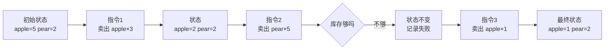

# 命令式编程（Imperative Programming）

@@DISCLAIMER@@

## 一句话定义

命令式编程就是**像写菜谱一样，按顺序给出一条条“改变状态”的指令**：先做什么、再做什么、满足什么条件就跳到哪里。

## 为什么重要

- 它是**计算机实际工作的方式**：CPU 一条条执行指令、读写内存。所有其他范式最终都要被翻译成命令式的机器码。
- 它是**几乎所有人学编程的起点**：变量、赋值、`if`、`for`、`while` 都是命令式的基本元素。
- 读懂命令式代码的关键能力——**在脑中跟踪状态变化**——也是调试的核心能力。

## 原理 / 图解

命令式程序 = **状态**（变量的当前值） + **改变状态的语句序列** + **控制流**（顺序、分支、循环）。

**过程式（Procedural）**是命令式的一个子类：把指令序列打包成“过程/函数”复用，C 语言是代表。【有据可查】维基百科对二者关系的说明：<https://en.wikipedia.org/wiki/Imperative_programming>

## 可运行示例

一个库存扣减的小程序，每一步都打印状态的变化（Python 3.15.0 实际运行）：

@@CODE:02_imperative.py@@

输出：

@@OUT:02_imperative@@

这段代码的“命令式特征”：有一个**被不断修改的字典 `stock`**，每一步的结果依赖之前所有步骤——如果第 1 步出错，后面全错。这既是它直观的原因，也是它难以并行和测试的原因。

## 常见误区

- **“命令式 = 落后”**：性能敏感的内核代码（CUDA kernel、数据库引擎内部）大多是命令式，因为它对内存和执行顺序有最精细的控制。
- **到处共享可变全局变量**：命令式最大的风险是“谁都能改状态”。【社区共识】把状态限制在函数或对象内部，是控制复杂度的第一步。
- **把“命令式”和“过程式”混为一谈**：过程式是命令式加上“函数封装”，OOP 也属于命令式家族（对象的方法同样在改状态）。

## 与 AI 开发的关系

- **训练循环本质上是命令式的**：`for batch in loader: loss = ...; loss.backward(); optimizer.step()`——每一步都在修改模型参数这个巨大的“状态”。
- **Jupyter Notebook 的坑来自命令式**：单元格可乱序执行，全局状态被反复修改，导致“我这里能跑、重启内核就不行”。【社区共识】
- **让 AI 生成脚本时**，命令式脚本最容易被人读懂和审查，适合一次性的数据处理任务。

## 延伸阅读

- 维基百科 Imperative programming：<https://en.wikipedia.org/wiki/Imperative_programming>
- Python 教程“控制流”一章：<https://docs.python.org/3/tutorial/controlflow.html>

## 无法核实 / 待考察点

- 【待考察/推测】“命令式比声明式更容易出 bug”的说法流传很广，但没有找到严格对照实验支持，本文不作此断言。
