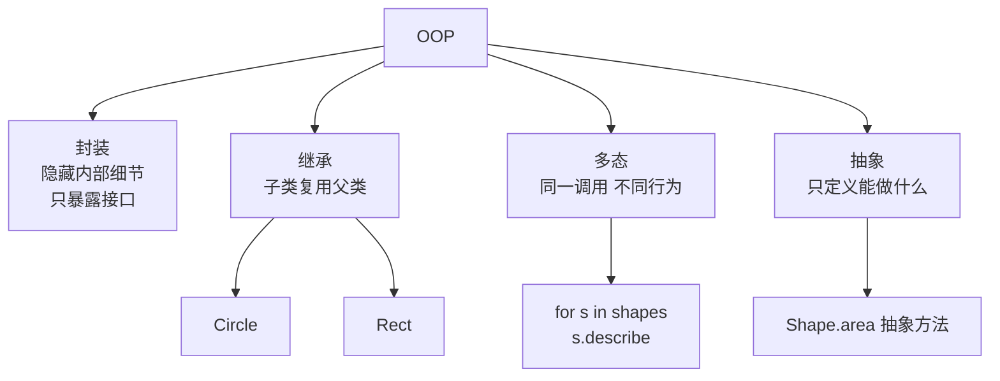

# 面向对象编程（OOP, Object-Oriented Programming）

@@DISCLAIMER@@

## 一句话定义

面向对象编程把程序组织成一群**“对象”——每个对象把数据（属性）和操作这些数据的行为（方法）打包在一起**，对象之间通过调用彼此的方法来协作。

## 为什么重要

- **管理复杂状态**：一个数据库连接、一个聊天会话、一个神经网络层，都有“自己的数据 + 自己的操作”，用对象表达最自然。
- **主流框架的骨架**：Django 的 Model、PyTorch 的 `nn.Module`、scikit-learn 的 `fit/predict` 接口都是 OOP。
- **设计模式与 SOLID 的基础**：不理解 OOP，就读不懂 [[k1.prog.design-patterns]] 与 [[k1.prog.solid]]。

## 原理 / 图解

OOP 四要素：

Python 的 OOP 有自己的特点：

| 特点 | 说明 |
|---|---|
| 一切皆对象 | 整数、函数、类本身都是对象（见 [[k1.py.object-reference]]） |
| 封装靠约定 | 没有真正的 `private`，单下划线 `_x` 表示“内部使用”，双下划线 `__x` 会触发名字改写 |
| 鸭子类型 | “走起来像鸭子就是鸭子”，不要求显式继承接口；配合 `typing.Protocol` 做静态检查 |
| 抽象基类 | `abc.ABC` + `@abstractmethod` 防止未实现的类被实例化 |

【有据可查】Python 官方教程“类”一章：<https://docs.python.org/3/tutorial/classes.html> ；`abc` 模块：<https://docs.python.org/3/library/abc.html>

## 可运行示例

@@CODE:05_oop.py@@

输出（Python 3.15.0）：

@@OUT:05_oop@@

注意第三行：抽象类 `Shape` 不能直接实例化，Python 在**创建对象时**就报错，提醒你漏实现了 `area`。

## 常见误区

- **继承层级过深**：五六层继承让人不知道某个方法到底来自哪里。【社区共识】“组合优于继承”（Favor composition over inheritance）出自《设计模式》（GoF, 1994）一书的原则之一——示例中 `Car` *有一个* `Engine` 而不是 *是一个* `Engine`。
- **为每个东西都写类**：只有一个方法、没有状态的类，通常应该是一个函数。【社区共识】Jack Diederich 的 PyCon 2012 演讲 *Stop Writing Classes* 专门讲这一点：<https://www.youtube.com/watch?v=o9pEzgHorH0>
- **getter/setter 泛滥**：Python 用 `@property` 就能在不改接口的情况下加校验，不必一开始就写 `get_x()/set_x()`。
- **把“对象”理解成“现实世界的实体”**：很多好用的对象是纯技术概念（迭代器、上下文管理器、策略），不对应现实物体。

## 与 AI 开发的关系

- **PyTorch 模型就是对象**：`class MyNet(nn.Module)` 中 `__init__` 定义层（状态 = 参数），`forward` 定义行为；`model.train()/eval()` 切换内部状态。【有据可查】<https://docs.pytorch.org/docs/stable/generated/torch.nn.Module.html>
- **scikit-learn 的统一接口**（`fit` / `predict` / `transform`）是多态的经典案例：换模型只换类名，其余代码不变。【有据可查】<https://scikit-learn.org/stable/developers/develop.html>
- **LLM 客户端抽象**：把 OpenAI、Claude、本地模型包装成同一个接口（多态），业务代码就不绑定某家厂商。

## 延伸阅读

- Python 教程·类：<https://docs.python.org/3/tutorial/classes.html>
- Python 数据模型（魔术方法的权威说明）：<https://docs.python.org/3/reference/datamodel.html>
- Luciano Ramalho,《流畅的 Python》（第 2 版，2022）第 11～14 章

## 无法核实 / 待考察点

- 【待考察/推测】“OOP 一词由 Alan Kay 提出”是广泛流传的说法，具体首次使用时间（约 1966–1967 年）各处说法不一，未核实原始资料。
