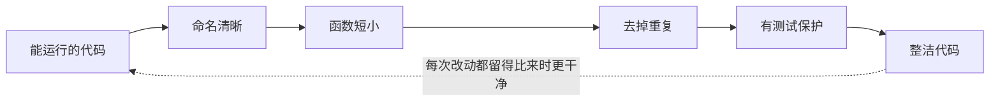

# Clean Code（整洁代码）

@@DISCLAIMER@@

## 一句话定义

Clean Code 指**让别人（包括三个月后的你）能快速读懂、放心修改的代码**：名字说清意图、函数短小专注、没有多余的惊喜。

## 为什么重要

- **代码被读的次数远多于被写的次数**。【有据可查】PEP 8 开篇即引用 Guido 的观点：“代码被阅读的频率远高于被编写的频率”：<https://peps.python.org/pep-0008/>
- **整洁度直接决定修改成本**：难懂的代码让每次改动都提心吊胆，bug 也躲在难懂的地方。
- **AI 时代更重要**：AI 能飞快生成代码，人类的主要工作变成“读和审”。可读性差的代码，人审不动，AI 也更容易改错。

## 原理 / 图解

【有据可查】“Clean Code”一词因 Robert C. Martin 2008 年的同名书籍而流行（Prentice Hall 出版）；第 2 版由 Addison-Wesley 于 2025 年 9～10 月出版（各渠道标注日期不同），据出版社介绍为全面重写，涵盖多种语言（含 Python），并新增“AI 编程工具的高效使用”等内容：<https://www.informit.com/store/clean-code-a-handbook-of-agile-software-craftsmanship-9780135398579>下面是社区里最常被引用的几条实践：

| 方面 | 做法 | 反例 |
|---|---|---|
| 命名 | 名字回答“是什么、为什么” | `d`、`tmp2`、`data_list_new` |
| 函数 | 短、只做一件事、参数少 | 300 行、7 个参数、带布尔开关参数 |
| 注释 | 解释“为什么”，而不是复述“做什么” | `i += 1  # i 加 1` |
| 结构 | 早返回，减少嵌套 | 五层 `if` 嵌套 |
| 一致性 | 遵守团队风格（Python 用 PEP 8 + 格式化器） | 同一项目混用三种命名风格 |

【社区共识】“童子军规则”：离开营地时让它比来时更干净——每次提交顺手改善一点，而不是攒成“大重写”。

## 可运行示例

同一个功能的两种写法，并用断言证明行为完全一样（Python 3.15.0 实际运行）：

@@CODE:08_clean_code.py@@

输出：

@@OUT:08_clean_code@@

第二版更长，但读名字就知道它在干什么：**整洁不等于短**。

## 常见误区

- **“整洁 = 越短越好”**：一行塞进三层推导式的“聪明代码”是可读性的敌人。
- **把书里的规则当法律**：如“函数不超过 N 行”。【社区共识】Clean Code 一书的部分建议（极短函数、大量小类）在社区有争议，例如 qntm 的长文 *It's probably time to stop recommending Clean Code*（2020）：<https://qntm.org/clean> 。应理解原则背后的目的，再结合语言和团队习惯取舍。
- **手工调格式**：格式问题交给工具。【有据可查】Ruff 可同时做 lint 与格式化：<https://docs.astral.sh/ruff/>
- **注释越多越好**：过时的注释比没有注释更糟。好的命名能替代大部分“做什么”的注释。

## 与 AI 开发的关系

- **AI 生成的代码常见“不整洁”**：变量名泛化（`result`、`data`）、重复代码、过度防御的 `try/except`。审查 AI 代码时把 Clean Code 清单当检查表。【社区共识】
- **整洁代码更利于 AI 理解上下文**：清晰的函数名和类型提示能让编程助手给出更准确的补全和修改。【待考察/推测】这一点符合直觉，但未找到严格的对照实验。
- **在提示词里写明规范**：如“遵循 PEP 8，函数不超过 30 行，使用描述性命名，加类型提示”，或在项目里放规则文件（如 `AGENTS.md`、编辑器规则文件）让 AI 持续遵守。

## 延伸阅读

- PEP 8 – Python 代码风格指南：<https://peps.python.org/pep-0008/>
- Google Python 风格指南：<https://google.github.io/styleguide/pyguide.html>
- Robert C. Martin,《代码整洁之道》（2008；第 2 版 2025）
- qntm, *It's probably time to stop recommending Clean Code*：<https://qntm.org/clean>

## 无法核实 / 待考察点

- 【待考察/推测】《Clean Code》第 2 版中关于 AI 工具的具体观点本文未阅读原书核实，仅依据出版社简介。
- 【待考察/推测】“可读性提升 AI 代码修改准确率”缺少公开定量研究。
