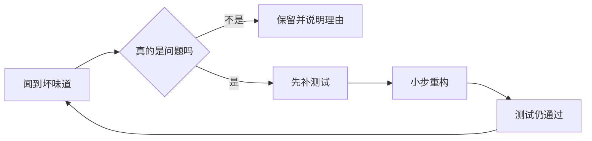

# 代码坏味道（Code Smell）

@@DISCLAIMER@@

## 一句话定义

代码坏味道是**代码表面上能运行、但暗示设计可能有问题的迹象**——就像冰箱里飘出的怪味，不一定已经坏了，但值得打开看看。

## 为什么重要

- **它是重构的“报警器”**：坏味道告诉你“哪里该重构”，[[k1.prog.refactoring]] 告诉你“怎么重构”。
- **可以部分自动化检测**：很多坏味道（过长函数、参数过多、重复代码、魔法数字）能用静态分析工具发现。
- **审查 AI 代码的速查表**：AI 生成的代码特别容易出现“重复代码”和“过长函数”。

## 原理 / 图解

【有据可查】“Code Smell”一词由 Kent Beck 提出，经 Martin Fowler《重构》（1999）一书流行：<https://martinfowler.com/bliki/CodeSmell.html> 。Fowler 强调：坏味道是“容易被发现的表面迹象”，**不一定**意味着问题。

常见坏味道与对应的重构手法：

| 坏味道 | 表现 | 典型重构手法 |
|---|---|---|
| 过长函数 Long Function | 一个函数几十上百行 | 提炼函数 Extract Function |
| 过长参数列表 | 5 个以上参数 | 引入参数对象、保留整个对象 |
| 重复代码 Duplicated Code | 复制粘贴的逻辑 | 提炼函数 / 上移方法 |
| 魔法数字 | 代码里出现 `86400`、`0.17` | 用具名常量替换 |
| 发散式变化 | 一个类因多种原因被改 | 拆分类（对应 SRP） |
| 霰弹式修改 | 一个需求要改十个文件 | 搬移函数，把相关逻辑聚到一起 |
| 依恋情结 Feature Envy | 函数老是访问别的对象的数据 | 把函数搬到那个对象里 |
| 基本类型偏执 | 用字符串/字典表示一切 | 引入小类或 dataclass |

## 可运行示例

用 Python 标准库 `ast`（抽象语法树）写一个迷你坏味道检测器，检测“过长函数、参数过多、魔法数字”（Python 3.15.0 实际运行）：

@@CODE:09_code_smell.py@@

输出：

@@OUT:09_code_smell@@

真实项目里不用自己写——【有据可查】Ruff 的 `PLR0913`（参数过多）、`PLR2004`（魔法值比较）、`C901`（复杂度过高）等规则可直接启用：<https://docs.astral.sh/ruff/rules/>

## 常见误区

- **“有坏味道就必须改”**：坏味道是提示，不是判决。性能关键路径上的长函数、与协议一一对应的大量参数，可能是合理的。
- **只靠工具**：工具擅长“过长、过多、重复”，但发现不了“名字误导”“抽象层次错乱”这类需要理解业务的坏味道。
- **一次性大扫除**：把全项目的坏味道一次改完，风险极高。应结合需求逐步改善。

## 与 AI 开发的关系

- **AI 代码的高频坏味道**：重复代码（每次生成一份相似的工具函数）、过度宽泛的异常捕获、过长函数、无用的注释与死代码。【社区共识】
- **反过来让 AI 当“嗅探器”**：把文件交给 AI 并要求“按 Fowler 坏味道清单列出问题，按严重度排序，不要直接改”，是效率很高的用法——但结论仍需人判断。【社区共识】
- **Notebook 坏味道**：全局变量满天飞、单元格依赖隐藏状态，是数据科学代码最典型的问题。

## 延伸阅读

- Martin Fowler, *CodeSmell*：<https://martinfowler.com/bliki/CodeSmell.html>
- Refactoring.Guru 坏味道目录：<https://refactoring.guru/refactoring/smells>
- Python `ast` 模块：<https://docs.python.org/3/library/ast.html>
- Ruff 规则列表：<https://docs.astral.sh/ruff/rules/>

## 无法核实 / 待考察点

- 【待考察/推测】示例中“20 行、5 个参数”的阈值是演示用，不同工具默认阈值不同（如 Pylint 默认 `max-args=5`），未逐一核对。
