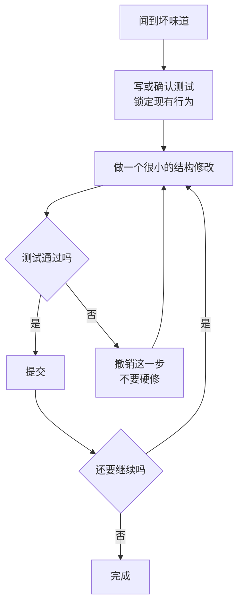

# 重构（Refactoring）

@@DISCLAIMER@@

## 一句话定义

重构是**在不改变软件外部行为的前提下，改善代码内部结构**的一系列小步修改——用户感觉不到任何变化，但代码变得更好读、更好改。

## 为什么重要

- **对抗“代码腐烂”**：需求不断叠加，代码自然会变乱。持续的小重构让项目保持可修改。
- **让新功能更容易加**：【社区共识】Kent Beck 的名言“先让改动变容易（这可能很难），再做那个容易的改动”（make the change easy, then make the easy change）。
- **它有明确的方法论**：不是“随便改改”，而是一套有名字、有步骤、可验证的手法。

## 原理 / 图解

【有据可查】Martin Fowler 在《重构》中给出定义：“对软件内部结构的一种调整，目的是在不改变其可观察行为的前提下，提高其可理解性，降低其修改成本。”第 2 版（2018）改用 JavaScript 示例。手法目录见：<https://refactoring.com/catalog/>

重构的安全循环：

| 常用手法 | 什么时候用 |
|---|---|
| 提炼函数 Extract Function | 一段代码需要注释才能看懂 |
| 内联函数 Inline Function | 函数体和名字一样清楚，多一层没意义 |
| 提炼变量 / 以查询取代临时变量 | 复杂表达式难懂 |
| 改名 Rename | 名字不再准确（最简单、收益最高） |
| 以多态取代条件表达式 | 同一个 `if type == ...` 出现在多处 |
| 用常量 / 查表替代魔法数字和分支 | 示例中的 `UNIT_PRICE` |

**特征测试（Characterization Test）**：给没有测试的旧代码先写测试，记录它“现在实际怎么表现”（哪怕有 bug），用来保证重构不改变行为。【有据可查】这一术语来自 Michael Feathers《修改代码的艺术》（*Working Effectively with Legacy Code*, 2004）。

## 可运行示例

把有重复分支的 `price_v1` 重构为查表 + 提炼函数的 `price_v2`，用特征测试证明行为不变（Python 3.15.0 实际运行）：

@@CODE:10_refactoring.py@@

输出：

@@OUT:10_refactoring@@

注意测试覆盖了边界 `qty=10`（不打折）和 `qty=11`（打折）——**边界值是重构最容易悄悄改错的地方**。

## 常见误区

- **把“重写”叫重构**：推倒重来不是重构。重构的每一步都保持系统可运行、测试可通过。
- **重构和加功能混在一个提交里**：出了问题无法判断是哪部分引起的。【社区共识】Kent Beck 的“两顶帽子”：同一时间只戴“加功能”或“重构”其中一顶。
- **没有测试就重构**：没有测试的“重构”其实是“祈祷式修改”。
- **以为重构会让程序变慢**：大多数重构对性能影响可忽略；真有性能问题，先测量（profiling）再优化。

## 与 AI 开发的关系

- **AI 很擅长机械重构**（改名、提炼函数、加类型提示），但也会“顺手”改变行为（调整默认值、吞掉异常）。【社区共识】让 AI 重构前先让它写特征测试，或要求“只做结构修改，列出所有行为变化”。
- **IDE 的自动重构更可靠**：改名、移动文件等用 IDE / 语言服务器的确定性重构，比让 LLM 改文本更安全。
- **Notebook → 模块**：把实验 Notebook 重构成可复用的 Python 模块（提炼函数、去掉全局状态），是 AI 项目从原型走向生产的关键一步。

## 延伸阅读

- Martin Fowler 重构手法目录：<https://refactoring.com/catalog/>
- Martin Fowler,《重构：改善既有代码的设计》（第 2 版，2018）
- Michael Feathers,《修改代码的艺术》（2004）
- Python `unittest`：<https://docs.python.org/3/library/unittest.html>

## 无法核实 / 待考察点

- 【待考察/推测】“make the change easy, then make the easy change”出自 Kent Beck 2012 年左右的一条推文，原帖链接未核实。
