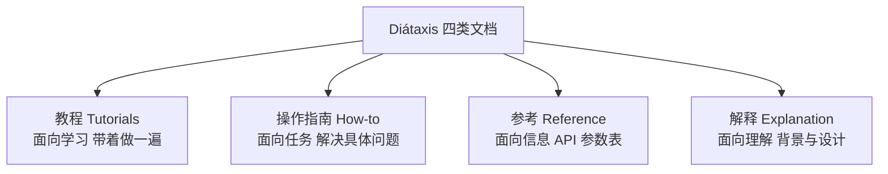

# 文档（Documentation）

@@DISCLAIMER@@

## 一句话定义

软件文档是**写给人（和越来越多地写给 AI）看的、说明代码“是什么、怎么用、为什么这样设计”的文字**，从函数的 docstring 到项目的 README，再到完整的用户手册。

## 为什么重要

- **代码只能说明“怎么做”，说不清“为什么”**：为什么选这个算法、为什么这个参数不能为 0，需要文档。
- **降低使用门槛**：一个好 README 能让新人十分钟跑起项目；没有文档的开源项目基本没人用。
- **AI 编程助手会读文档**：docstring、类型提示、README、项目规则文件都会进入 AI 的上下文，文档质量直接影响 AI 的输出质量。

## 原理 / 图解

【有据可查】Diátaxis 框架把技术文档分为四类，各自满足不同需求：<https://diataxis.fr/>

代码层面的文档层次：

| 层次 | 载体 | 写什么 |
|---|---|---|
| 行内 | 注释 `#` | 为什么这样写（非显而易见的原因） |
| 函数 / 类 | docstring | 做什么、参数、返回值、异常、示例 |
| 模块 / 包 | 模块 docstring、`__init__.py` | 这个模块负责什么 |
| 项目 | README、CHANGELOG、CONTRIBUTING | 怎么安装、怎么用、怎么贡献 |
| 系统 | 架构文档、ADR（架构决策记录） | 关键设计决策与取舍 |

【有据可查】Python 的 docstring 约定见 PEP 257：<https://peps.python.org/pep-0257/> 。常见的 docstring 风格有 Google 风格、NumPy 风格和 reStructuredText 风格。

## 可运行示例

一个 Google 风格的 docstring，其中的示例同时是**可执行的测试**（doctest），并用 `help()` 查看（Python 3.15.0 实际运行）：

@@CODE:11_documentation.py@@

输出：

@@OUT:11_documentation@@

doctest 的价值：**文档里的示例一旦和代码不一致，测试就会失败**，从而避免“文档过时”。【有据可查】<https://docs.python.org/3/library/doctest.html>

## 常见误区

- **注释复述代码**：`x = x + 1  # x 加 1` 毫无价值。注释应解释意图和原因。
- **只写 API 参考，不写教程**：参数表很全，但新人不知道从哪开始——这正是 Diátaxis 要解决的问题。
- **文档与代码分离太远**：放在别处的 Wiki 很快过时。【社区共识】“文档即代码（Docs as Code）”：文档和代码放在同一仓库、同一评审流程里。
- **README 里写死版本号和截图却从不更新**。

## 与 AI 开发的关系

- **AI 规则文件是一种新型文档**：如 `AGENTS.md`、各编辑器的项目规则文件，用来告诉编程助手项目约定、构建命令、禁止事项。【有据可查】AGENTS.md 约定的说明站点：<https://agents.md/>
- **`llms.txt`**：一些网站提供面向 LLM 的精简文档入口。【有据可查】提案站点：<https://llmstxt.org/> 【待考察/推测】各大模型/工具是否实际读取 llms.txt 尚无统一说法。
- **让 AI 写文档**效率很高，但必须核对：AI 容易编造不存在的参数或夸大功能。doctest 可以自动核对其中的示例。
- **RAG 的质量取决于文档质量**：企业知识库问答效果差，往往根子在原始文档本身结构混乱。【社区共识】

## 延伸阅读

- Diátaxis：<https://diataxis.fr/>
- PEP 257 – Docstring 约定：<https://peps.python.org/pep-0257/>
- Google Python 风格指南·注释与 docstring：<https://google.github.io/styleguide/pyguide.html#38-comments-and-docstrings>
- Sphinx 文档工具：<https://www.sphinx-doc.org/>；MkDocs：<https://www.mkdocs.org/>

## 无法核实 / 待考察点

- 【待考察/推测】AGENTS.md 与 llms.txt 都是较新的社区约定，被哪些工具正式支持、支持到什么程度变化很快，本文未逐一核实。
