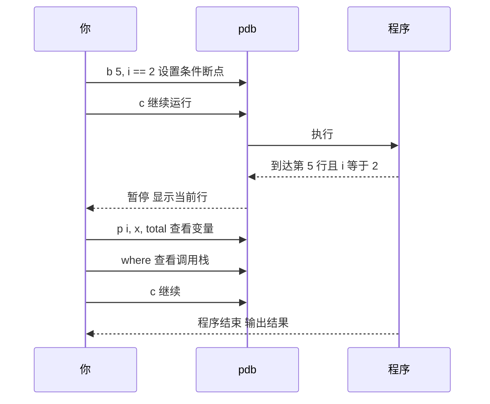

# 断点（Breakpoint）与交互式调试器

@@DISCLAIMER@@

## 一句话定义

断点是**让程序运行到指定位置时暂停下来的标记**，暂停后你可以查看所有变量、一步步执行、甚至修改值，就像给运行中的程序按下“暂停键”再拿放大镜看。

## 为什么重要

- **比 print 信息量大得多**：一次暂停就能看到当前所有局部变量、调用栈，不用反复加 print 再重跑。
- **适合复杂状态**：循环第 1000 次才出错？用条件断点，只在那一次停下。
- **理解陌生代码的利器**：在框架源码里打断点，单步跟进，比读文档更快理解它在干什么。

## 原理 / 图解

【有据可查】Python 3.7 起内建 `breakpoint()` 函数（PEP 553），默认进入 `pdb`；可通过环境变量 `PYTHONBREAKPOINT` 切换调试器或设为 `0` 全局禁用：<https://peps.python.org/pep-0553/> ；pdb 命令参考：<https://docs.python.org/3/library/pdb.html>

pdb 常用命令速查：

| 命令 | 作用 | 命令 | 作用 |
|---|---|---|---|
| `b 行号[, 条件]` | 设置（条件）断点 | `n` | 下一行（不进入函数） |
| `c` | 继续到下一个断点 | `s` | 单步进入函数 |
| `p 表达式` | 打印值 | `r` | 运行到当前函数返回 |
| `pp` | 美化打印 | `w` / `where` | 显示调用栈 |
| `l` / `ll` | 显示源码 | `u` / `d` | 在栈帧间上下移动 |
| `interact` | 进入交互式 Python | `q` | 退出 |

## 可运行示例

为了能自动运行和截取输出，这里把命令“喂”给 pdb，而不是手动输入（Python 3.15.0 实际运行）：

@@CODE:14_breakpoint.py@@

输出：

@@OUT:14_breakpoint@@

解读：断点只在 `i == 2` 时触发，此时 `x=7`，`total=6`（即 5×0 + 6×1）；`where` 显示了从 pdb 入口到 `accumulate` 的调用栈。日常使用时更常见的写法是在代码里直接写一行 `breakpoint()`，或在 IDE（VS Code、PyCharm）里点击行号左侧设置断点。

【有据可查】Python 3.15 的 pdb 默认使用新的交互式 shell（带语法高亮等）：<https://docs.python.org/3.15/whatsnew/3.15.html>

## 常见误区

- **把 `breakpoint()` 提交进仓库**：线上服务会卡住等待输入。可用 Ruff 规则 `T100` 检查遗留的调试语句：<https://docs.astral.sh/ruff/rules/debugger/>
- **在多进程 / 远程环境里用不了就放弃**：远程调试可以用 `debugpy`（VS Code 的 Python 调试后端）：<https://github.com/microsoft/debugpy>
- **只会“下一步”**：善用条件断点、`r`（运行到返回）、`u/d`（切换栈帧）能省大量时间。
- **断点调试并发/异步代码时误判**：暂停一个线程会改变时序，竞态问题可能因此“消失”，此时日志更可靠。

## 与 AI 开发的关系

- **调试训练代码**：在 `forward` 里打断点，检查每层输出的 `shape`、是否出现 `nan`，是定位模型 bug 的常用手段。
- **Jupyter 中调试**：`%debug` 魔法命令可以在异常发生后进入事后调试（post-mortem）。【有据可查】<https://ipython.readthedocs.io/en/stable/interactive/magics.html#magic-debug>
- **调试 Agent / LLM 应用**：在工具调用函数入口打断点，可以看到模型实际传进来的参数——常常会发现模型给的 JSON 和你预想的不一样。
- **Agent 自己用调试器**【待考察/推测】：已有研究和工具让编程 Agent 调用 pdb 等调试器，但效果和普及程度尚无定论。

## 延伸阅读

- PEP 553 – Built-in breakpoint()：<https://peps.python.org/pep-0553/>
- pdb 文档：<https://docs.python.org/3/library/pdb.html>
- VS Code Python 调试：<https://code.visualstudio.com/docs/python/debugging>

## 无法核实 / 待考察点

- 【待考察/推测】Python 3.15 pdb 新 shell 的具体交互差异（快捷键、补全）未逐项实测。
