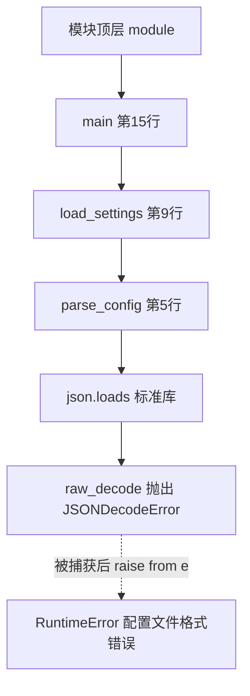

# 栈追踪（Stack Trace / Traceback）

@@DISCLAIMER@@

## 一句话定义

栈追踪是**程序出错时打印出的“事故现场报告”**：从最外层调用一路列到出错的那一行，告诉你“谁调用了谁、在哪一行、因为什么异常而崩溃”。

## 为什么重要

- **它是最重要的调试线索**，而且是免费的——不用加任何代码就有。
- **看懂它能省下大量时间**：很多新手看到一大片红字就慌，其实答案常常就写在最后一行。
- **也是向别人（或 AI）求助时最该附上的信息**。

## 原理 / 图解

每次函数调用会在**调用栈**上压入一个“栈帧”（记录函数名、文件、行号、局部变量）。出错时，Python 从栈底到栈顶打印这些帧：

**阅读顺序口诀**：

1. **先看最后一行**：异常类型 + 消息（`RuntimeError: 配置文件格式错误`）。
2. **往上找你自己的代码**：标准库和第三方库的帧通常不是问题根源。
3. **看异常链**：“The above exception was the direct cause of the following exception” 表示前一个异常是后一个异常的**直接原因**（用了 `raise ... from e`）；若写的是 “During handling of the above exception, another exception occurred”，则表示在处理异常时又出了新错。

【有据可查】Python 3.11 起，traceback 用 `~~~^^^` 精确标出出错的表达式位置（PEP 657）：<https://peps.python.org/pep-0657/> ；`traceback` 模块文档：<https://docs.python.org/3/library/traceback.html>

## 可运行示例

一个“配置文件多了个逗号”的错误，经过两层包装后的完整栈追踪，以及用 `traceback` 模块程序化地分析它（Python 3.15.0 实际运行）：

@@CODE:15_stack_trace.py@@

输出（Python 解释器路径已简写为 `<python3.15>`）：

@@OUT:15_stack_trace@@

几个细节：

- `~~~~~~~~~~^^^^^^` 指出了具体是哪个子表达式出错。
- 原始错误 `Illegal trailing comma before end of object: line 1 column 21` 精确到了第 21 列——这正是那个多余的逗号。
- 因为用了 `from e`，原始的 `JSONDecodeError` 被完整保留，没有丢失根因。

## 常见误区

- **只看第一行或中间某行**：根因在最后一行，位置在“最后一个属于你代码的帧”。
- **截图发给别人**：应复制文本，方便搜索和让 AI 解析。
- **`raise NewError(...)` 不加 `from e`**：在 `except` 块中直接抛新异常时 Python 仍会保留上下文（显示为“During handling…”），但用 `from e` 能更明确地表达因果；`from None` 则会刻意隐藏原始异常，只在原始异常确实无用时使用。
- **用 `print(e)` 代替完整栈**：只打印消息会丢失位置信息。记录日志时应使用 `logger.exception(...)`（见 [[k1.prog.logging]]）。

## 与 AI 开发的关系

- **深度学习的栈追踪很长**：PyTorch 报错常穿过几十层框架代码。重点找你自己的 `forward`/训练循环那一帧，以及最后的形状/设备信息（如 `mat1 and mat2 shapes cannot be multiplied`）。
- **CUDA 错误是异步报告的**：GPU 报错时栈追踪指向的行可能不是真正出错的地方。【有据可查】PyTorch 文档建议设置 `CUDA_LAUNCH_BLOCKING=1` 同步执行以定位：<https://docs.pytorch.org/docs/stable/notes/cuda.html>
- **把栈追踪交给 AI 时**：贴完整文本、说明你的代码是哪几帧、附上相关代码片段；注意先**删除栈追踪中可能出现的密钥、内网路径、用户数据**。

## 延伸阅读

- Python 教程·错误和异常：<https://docs.python.org/3/tutorial/errors.html>
- `traceback` 模块：<https://docs.python.org/3/library/traceback.html>
- PEP 657 – 精确错误位置：<https://peps.python.org/pep-0657/>
- PEP 3134 – 异常链与 `__cause__`：<https://peps.python.org/pep-3134/>

## 无法核实 / 待考察点

- 【待考察/推测】JSON 解码错误消息的措辞（如 “Illegal trailing comma…”）随 Python 版本可能不同，本文输出来自 3.15.0。
