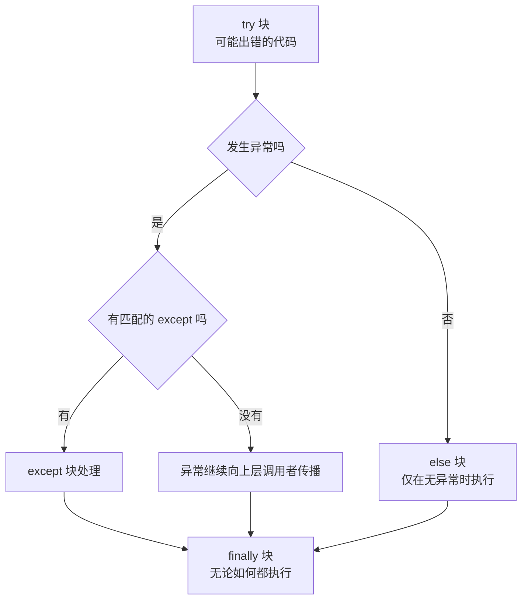

# 异常处理（Exception Handling）

@@DISCLAIMER@@

## 一句话定义

异常处理是**程序遇到意外情况时，有组织地“报告问题—传递问题—在合适的地方处理问题”**的机制，在 Python 中由 `raise`、`try / except / else / finally` 构成。

## 为什么重要

- **现实世界充满意外**：文件不存在、网络超时、API 限流、用户输入乱码。没有异常处理，程序遇到第一个意外就崩溃。
- **错误处理写不好比不写更危险**：吞掉异常会让问题悄悄扩散，最后在完全无关的地方爆发。
- **是健壮性和可维护性的分水岭**：好的异常设计能让调用方一眼知道“可能出什么错、该怎么应对”。

## 原理 / 图解

【有据可查】Python 官方教程“错误和异常”：<https://docs.python.org/3/tutorial/errors.html> ；内建异常层级：<https://docs.python.org/3/library/exceptions.html#exception-hierarchy>

五个好习惯：

| # | 习惯 | 理由 |
|---|---|---|
| 1 | 定义领域内的自定义异常 | 调用方能精确捕获 `ConfigError`，而不是猜 `ValueError` 的含义 |
| 2 | `try` 块尽量小 | 只包住可能出错的那一行，避免误捕获 |
| 3 | 捕获具体异常 | 裸 `except:` 连 `KeyboardInterrupt` 都会吞掉 |
| 4 | `finally` 或 `with` 做清理 | 保证文件、连接、锁一定被释放（见 [[k1.py.context-manager]]） |
| 5 | 在“知道怎么办”的层级处理 | 底层抛出，上层决定重试、降级还是报错给用户 |

【有据可查】Python 3.11 引入 `ExceptionGroup` 与 `except*`（PEP 654），用于同时发生的多个异常，例如并发任务中多个子任务失败：<https://peps.python.org/pep-0654/>

## 可运行示例

@@CODE:16_exceptions.py@@

输出（Python 3.15.0）：

@@OUT:16_exceptions@@

> 注：输出里 `端口 = 8080` 出现在最后，是因为 `print` 写到标准输出（有缓冲），日志写到标准错误（无缓冲），两者被重定向到同一个文件时顺序会错开。这本身就是一个值得记住的调试小知识：**混用 print 与日志时，不要用输出顺序推断执行顺序**。

可以看到：

- `finally` 在每次调用中都执行了（4 条 “检查完毕”）。
- `{"port": "abc"}` 通过 `from e` 保留了原始的 `ValueError` 作为原因。
- `except*` 把一个异常组按类型分别处理。

## 常见误区

- **`except Exception: pass`**：最常见、最危险的写法。至少要记录日志，最好只捕获你能处理的异常。
- **用异常控制正常流程**：例如用异常代替 `if` 判断循环结束（迭代器协议的 `StopIteration` 是语言层面的特例）。不过 Python 社区也接受“EAFP（先做再请求原谅）”风格，如 `try: d[k] except KeyError:`，关键是不要滥用。【有据可查】EAFP 词条：<https://docs.python.org/3/glossary.html#term-EAFP>
- **捕获后重新抛出时丢失原因**：应使用 `raise NewError(...) from e`。
- **在 `finally` 里 `return`**：会吞掉正在传播的异常。【有据可查】Python 3.14 起对 `finally` 中的 `return/break/continue` 发出 `SyntaxWarning`（PEP 765）：<https://peps.python.org/pep-0765/>

## 与 AI 开发的关系

- **调用 LLM API 必须处理的异常**：超时、限流（HTTP 429）、服务端错误（5xx）、内容审核拒绝、输出格式不合法。通常的策略是：对**可重试**的错误（超时、429、部分 5xx）做带退避的有限次重试（见 [[k1.py.decorator]] 的 retry 示例），对**不可重试**的错误（认证失败、参数错误）立即报错。【社区共识】
- **结构化输出解析失败**：模型返回的 JSON 可能不合法。捕获 `json.JSONDecodeError` 或 Pydantic 的 `ValidationError`，再决定是否让模型重试修正。
- **并发调用中的多个失败**：`asyncio.TaskGroup` 中多个任务失败时会抛出 `ExceptionGroup`，需用 `except*` 处理（见 [[k1.py.async-await]]）。
- **AI 生成代码的通病**：过度使用 `try/except Exception`，把真实错误吞掉后返回一个“看起来正常”的默认值。评审时要重点检查。

## 延伸阅读

- 教程·错误和异常：<https://docs.python.org/3/tutorial/errors.html>
- 内建异常：<https://docs.python.org/3/library/exceptions.html>
- PEP 654 – Exception Groups：<https://peps.python.org/pep-0654/>
- PEP 765 – finally 中的控制流：<https://peps.python.org/pep-0765/>

## 无法核实 / 待考察点

- 【待考察/推测】各 LLM 厂商的错误码与“是否可重试”的划分不尽相同，应以各自 API 文档为准，本文只给通用原则。
