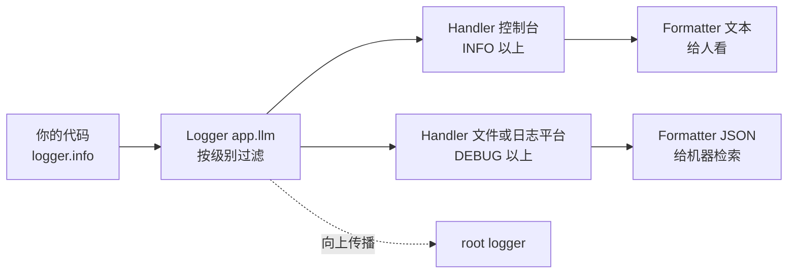

# 日志（Logging）

@@DISCLAIMER@@

## 一句话定义

日志是**程序在运行过程中按级别记录下来的事件流水账**，让你在事后（尤其是线上、无法打断点的环境）还原“当时发生了什么”。

## 为什么重要

- **线上没有调试器**：服务器上的程序出了问题，日志几乎是唯一线索。
- **比 print 强在哪**：有级别（可按需开关）、有时间和来源、可同时输出到多处（控制台、文件、日志平台）、可结构化检索。
- **可观测性的三大支柱之一**：日志（Logs）、指标（Metrics）、链路追踪（Traces）。【有据可查】OpenTelemetry 对这三类信号的定义：<https://opentelemetry.io/docs/concepts/signals/>

## 原理 / 图解

Python 标准库 `logging` 的核心组件：

| 级别 | 数值 | 用途 |
|---|---|---|
| DEBUG | 10 | 开发调试的细节（请求体大小、中间变量） |
| INFO | 20 | 正常的关键事件（服务启动、调用模型） |
| WARNING | 30 | 值得注意但不影响运行（接近限流、使用了默认值） |
| ERROR | 40 | 某个操作失败 |
| CRITICAL | 50 | 整个程序可能无法继续 |

【有据可查】`logging` 官方 HOWTO 与 Cookbook：<https://docs.python.org/3/howto/logging.html> 、<https://docs.python.org/3/howto/logging-cookbook.html>

## 可运行示例

两个 Handler：控制台给人看（文本、INFO 以上），内存缓冲给机器看（JSON、DEBUG 以上），并演示 `extra` 上下文、`logger.exception` 和密钥脱敏（Python 3.15.0 实际运行，示例 key 为伪造）：

@@CODE:17_logging.py@@

输出：

@@OUT:17_logging@@

观察：

- `DEBUG` 那条只出现在 JSON 中，控制台没有——**同一条日志，不同目的地按不同级别过滤**。
- `logger.exception` 自动附带了完整的栈追踪。
- `request_id` 让你能把同一请求的所有日志串起来。

## 常见误区

- **用 f-string 拼日志**：`logger.debug(f"x={big()}")` 即使 DEBUG 关闭也会计算 `big()`。推荐 `logger.debug("x=%s", x)` 的惰性格式化。【有据可查】<https://docs.python.org/3/howto/logging.html#optimization>
- **在库代码里调用 `logging.basicConfig`**：配置日志是应用程序的事，库只应 `getLogger(__name__)`。【有据可查】官方 HOWTO 的“为库配置日志”一节：<https://docs.python.org/3/howto/logging.html#configuring-logging-for-a-library>
- **日志里记录密钥、密码、完整用户隐私数据**：日志往往保存很久、权限更宽，是数据泄露的常见渠道。
- **什么都记**：日志太多等于没有日志，还会产生存储成本。
- **用 `print` 代替日志上线**。

## 与 AI 开发的关系

- **LLM 应用必须记录的东西**【社区共识】：模型名与版本、提示词模板版本、token 用量、延迟、请求 ID、工具调用参数与结果、错误与重试次数。没有这些就无法复现“为什么昨天好好的今天答错了”。
- **隐私与合规**：用户输入可能包含个人信息，记录前要脱敏或采样，并遵守所在地区的数据保护规定。
- **LLM 可观测平台**：如 Langfuse、LangSmith、Arize Phoenix，以及 OpenTelemetry 的生成式 AI 语义约定，把日志、链路追踪与 token 成本放在一起分析。【有据可查】OpenTelemetry GenAI 语义约定：<https://opentelemetry.io/docs/specs/semconv/gen-ai/>
- **训练日志**：训练损失、学习率等通常用 TensorBoard、Weights & Biases 等专用工具记录，而不是普通文本日志。

## 延伸阅读

- Logging HOWTO：<https://docs.python.org/3/howto/logging.html>
- Logging Cookbook：<https://docs.python.org/3/howto/logging-cookbook.html>
- structlog（结构化日志库）：<https://www.structlog.org/>
- OpenTelemetry 信号概念：<https://opentelemetry.io/docs/concepts/signals/>

## 无法核实 / 待考察点

- 【待考察/推测】OpenTelemetry GenAI 语义约定仍处于发展阶段，字段名可能变化，本文未核实其当前稳定性级别。
