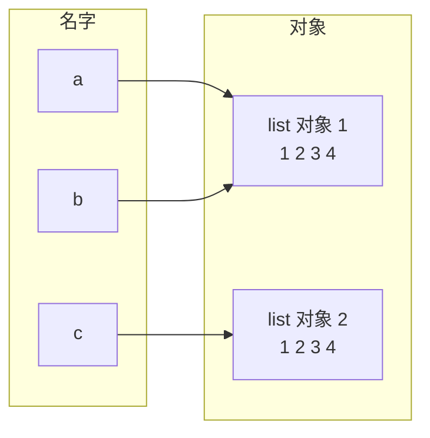

# 变量、对象与引用

@@DISCLAIMER@@

## 一句话定义

在 Python 里，**变量只是贴在对象上的“名字标签”**：赋值 `b = a` 不是复制一份数据，而是给同一个对象再贴一张标签。

## 为什么重要

- **一大类“灵异 bug”的根源**：“我只改了 b，怎么 a 也变了？”——因为 a 和 b 是同一个对象。
- **理解函数传参**：Python 传的是“对象引用”，函数内能修改可变对象，但不能让调用方的变量改指别处。
- **理解 NumPy 视图、Pandas Copy-on-Write、PyTorch 张量共享内存**的前提（见 [[k1.lib.numpy]]、[[k1.lib.pandas]]）。

## 原理 / 图解

【有据可查】Python 语言参考：“对象是 Python 对数据的抽象……每个对象都有标识（identity）、类型和值”；`is` 比较标识，`id()` 返回标识：<https://docs.python.org/3/reference/datamodel.html#objects-values-and-types>

| 操作 | 发生了什么 | 原对象受影响吗 |
|---|---|---|
| `b = a` | 新名字指向同一对象 | 是同一个对象 |
| `b.append(4)` | 原地修改对象 | 是（a 也看到） |
| `b = b + [4]` | 创建新对象，b 改指新对象 | 否 |
| `c = list(a)` / `a.copy()` / `copy.copy(a)` | 浅拷贝：新容器，内部元素仍共享 | 外层不受影响，内层可能受影响 |
| `copy.deepcopy(a)` | 递归复制所有层 | 完全独立 |

**`==` 与 `is`**：`==` 问“值相等吗”，`is` 问“是同一个对象吗”。判断 `None` 应使用 `is None`。【有据可查】PEP 8 建议与单例（如 None）比较时使用 `is`：<https://peps.python.org/pep-0008/#programming-recommendations>

## 可运行示例

@@CODE:18_object_reference.py@@

输出（Python 3.15.0）：

@@OUT:18_object_reference@@

关键观察：

- `rebind` 里 `lst = [...]` 只是让**函数内的名字**改指新列表，调用方的 `items` 不受影响；`add_item` 的 `append` 修改的是共享对象，所以调用方看得到。
- 浅拷贝 `shallow` 的内层列表与原对象共享，所以 `nested[0].append(99)` 也影响了它。

## 常见误区

- **“Python 是传值还是传引用？”**：都不准确。更准确的说法是“传对象引用”（call by object reference / call by sharing）。
- **用 `is` 比较数字或字符串**：`a is b` 对小整数和部分字符串可能为 True，这是 CPython 的缓存/驻留优化，不是语言保证。【有据可查】Python 3.8 起对字面量使用 `is` 会给出 `SyntaxWarning`。
- **以为 `copy()` 是深拷贝**：嵌套结构要用 `copy.deepcopy`。
- **把引用计数当作语言规范**：`sys.getrefcount` 是 CPython 的实现细节；【有据可查】官方文档明确提醒：返回值未必反映真实引用数（例如 3.12 起的“永生对象”引用计数极大），除 0 或 1 外不要依赖其准确性：<https://docs.python.org/3/library/sys.html#sys.getrefcount>

## 与 AI 开发的关系

- **NumPy 切片是视图，不是拷贝**：修改切片会修改原数组（见 [[k1.lib.numpy]] 示例的最后一行）。
- **PyTorch 张量**：`b = a` 共享同一张量；`a.view(...)` 共享存储；需要独立副本用 `a.clone()`。【有据可查】<https://docs.pytorch.org/docs/stable/tensor_view.html>
- **配置对象被意外共享**：多个实验共用同一个 `config` 字典，一个实验改了学习率，其他实验也跟着变——用 `copy.deepcopy(config)` 或不可变配置（frozen dataclass / `frozendict`）避免。
- **对话历史列表**：把同一个 `messages` 列表传给多个 Agent 并各自 `append`，会导致历史互相污染。

## 延伸阅读

- Python 数据模型：<https://docs.python.org/3/reference/datamodel.html>
- Ned Batchelder, *Facts and myths about Python names and values*（PyCon 2015）：<https://nedbatchelder.com/text/names1.html>
- `copy` 模块：<https://docs.python.org/3/library/copy.html>

## 无法核实 / 待考察点

- 【待考察/推测】示例中 `sys.getrefcount` 输出的 2 和 3 在 3.15.0 上实测成立，但其他版本或 free-threaded 构建上可能不同（free-threaded 构建使用了不同的引用计数方案）。
