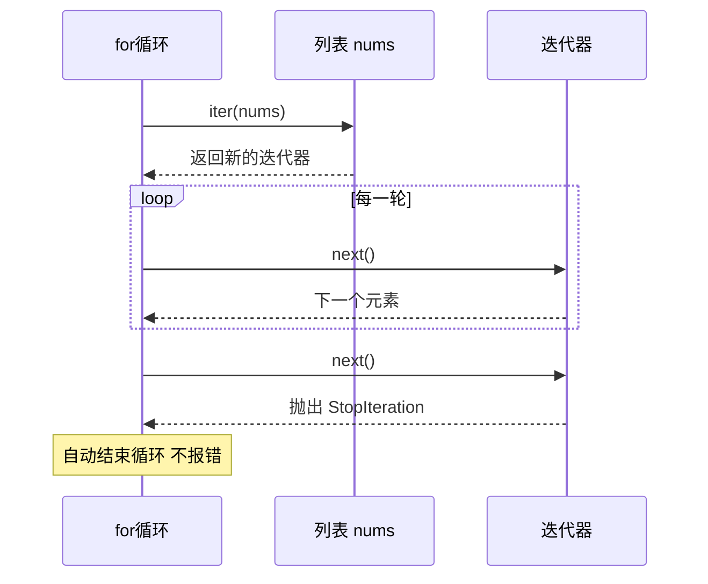

# 迭代器（Iterator）与可迭代对象

@@DISCLAIMER@@

## 一句话定义

**可迭代对象（iterable）是“能被逐个取出元素”的东西，迭代器（iterator）是“负责一个个往外递元素、并记住进度”的那个对象**——`for` 循环就是不停向迭代器要“下一个”，直到它说“没了”。

## 为什么重要

- **Python 里的 `for` 循环全靠它**：列表、字典、文件、数据库游标、DataLoader 都实现了迭代协议。
- **惰性计算的基础**：迭代器每次只产生一个元素，可以处理比内存大得多、甚至无限长的数据流。
- **理解“为什么第二次遍历是空的”**这类常见 bug。

## 原理 / 图解

【有据可查】迭代器协议：可迭代对象实现 `__iter__()` 返回迭代器；迭代器实现 `__next__()` 返回下一个元素，没有元素时抛出 `StopIteration`，并且其 `__iter__()` 返回自身：<https://docs.python.org/3/library/stdtypes.html#iterator-types> 、<https://docs.python.org/3/glossary.html#term-iterator>

| 概念 | 能否重复遍历 | 例子 |
|---|---|---|
| 可迭代对象（容器） | 能，每次 `iter()` 得到新迭代器 | list、dict、str、range |
| 迭代器 | 不能，用完就空 | `iter(list)`、文件对象、`map`、`zip`、生成器 |

## 可运行示例

@@CODE:20_iterator.py@@

输出（Python 3.15.0）：

@@OUT:20_iterator@@

`itertools.count` 是**无限**迭代器，但配合 `islice` 只取前 5 个，所以不会死循环——这就是惰性的威力。【有据可查】`itertools.batched` 自 Python 3.12 起可用：<https://docs.python.org/3/library/itertools.html#itertools.batched>

## 常见误区

- **把迭代器当列表用两次**：`m = map(f, xs)` 后先 `len(list(m))` 再 `for x in m`，第二次什么都没有。需要多次使用就先 `list()`。
- **在遍历列表时修改它**：边遍历边删除会跳过元素，应遍历副本或构造新列表。
- **手写 `__next__` 类**：大多数情况下用生成器（见 [[k1.py.generator]]）更简洁。
- **以为 `range` 是迭代器**：`range` 是可迭代的**序列**，可以重复遍历、支持索引和 `len`。

## 与 AI 开发的关系

- **PyTorch `DataLoader`** 是可迭代对象：每个 epoch `for batch in loader` 都会创建新的迭代器、重新打乱数据。【有据可查】<https://docs.pytorch.org/docs/stable/data.html>
- **流式数据集**：Hugging Face `datasets` 的 `streaming=True` 返回 `IterableDataset`，可以不下载完整数据集就开始逐条处理。【有据可查】<https://huggingface.co/docs/datasets/stream>
- **分批调用 API**：用 `itertools.batched(texts, 64)` 把大量文本按批送去做嵌入（embedding），控制每次请求大小。
- **LLM 流式输出**：SDK 返回的流对象通常是（同步或异步）迭代器，`for chunk in stream` 逐块拿到生成的文本。

## 延伸阅读

- 迭代器类型：<https://docs.python.org/3/library/stdtypes.html#iterator-types>
- `itertools`：<https://docs.python.org/3/library/itertools.html>
- PEP 234 – Iterators：<https://peps.python.org/pep-0234/>

## 无法核实 / 待考察点

- 【待考察/推测】Python 3.15 What's New 提到新增了支持并发访问迭代器的工具（`serialize_iterator`、`synchronized_iterator()`、`concurrent_tee()`），本文未实测，所属模块请以官方文档为准。
