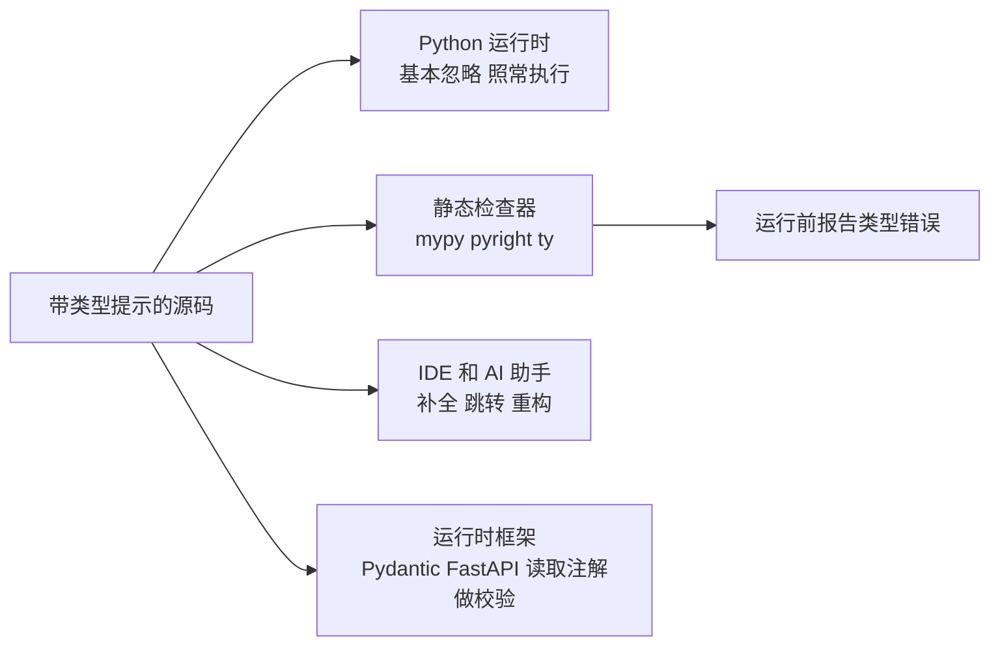

# 类型提示（Type Hints）

@@DISCLAIMER@@

## 一句话定义

类型提示是**写在代码里、说明“这个变量/参数/返回值应该是什么类型”的标注**（如 `def f(x: int) -> str`）；Python 运行时**不强制检查**它，但静态检查器、IDE、框架和 AI 助手都会利用它。

## 为什么重要

- **在运行前发现一类错误**：把字符串传给要整数的函数，mypy / pyright 在你保存文件时就能报出来。
- **代码即文档**：看签名就知道怎么调用，不用翻实现。
- **现代框架的基础**：FastAPI、Pydantic、Typer、SQLModel 都在**运行时读取类型提示**来做参数校验、生成 API 文档和 JSON Schema。
- **让 AI 更懂你的代码**：类型信息为编程助手提供了精确的上下文。

## 原理 / 图解

【有据可查】类型提示由 PEP 484 引入（Python 3.5），之后不断演进：PEP 526（变量注解）、PEP 544（Protocol）、PEP 589（TypedDict）、PEP 604（`X | Y`）、PEP 695（3.12 的 `type` 语句和 `def f[T]` 泛型语法）：<https://peps.python.org/pep-0484/> 、<https://peps.python.org/pep-0695/> ；typing 文档：<https://docs.python.org/3/library/typing.html>

常用写法速查：

| 需求 | 写法 |
|---|---|
| 基本类型 | `x: int`、`name: str`、`ok: bool` |
| 容器 | `list[str]`、`dict[str, float]`、`tuple[int, ...]` |
| 可能为空 | `str \| None` |
| 只能取几个值 | `Literal["system", "user", "assistant"]` |
| 字典结构 | `class Message(TypedDict): role: str; content: str` |
| 结构化接口（鸭子类型） | `class LLM(Protocol): def chat(...) -> str: ...` |
| 泛型函数（3.12+） | `def first[T](items: list[T]) -> T \| None` |
| 类型别名（3.12+） | `type Role = Literal[...]` |

## 可运行示例

**① 运行时**：类型提示不会阻止错误调用（Python 3.15.0 实际运行）：

@@CODE:24_type_hints.py@@

输出：

@@OUT:24_type_hints@@

`double("ab")` 返回了 `'abab'`——Python 没有拦它。

**② 静态检查**：同样的错误交给 mypy：

@@CODE:24b_type_errors.py@@

运行 `python -m mypy 24b_type_errors.py`（mypy 2.4.0）的真实输出：

@@OUT:24b_mypy@@

两处错误在**没有运行代码**的情况下就被发现了。

## 常见误区

- **以为加了类型提示就有运行时检查**：没有。需要运行时校验请用 Pydantic、`beartype` 等库，或在边界处手动校验。
- **到处写 `Any`**：`Any` 会关闭检查，等于没写。不确定时宁可写 `object` 并在使用前收窄类型。
- **追求 100% 精确的复杂类型**：过于复杂的类型标注会降低可读性。对外接口（公共函数签名）优先标注，内部临时变量可依赖推断。【社区共识】
- **用旧写法**：`List[str]`、`Optional[str]`、`Union[a, b]` 仍可用，但 Python 3.9+/3.10+ 推荐 `list[str]`、`str | None`。
- **把 Protocol 当 ABC 用**：Protocol 不要求显式继承，只要结构匹配即可（结构化子类型），而 ABC 要求继承。

## 与 AI 开发的关系

- **结构化输出与工具调用**：用 Pydantic 模型（基于类型提示）定义 LLM 输出的 JSON 结构，SDK 自动转为 JSON Schema 发给模型，并在返回后校验。【有据可查】Pydantic 文档：<https://docs.pydantic.dev/latest/concepts/json_schema/>
- **工具函数签名即工具说明**：Agent 框架常从函数的类型提示生成工具参数 schema，标注越准确，模型调用越准确（见 [[k1.py.decorator]]）。
- **多模型抽象**：用 `Protocol` 定义 `LLM` 接口，不同厂商的客户端只要“长得像”就能互换，静态检查器负责确认（见 [[k1.prog.solid]] 的依赖倒置）。
- **AI 生成代码的护栏**：在 CI 里跑 mypy/pyright，能自动拦截 AI 写出的类型不一致代码。
- **类型检查器在提速**：除 mypy、pyright 外，Astral 的 `ty`、Meta 的 `pyrefly` 等基于 Rust 的新检查器正在发展。【待考察/推测】它们的稳定性与覆盖度截至本文尚未逐一核实。

## 延伸阅读

- `typing` 文档：<https://docs.python.org/3/library/typing.html>
- Python 类型系统规范（typing spec）：<https://typing.python.org/en/latest/spec/>
- mypy 文档：<https://mypy.readthedocs.io/en/stable/>
- pyright：<https://github.com/microsoft/pyright>

## 无法核实 / 待考察点

- 【待考察/推测】Python 3.15 新增的 `TypeForm`（PEP 747）、带额外项的 `TypedDict`（PEP 728）在各检查器中的支持进度未核实。
- 【待考察/推测】`ty`、`pyrefly` 是否已发布正式稳定版未核实。
