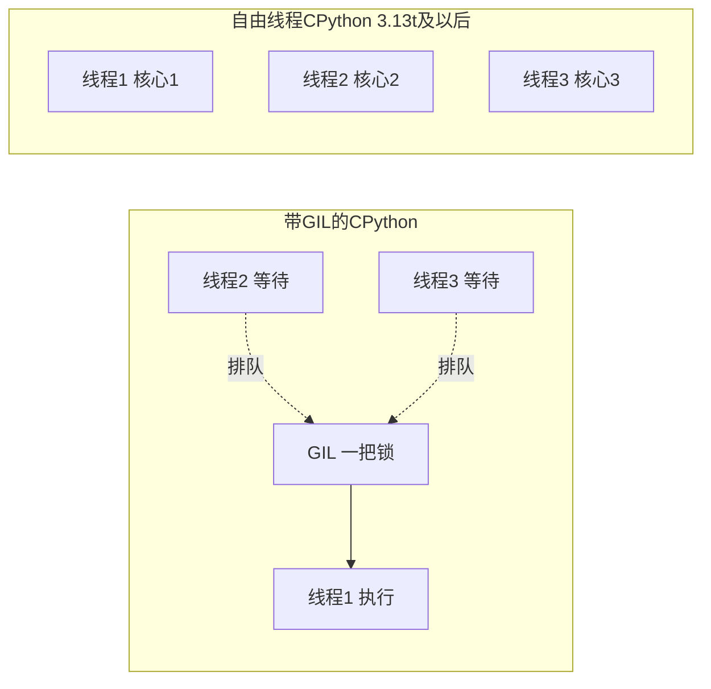

# 多线程（Threading）、GIL 与自由线程 Python

@@DISCLAIMER@@

## 一句话定义

多线程是**在同一个进程里同时运行多条执行流，它们共享同一块内存**；在传统 CPython 中，全局解释器锁（GIL）使同一时刻只有一个线程执行 Python 字节码，而 Python 3.13 起提供的“自由线程（free-threaded）”构建可以去掉 GIL。

## 为什么重要

- **I/O 并发的简单方案**：调用不支持 async 的库（如 `requests`、某些数据库驱动）时，线程池是最直接的并发方式。
- **Python 正在经历十几年来最大的并发变革**：GIL 可选化（PEP 703）让多线程首次有可能在纯 Python 代码上利用多核。
- **共享内存是双刃剑**：方便，但会引入竞态条件——这在去掉 GIL 后更容易暴露。

## 原理 / 图解

【有据可查】时间线：
- PEP 703（2023 年接受）提出让 GIL 可选：<https://peps.python.org/pep-0703/>
- Python 3.13（2024-10）：实验性提供 free-threaded 构建（`python3.13t`）。
- Python 3.14（2025-10-07）：free-threaded 构建转为**官方支持**（PEP 779），单线程性能损失约 5%～10%：<https://docs.python.org/3/whatsnew/3.14.html> 、<https://peps.python.org/pep-0779/>
- Python 3.15（2026-10-09）：为 free-threaded 构建提供稳定 ABI `abi3t`（PEP 803），官方 macOS 安装包默认安装自由线程支持：<https://docs.python.org/3.15/whatsnew/3.15.html>
- 官方使用指南：<https://docs.python.org/3/howto/free-threading-python.html>

| 场景 | 带 GIL | 自由线程构建 |
|---|---|---|
| I/O 等待（sleep、网络） | 有效（等待时释放 GIL） | 有效 |
| 纯 Python CPU 计算 | 基本无加速 | 可接近核数倍加速 |
| NumPy 等 C 扩展的重计算 | 很多操作会释放 GIL，有加速 | 有加速 |
| 无锁共享可变状态 | 仍不安全（只是不易暴露） | 不安全且更易暴露 |

## 可运行示例

同一个脚本分别用 Python 3.15.0 的默认构建和自由线程构建（`python3.15t`）运行：

@@CODE:27_threading.py@@

**默认构建（GIL 启用）** 输出：

@@OUT:27_threading@@

**自由线程构建（python3.15t，GIL 关闭）** 输出：

@@OUT:27_threading_ft@@

对比解读（同一台 8 核机器）：

1. **I/O 型**：两者都约 4 倍加速——等待期间线程不占用解释器。
2. **CPU 型**：默认构建只有约 1.3 倍，自由线程构建达到约 3.7 倍——这就是去掉 GIL 的意义。
3. **竞态条件**：默认构建下“不加锁”这次碰巧得到了正确结果 800000，**但这并不代表线程安全**——GIL 只是让线程切换没那么频繁；自由线程构建下四个线程真正同时读写，结果只有 314757，大量更新丢失。**两种构建下，加锁都得到正确结果。**

## 常见误区

- **“有 GIL 就不需要锁”**：GIL 保护的是解释器内部数据结构，不保护你的“读—改—写”逻辑。`count += 1` 本身也不是原子操作。
- **“自由线程 = 所有程序都变快”**：单线程程序反而略慢（约 5%～10%）；依赖的 C 扩展若未适配自由线程，可能会重新启用 GIL 或出现问题。【有据可查】官方 HOWTO 对“导入不兼容扩展时 GIL 会被重新启用”的说明：<https://docs.python.org/3/howto/free-threading-python.html>
- **线程开得越多越好**：线程有内存开销和切换开销；I/O 场景用线程池并设置合理上限。
- **在线程中修改 GUI 或 Streamlit 界面元素**：多数 UI 框架要求在主线程/脚本线程中更新界面。
- **调试多线程问题只靠断点**：断点会改变时序，日志 + 最小复现更可靠。

## 与 AI 开发的关系

- **并发调用同步 SDK**：`ThreadPoolExecutor(max_workers=8)` 批量调用只有同步接口的 API，是最省事的提速方式。
- **推理服务中的预处理/后处理**：自由线程构建有望让分词、特征处理等纯 Python 逻辑在多核上并行，减少对多进程的依赖。【待考察/推测】主流推理框架对自由线程构建的正式支持程度尚不明确。
- **生态适配进度**：NumPy、PyTorch 等已陆续提供 free-threaded（`cp3xt`）wheel，但并非所有库都已适配。【有据可查】社区维护的兼容性追踪：<https://py-free-threading.github.io/tracking/>
- **共享模型对象**：多个线程共用一个模型做推理时，要确认该框架的推理接口是否线程安全。

## 延伸阅读

- 官方 HOWTO：Python 自由线程支持：<https://docs.python.org/3/howto/free-threading-python.html>
- `threading` 文档：<https://docs.python.org/3/library/threading.html>
- 社区指南 Python Free-Threading Guide：<https://py-free-threading.github.io/>
- PEP 703：<https://peps.python.org/pep-0703/>

## 无法核实 / 待考察点

- 【待考察/推测】“5%～10% 单线程损失”是官方给出的大致范围，具体取决于平台和负载，本文未做基准测试。
- 【待考察/推测】GIL 构建下“不加锁”结果是否正确具有随机性，换次运行或换机器可能得到错误结果。
