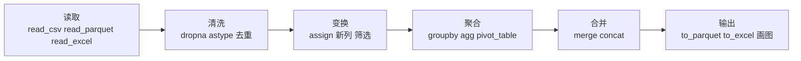

# Pandas：表格数据分析（3.x）

@@DISCLAIMER@@

## 一句话定义

Pandas 是 Python 最流行的**表格数据（DataFrame）处理库**：像在代码里操作一张带列名的 Excel 表，可以读取、清洗、筛选、分组统计、合并和导出。

## 为什么重要

- **数据分析的事实标准**：教程、Stack Overflow 答案、AI 生成的分析代码，绝大多数默认用 Pandas。
- **数据的“万能转接头”**：能读写 CSV、Excel、JSON、Parquet、SQL 数据库等几十种格式。
- **2026 年进入 3.x 时代**：默认行为有重大变化，老教程里的写法可能失效或含义改变。

## 原理 / 图解

【有据可查】pandas 3.0.0 于 2026-01-21 发布，主要变化：<https://pandas.pydata.org/pandas-docs/version/3.0.1/whatsnew/v3.0.0.html>
- **Copy-on-Write（CoW）成为默认且唯一模式**：任何索引或方法返回的结果都“表现得像副本”；链式赋值 `df[...][...] = v` 不再生效，`SettingWithCopyWarning` 被移除。说明：<https://pandas.pydata.org/docs/user_guide/copy_on_write.html>
- **默认字符串类型变为 `str`**（安装 PyArrow 时由其支撑，缺失值用 `NaN`）。
- 引入 `pd.col(...)` 表达式语法的初版；最低要求 Python 3.11。

本文使用 pandas 3.0.6（PyPI 发布于 2026-09-17）。

数据分析的典型流水线：

“分组—应用—合并”（split-apply-combine）是 `groupby` 的核心思想。【有据可查】<https://pandas.pydata.org/docs/user_guide/groupby.html>

## 可运行示例

@@CODE:29_pandas.py@@

输出（Python 3.13.5 + pandas 3.0.6 + PyArrow 25.0.1）：

@@OUT:29_pandas@@

注意几处 3.x 特有的表现：

- 第二行：字符串列的类型显示为 `StringDtype(na_value=nan)`，即新的默认 `str` 类型，而不是 2.x 的 `object`。
- 最后两行：对筛选结果 `sub` 赋值**不会**影响原表 `df`（CoW）；要改原表就直接在 `df` 上用 `.loc[条件, 列] = 值`。

## 常见误区

- **照搬 2.x 时代的链式赋值**：`df[df.a > 0]["b"] = 1` 在 3.x 中不会修改 `df`。统一改用 `df.loc[df.a > 0, "b"] = 1`。
- **逐行 `iterrows()` / `apply(axis=1)`**：非常慢。优先使用向量化列运算。
- **用 `inplace=True` 以为能省内存**：官方并不推荐，且多数情况下并不省内存；链式方法调用更清晰。
- **代码里写 `dtype == object` 判断字符串列**：3.x 默认字符串类型已不是 `object`，此类判断会失效，可用 `pd.api.types.is_string_dtype`。
- **数据量很大还硬上 Pandas**：单机内存放不下或速度不够时，考虑 Polars、DuckDB（见 [[k1.lib.polars]]）。

## 与 AI 开发的关系

- **评测结果分析**：把模型在测试集上的逐条结果放进 DataFrame，按任务、按模型 `groupby` 求平均分和成本，正是示例在做的事。
- **训练数据清洗**：去重、过滤过长/过短样本、统计标签分布。
- **“让 AI 写 Pandas”的注意点**：模型的训练语料中大量是 2.x 甚至 1.x 写法，可能生成已被移除或含义已变的代码（链式赋值、`append` 方法等）。【社区共识】提示词里写明“使用 pandas 3.x，遵循 Copy-on-Write 语义”。
- **与 LLM 结合的表格问答**：让 LLM 生成 Pandas 代码回答数据问题时，需要在沙箱中执行并审查，避免执行任意代码带来的风险。【社区共识】

## 延伸阅读

- 10 分钟入门 pandas：<https://pandas.pydata.org/docs/user_guide/10min.html>
- pandas 3.0.0 新特性：<https://pandas.pydata.org/pandas-docs/version/3.0.1/whatsnew/v3.0.0.html>
- Copy-on-Write 指南：<https://pandas.pydata.org/docs/user_guide/copy_on_write.html>
- Wes McKinney,《利用 Python 进行数据分析》第 3 版（在线免费英文版）：<https://wesmckinney.com/book/>

## 无法核实 / 待考察点

- 【待考察/推测】`pd.col` 表达式语法的能力边界与后续版本的演进方向未核实。
- 【待考察/推测】未安装 PyArrow 时 `str` 类型的回退实现与性能差异，本文未实测。
