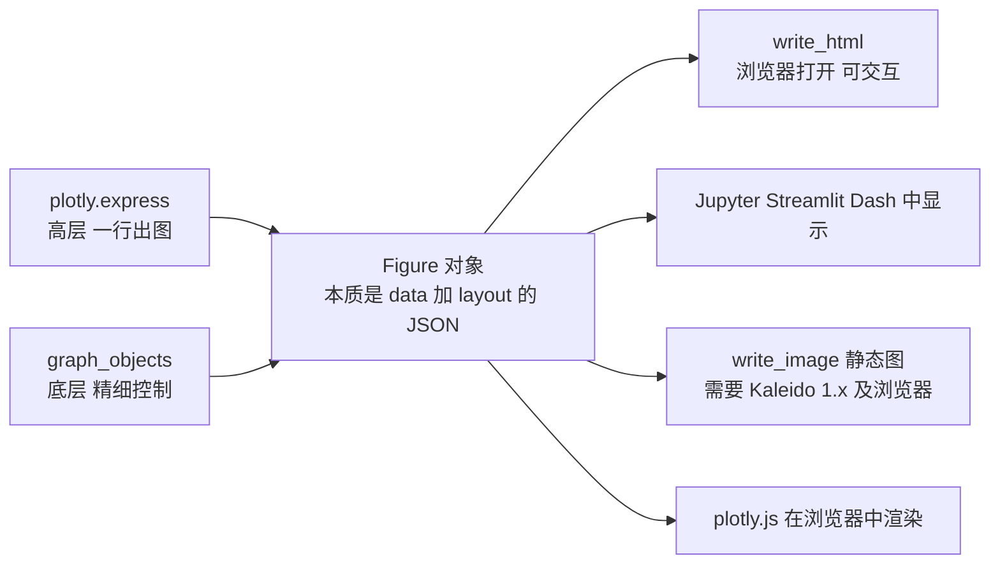

# Plotly：交互式图表（7.x）

@@DISCLAIMER@@

## 一句话定义

Plotly（Python 版为 plotly.py）是一个**生成可交互网页图表**的库：图表可以悬停查看数值、缩放、平移、点击图例隐藏系列，并能导出为独立的 HTML 文件，或嵌入 Jupyter、Streamlit、Dash 应用。

## 为什么重要

- **交互让探索更快**：几千个点的散点图，悬停就能看到每个点是哪个样本，不用反复改代码。
- **天然适合网页与仪表盘**：导出 HTML 发给别人用浏览器就能看；与 Streamlit/Dash 无缝集成。
- **高层 API 很省事**：`plotly.express` 一行代码出图，风格类似 Seaborn。

## 原理 / 图解

【有据可查】plotly.py 7.0 于 2026-08-25 发布，内置 plotly.js 4；移除了 Mapbox 相关图形（改用 `*map` 系列与 `layout.map`）、移除了已弃用的 figure factory、Orca 以及 1.0 以下的 Kaleido，`write_image` 不再有 `engine` 参数：<https://plotly.com/python/v7-migration/> 。本文使用 plotly 7.1.0（PyPI 发布于 2026-09-15）。

| 层次 | 用法 | 适合 |
|---|---|---|
| `plotly.express`（px） | `px.scatter(df, x=..., y=..., color=...)` | 绝大多数常规图表 |
| `plotly.graph_objects`（go） | `go.Figure(go.Scatter(...))`、`fig.add_trace` | 叠加多层、精细定制 |
| Dash | 基于 Plotly 的 Web 应用框架 | 正式的数据应用 |

## 可运行示例

@@CODE:35_plotly.py@@

输出（Python 3.13.5 + plotly 7.1.0）：

@@OUT:35_plotly@@

导出的 HTML 在浏览器中打开后的截图（用无头 Chrome 截取；实际文件可悬停、缩放）：

交互式原文件：`img/plotly-demo.html`（使用 CDN 加载 plotly.js，离线打开时需要联网；如需离线，使用 `include_plotlyjs=True`，文件会增大到数 MB）。

最后一行输出说明：**Figure 本质上就是一个 JSON**（`data` + `layout`），这也是 Plotly 图表容易在前后端之间传递的原因。

## 常见误区

- **照搬旧教程的 Mapbox 写法**：7.x 中 `scatter_mapbox` 等已移除，需改用 `scatter_map` 等新函数。
- **以为 `write_image` 开箱即用**：导出 PNG/SVG 需要安装 Kaleido（7.x 要求 1.0 及以上），Kaleido 1.x 还需要系统中有可用的 Chrome/Chromium。【有据可查】见上方 v7 迁移指南。本文示例因此改用 `write_html`，静态截图由无头 Chrome 截取。
- **数据量很大时性能差**：几十万个点时用 `go.Scattergl`（WebGL）或先抽样/聚合。
- **默认 `include_plotlyjs=True` 导致文件很大**：每个 HTML 都内嵌几 MB 的 JS，批量导出时可改用 `"cdn"`。

## 与 AI 开发的关系

- **嵌入向量交互探索**：降维后的散点图配合 `hover_data=["原文"]`，悬停就能看到每个点对应的文本，是检查聚类和检索质量的好方法。
- **评测仪表盘**：成本—质量散点图（如示例）帮助在多个模型之间做取舍。
- **与 Streamlit 结合**：`st.plotly_chart(fig)` 直接把交互图放进应用（见 [[k1.lib.streamlit]]）。
- **让 LLM 生成图表**：因为 Figure 是 JSON，部分应用让模型直接输出 Plotly JSON 规格再渲染。【待考察/推测】这种做法的可靠性依赖模型与校验机制，未见权威评估。

## 延伸阅读

- 入门：<https://plotly.com/python/getting-started/>
- Plotly Express：<https://plotly.com/python/plotly-express/>
- v7 迁移指南：<https://plotly.com/python/v7-migration/>
- 图表参考（所有属性）：<https://plotly.com/python/reference/>

## 无法核实 / 待考察点

- 【待考察/推测】plotly 7.1 相对 7.0 的具体变化未核实。
- 【待考察/推测】Kaleido 1.x 在无图形界面的 Linux 服务器上的依赖要求未实测（本机未安装 Kaleido）。
