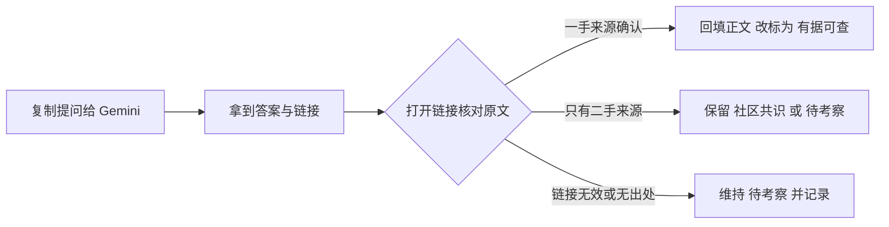

# K1 待补查清单（可直接交给 Gemini 的搜索提问）

> **免责声明**：本清单列出 K1 初稿中**未能找到可靠一手资料**、或资料存在矛盾的具体问题。每条都写成可以直接复制给 Gemini（或其他带联网搜索的助手）的提问，并要求给出原始出处。查到的结论在回填正文前仍需人工核对来源。整理日期：2026-10-13。

**通用提问后缀**（建议附在每条后面）：
> 请只引用官方文档、PEP、项目仓库、发布说明或原作者的一手资料，给出链接和发布日期；如果找不到一手出处，请明确说“未找到”，不要推测。

---

## A. 历史与出处类（编程基础）

| # | 对应节点 | 提问 |
|---|---|---|
| A1 | k1.prog.solid | “SOLID”这个缩写最早是谁、在哪一年、在什么文章或演讲中提出的？常说是 Michael Feathers 在 2004 年前后提出，请找到 Feathers 本人或 Robert C. Martin 对此的原始说明。 |
| A2 | k1.prog.solid | Robert C. Martin 的论文 *Design Principles and Design Patterns*（约 2000 年）目前有没有官方或作者认可的在线 PDF 托管地址？原文中是否已经包含全部五条原则？ |
| A3 | k1.prog.oop | Alan Kay 第一次使用 “object-oriented programming” 这个词是在哪一年？请找 Alan Kay 本人的说法（如 2003 年给 Stefan Ram 的邮件、*The Early History of Smalltalk*）中关于时间的原文。 |
| A4 | k1.prog.refactoring | Kent Beck 的名言 “make the change easy (warning: this may be hard), then make the easy change” 最早出自哪条推文或哪篇文章？请给出原始链接和日期。 |
| A5 | k1.prog.functional | “Functional Core, Imperative Shell”这一说法最早出自 Gary Bernhardt 的哪个作品（Destroy All Software 的哪一集、哪一年）？ |
| A6 | k1.prog.design-patterns | Peter Norvig 1996 年演讲 *Design Patterns in Dynamic Languages* 中“23 个 GoF 模式里有 16 个变得不可见或更简单”的结论，具体是针对哪些语言特性、列出了哪 16 个模式？ |
| A7 | k1.prog.paradigm | 编程范式有没有学术上被广泛接受的标准分类？请比较 Peter Van Roy 的分类、维基百科分类与主流教材（如 SICP、CTM）的差异。 |

## B. 定量数据类（缺乏可靠统计）

| # | 对应节点 | 提问 |
|---|---|---|
| B1 | k1.prog.debugging | 有没有严谨的实证研究（同行评审论文或大型企业公开数据）统计程序员花在调试上的时间比例？请列出研究名称、样本规模、方法和结论，并说明常被引用的“35%～50%”出自哪里。 |
| B2 | k1.prog.code-review | 2025—2026 年有没有独立第三方（非厂商自评）对 AI 代码评审工具的评估，给出它们发现真实缺陷的召回率与误报率？ |
| B3 | k1.prog.code-review | “slopsquatting”（攻击者抢注 LLM 幻觉出来的包名）有哪些已公开的真实攻击案例和规模统计？请给出安全研究报告原文链接。 |
| B4 | k1.prog.clean-code | 是否有研究定量证明“代码可读性/命名质量会影响 LLM 编程助手修改代码的正确率”？请给出论文与实验设置。 |
| B5 | k1.prog.paradigm | 是否有研究统计 LLM 生成的 Python 代码在范式风格上的偏好（命令式 vs 函数式 vs OOP）？ |

## C. 版本与新特性类（Python 3.15 及工具链）

| # | 对应节点 | 提问 |
|---|---|---|
| C1 | k1.py.iterator | Python 3.15 What's New 提到新增 `serialize_iterator`、`synchronized_iterator()`、`concurrent_tee()` 用于并发访问迭代器，它们属于哪个标准库模块？请给出官方文档页面和用法示例。 |
| C2 | k1.prog.breakpoint | Python 3.15 中 pdb “默认使用新的交互式 shell”后，具体有哪些可见变化（语法高亮、多行编辑、补全、快捷键）？与 3.14 的 pdb 相比有什么不兼容之处？ |
| C3 | k1.py.type-hints | 截至 2026 年 10 月，mypy、pyright、ty（Astral）、pyrefly（Meta）对 Python 3.15 新增的 PEP 747 `TypeForm` 与 PEP 728（TypedDict 的 closed / extra_items）各支持到什么程度？ty 与 pyrefly 是否已发布 1.0 稳定版？ |
| C4 | k1.py.mutability | Python 3.15 新增 `frozendict`（PEP 814）后，Pydantic、orjson、msgspec、PyYAML 等常用第三方库是否已支持它的序列化与校验？ |
| C5 | k1.py.threading | 截至 2026 年 10 月，PyTorch、vLLM、Transformers、Pandas、Polars 对 CPython 自由线程构建（3.14t/3.15t）的官方支持状态如何？是否发布了 cp314t/cp315t wheel？导入后会不会重新启用 GIL？ |
| C6 | k1.py.threading | Python 3.14/3.15 官方对自由线程构建“单线程性能损失”的最新数字是多少？请找 What's New 或核心开发者基准测试的原文。 |
| C7 | k1.py.object-reference | 在 CPython 3.15 自由线程构建中，`sys.getrefcount()` 的返回值行为与默认构建有何不同（偏向引用计数 biased reference counting 的影响）？ |

## D. 第三方库细节类

| # | 对应节点 | 提问 |
|---|---|---|
| D1 | k1.lib.pandas | pandas 3.x 的 `pd.col()` 表达式语法目前支持哪些操作？官方路线图中它后续会如何扩展？请引用 pandas 3.0 发布说明与相关 PDEP。 |
| D2 | k1.lib.pandas | pandas 3.x 在**未安装 PyArrow** 时，默认 `str` dtype 用什么实现？与 PyArrow 支撑的实现在性能和行为上有哪些差异？ |
| D3 | k1.lib.polars | Polars 2.0 默认开启的 out-of-core 溢写（约 80% 内存阈值、64GB 磁盘预算）如何配置或关闭？对应的环境变量或 API 叫什么？ |
| D4 | k1.lib.pyarrow | pyarrow 26.0.0（2026-10-09 发布）相对 25.x 有哪些破坏性变更（breaking changes）？对 pandas 3.x 与 Polars 2.0 的互操作有没有影响？ |
| D5 | k1.lib.openpyxl | openpyxl 项目目前的维护状态如何？3.1.5（2024-06）之后是否有 3.2 的开发计划？官方是否仍推荐配合 `defusedxml` 处理不可信文件？ |
| D6 | k1.lib.seaborn | seaborn 0.13.2（2024-01）之后是否有新版本计划？0.13.2 与 pandas 3.x（Copy-on-Write、新的 str dtype）是否存在已知兼容性问题？请查 GitHub issue。 |
| D7 | k1.lib.plotly | plotly.py 7.1 相对 7.0 有哪些变化？Kaleido 1.x 在无图形界面的 Linux 服务器上导出静态图需要哪些系统依赖（Chrome/Chromium 版本、`kaleido.get_chrome()` 等）？ |
| D8 | k1.lib.streamlit | Streamlit 从 1.50 到 1.65 之间新增或改变了哪些与 LLM 应用相关的功能（聊天组件、流式输出、缓存行为）？`AppTest` 能否检查 `st.bar_chart` / `st.plotly_chart` 的数据内容？ |
| D9 | k1.lib.numpy | NumPy 2.1～2.5 各版本的主要新特性与弃用项有哪些？是否有面向用户的汇总页面？ |
| D10 | k1.lib.matplotlib | matplotlib 3.11 相对 3.10 的主要新特性是什么？对中文字体处理或默认样式有无变化？ |

## E. AI 工具生态类（变化快、需定期复查）

| # | 对应节点 | 提问 |
|---|---|---|
| E1 | k1.prog.documentation | 截至 2026 年 10 月，哪些主流 AI 编程工具正式支持读取 `AGENTS.md`？哪些大模型或搜索产品官方声明会读取网站的 `llms.txt`？请给出各厂商官方文档链接。 |
| E2 | k1.prog.logging | OpenTelemetry GenAI 语义约定（gen_ai.*）目前的稳定性级别是什么（experimental / development / stable）？最近一次版本有哪些字段变化？ |
| E3 | k1.py.decorator | MCP Python SDK、OpenAI Agents SDK、LangChain 等框架从函数 docstring 自动生成工具参数描述时，分别支持哪种 docstring 风格（Google / NumPy / reST）？ |
| E4 | k1.prog.breakpoint | 有哪些公开研究或产品让编程 Agent 直接调用 pdb 等交互式调试器？效果评估如何？ |
| E5 | k1.py.mutability | LangGraph 当前版本中状态（State）的更新语义是什么——reducer 返回新对象还是原地修改？官方文档如何描述？ |

---

## 回填流程建议

