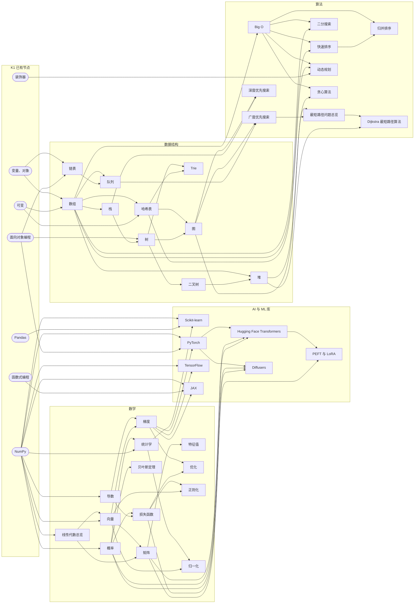
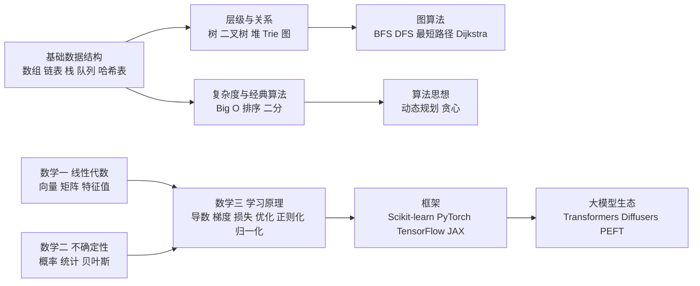

# K2 目录：AI/ML 库 · 数据结构 · 算法 · 数学

> **免责声明**：本批为“河洛序”知识图谱 K2 批次**初稿**，由 AI 辅助整理，仅供学习参考，不构成任何承诺。版本信息截至 2026-10-14。标注说明：**【有据可查】**附官方/原始来源；**【社区共识】**为业界普遍做法；**【待考察/推测】**为未能核实或推断。

## 本批概况

- 节点数：**40**（AI/ML 库 7 · 数据结构 10 · 算法 10 · 数学 13），**一个知识点一篇，未合并**。
- 每篇结构：YAML front matter（id / title / domain / prerequisites / related / tags）→ 一句话定义 → 为什么重要 → 原理/图解 → 可运行示例 → 常见误区 → 与 AI 开发的关系 → 延伸阅读 → 无法核实/待考察点。
- id 前缀为 `k2.`；prerequisites / related 可引用 K1 的 id（`k1.xxx`，如 `k1.lib.numpy`），所有引用均已脚本校验存在。文中 `[[k2.xxx]]` / `[[k1.xxx]]` 是图谱内部链接。
- 数学篇（28–40）公式统一用 `$$ … $$`（行内 `$ … $`），并配有 NumPy 数值验证代码。
- 所有示例代码在 `examples/` 下，**均已实际运行**，文中输出为真实结果（保存在 `examples/out/`）。一键重跑：`examples/run_all.sh`。
- 重型库（PyTorch / TensorFlow / JAX / Transformers / Diffusers / PEFT）示例全部用**本地构造的微型网络、CPU 运行**，无需下载大模型；全部装上并跑通，**没有“未实跑”项**。05 篇末尾可选地从 Hugging Face Hub 下载测试用微型模型 `hf-internal-testing/tiny-random-gpt2`（失败时自动跳过）。
- 输出中保留了库自身打印的日志（TensorFlow 的 oneDNN 提示、Transformers 的加载进度条与警告），以便读者对照自己的运行结果。
- 配图在 `img/`：`optimizers.png`（37 篇）、`regularization.png`（39 篇），均由示例代码生成。
- 难以查到可靠资料的问题，见 [待补查清单.md](待补查清单.md)。

## 运行环境（实测）

| 用途 | 解释器 / 库版本 |
|---|---|
| 08–24、26–27 数据结构与算法 | CPython 3.15.0，仅标准库 |
| 01–07 AI/ML 库 | CPython 3.13.5 + scikit-learn 1.9.1、torch 2.14.1+cpu、tensorflow-cpu 2.21.0、keras 3.15.1、jax/jaxlib 0.11.2、transformers 5.19.0、diffusers 0.41.0、peft 0.21.2、accelerate 1.15.0 |
| 25 Dijkstra（含 SciPy 验证）、28–40 数学 | CPython 3.13.5 + numpy 2.5.4、scipy 1.18.1、scikit-learn 1.9.1、matplotlib、torch 2.14.1+cpu（40 篇对照） |
| 硬件 | 8 核 CPU、约 3GB 可用内存，无 GPU |

## 节点列表

| # | 文件 | id | 领域 | 前置节点 |
|---|---|---|---|---|
| 1 | [Scikit-learn：经典机器学习工具箱](01-Scikit-learn.md) | `k2.ml.sklearn` | AI/ML库 | `k1.lib.numpy`、`k1.lib.pandas`、`k2.math.statistics` |
| 2 | [PyTorch：动态图深度学习框架](02-PyTorch.md) | `k2.ml.pytorch` | AI/ML库 | `k1.lib.numpy`、`k1.prog.oop`、`k2.math.gradient` |
| 3 | [TensorFlow 与 Keras](03-TensorFlow.md) | `k2.ml.tensorflow` | AI/ML库 | `k1.lib.numpy`、`k2.math.gradient` |
| 4 | [JAX：可组合函数变换的数值计算库](04-JAX.md) | `k2.ml.jax` | AI/ML库 | `k1.lib.numpy`、`k1.prog.functional`、`k2.math.gradient` |
| 5 | [Hugging Face Transformers：预训练模型的统一接口](05-Transformers.md) | `k2.ml.transformers` | AI/ML库 | `k2.ml.pytorch`、`k2.math.matrix`、`k2.math.probability` |
| 6 | [Diffusers：扩散模型工具库](06-Diffusers.md) | `k2.ml.diffusers` | AI/ML库 | `k2.ml.pytorch`、`k2.math.probability`、`k2.math.loss-function` |
| 7 | [PEFT 与 LoRA：参数高效微调](07-PEFT.md) | `k2.ml.peft` | AI/ML库 | `k2.ml.transformers`、`k2.math.matrix` |
| 8 | [数组（Array）与 Python 列表](08-数组.md) | `k2.ds.array` | 数据结构 | `k1.py.object-reference`、`k1.py.mutability` |
| 9 | [链表（Linked List）](09-链表.md) | `k2.ds.linked-list` | 数据结构 | `k1.py.object-reference`、`k1.prog.oop` |
| 10 | [栈（Stack）](10-栈.md) | `k2.ds.stack` | 数据结构 | `k2.ds.array` |
| 11 | [队列（Queue）](11-队列.md) | `k2.ds.queue` | 数据结构 | `k2.ds.array`、`k2.ds.linked-list` |
| 12 | [哈希表（Hash Table）与 dict / set](12-哈希表.md) | `k2.ds.hash-table` | 数据结构 | `k2.ds.array`、`k1.py.mutability` |
| 13 | [树（Tree）](13-树.md) | `k2.ds.tree` | 数据结构 | `k1.prog.oop`、`k2.ds.stack` |
| 14 | [二叉树与二叉搜索树（BST）](14-二叉树.md) | `k2.ds.binary-tree` | 数据结构 | `k2.ds.tree` |
| 15 | [图（Graph）](15-图.md) | `k2.ds.graph` | 数据结构 | `k2.ds.hash-table`、`k2.ds.tree` |
| 16 | [堆（Heap）与优先队列](16-堆.md) | `k2.ds.heap` | 数据结构 | `k2.ds.array`、`k2.ds.binary-tree` |
| 17 | [Trie（前缀树 / 字典树）](17-Trie.md) | `k2.ds.trie` | 数据结构 | `k2.ds.tree`、`k2.ds.hash-table` |
| 18 | [Big O：时间与空间复杂度](18-Big-O.md) | `k2.algo.big-o` | 算法 | `k2.ds.array` |
| 19 | [快速排序（Quicksort）](19-快速排序.md) | `k2.algo.quicksort` | 算法 | `k2.algo.big-o`、`k2.ds.array` |
| 20 | [归并排序（Merge Sort）](20-归并排序.md) | `k2.algo.mergesort` | 算法 | `k2.algo.big-o`、`k2.algo.quicksort` |
| 21 | [二分搜索（Binary Search）](21-二分搜索.md) | `k2.algo.binary-search` | 算法 | `k2.algo.big-o`、`k2.ds.array` |
| 22 | [广度优先搜索（BFS）](22-BFS.md) | `k2.algo.bfs` | 算法 | `k2.ds.graph`、`k2.ds.queue` |
| 23 | [深度优先搜索（DFS）](23-DFS.md) | `k2.algo.dfs` | 算法 | `k2.ds.graph`、`k2.ds.stack` |
| 24 | [最短路径问题总览（BFS / Bellman-Ford / Floyd-Warshall）](24-最短路径.md) | `k2.algo.shortest-path` | 算法 | `k2.ds.graph`、`k2.algo.bfs` |
| 25 | [Dijkstra 最短路径算法](25-Dijkstra.md) | `k2.algo.dijkstra` | 算法 | `k2.algo.shortest-path`、`k2.ds.heap` |
| 26 | [动态规划（Dynamic Programming）](26-动态规划.md) | `k2.algo.dynamic-programming` | 算法 | `k2.algo.big-o`、`k2.ds.hash-table`、`k1.py.decorator` |
| 27 | [贪心算法（Greedy）](27-贪心.md) | `k2.algo.greedy` | 算法 | `k2.algo.big-o`、`k2.ds.heap` |
| 28 | [线性代数总览：线性方程组、线性变换与秩](28-线性代数.md) | `k2.math.linear-algebra` | 数学 | `k1.lib.numpy` |
| 29 | [向量：范数、点积与余弦相似度](29-向量.md) | `k2.math.vector` | 数学 | `k2.math.linear-algebra`、`k1.lib.numpy` |
| 30 | [矩阵与矩阵运算](30-矩阵.md) | `k2.math.matrix` | 数学 | `k2.math.vector`、`k2.math.linear-algebra` |
| 31 | [特征值与特征向量](31-特征值.md) | `k2.math.eigenvalue` | 数学 | `k2.math.matrix` |
| 32 | [概率：随机变量、分布与 softmax 采样](32-概率.md) | `k2.math.probability` | 数学 | `k1.lib.numpy` |
| 33 | [统计学：描述统计、置信区间与假设检验](33-统计学.md) | `k2.math.statistics` | 数学 | `k2.math.probability`、`k1.lib.numpy` |
| 34 | [贝叶斯定理与贝叶斯推断](34-贝叶斯.md) | `k2.math.bayes` | 数学 | `k2.math.probability` |
| 35 | [梯度与反向传播](35-梯度.md) | `k2.math.gradient` | 数学 | `k2.math.derivative`、`k2.math.vector` |
| 36 | [导数：变化率、数值微分与链式法则](36-导数.md) | `k2.math.derivative` | 数学 | `k1.lib.numpy` |
| 37 | [优化：梯度下降、动量与 Adam](37-优化.md) | `k2.math.optimization` | 数学 | `k2.math.gradient`、`k2.math.loss-function` |
| 38 | [损失函数：MSE、交叉熵与困惑度](38-损失函数.md) | `k2.math.loss-function` | 数学 | `k2.math.probability`、`k2.math.derivative` |
| 39 | [正则化：L1、L2、Dropout 与权重衰减](39-正则化.md) | `k2.math.regularization` | 数学 | `k2.math.loss-function`、`k2.math.vector` |
| 40 | [归一化：特征缩放、BatchNorm、LayerNorm 与 RMSNorm](40-归一化.md) | `k2.math.normalization` | 数学 | `k2.math.statistics`、`k2.math.vector` |

## 前置关系图

箭头表示“先学 A 再学 B”（仅画 prerequisites，不画 related）；圆角框为 K1 中的前置节点。

## 建议学习路线

## 合并说明

本批 40 个节点**全部独立成篇，没有合并**。原因：每个节点都有官方文档、原始论文或经典教材可引用，且都能写出独立运行、体现该知识点本质的示例，资料量足以支撑单篇。
边界处理：**最短路径**与 **Dijkstra** 分开——“最短路径”篇是问题总览（BFS / Bellman-Ford / Floyd-Warshall 与选型），“Dijkstra”篇只深入讲这一个算法（正确性论证、负权反例）；**梯度**与**导数**分开——导数篇讲一元变化率、数值微分与链式法则，梯度篇讲多元梯度与反向传播；**线性代数**篇为总览，向量、矩阵、特征值各自深入。

## 修订记录

- 2026-10-14：K2 初稿（40 篇）。
