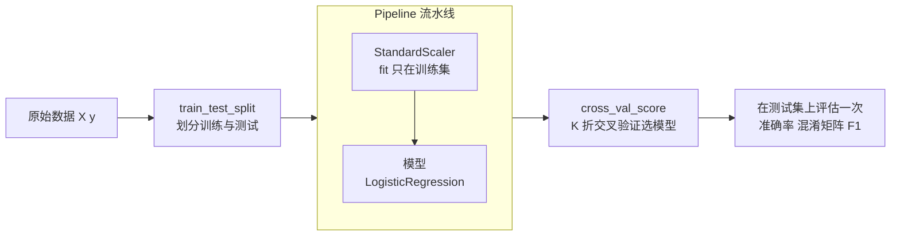

# Scikit-learn：经典机器学习工具箱

> **免责声明**：本文是“河洛序”知识图谱 K2 批次的**初稿**，由 AI 辅助整理，仅供学习参考，不构成任何承诺或保证。版本信息截至 2026-10-14；文中示例已在 Python 3.15.0（数据结构与算法，纯标准库）或 Python 3.13 + 所列库版本（AI/ML 库与数学）下**实际运行**，输出为真实结果，但换机器、换版本时数字（尤其是耗时）会不同。
>
> 标注说明：**【有据可查】** 附官方文档 / 原始出处链接；**【社区共识】** 为业界普遍做法，没有唯一权威出处；**【待考察/推测】** 为未能核实或作者推断，请勿当作定论。

## 一句话定义

scikit-learn（sklearn）是 Python 最常用的**经典机器学习库**：线性模型、决策树、随机森林、SVM、聚类、降维、预处理、评估指标，都通过同一套 `fit / predict / transform` 接口来使用。

## 为什么重要

- **表格数据的首选**：结构化数据（用户画像、风控、销量预测）上，经典模型加好的特征工程往往又快又准，未必需要深度学习。
- **方法论的“标准答案”**：训练/测试划分、交叉验证、流水线、指标——这些规范大多以 sklearn 的写法为参照。
- **深度学习项目也离不开它**：数据划分、标准化、评估指标（F1、AUC）、做基线模型（baseline）。

## 原理 / 图解

【有据可查】sklearn 的统一 API 设计（Estimator / Predictor / Transformer）见其 API 设计论文与开发者文档：<https://scikit-learn.org/stable/developers/develop.html> ；用户指南：<https://scikit-learn.org/stable/user_guide.html> 。本文使用 scikit-learn 1.9.1（PyPI 发布于 2026-09-10）。



| 接口 | 作用 | 例子 |
|---|---|---|
| `fit(X, y)` | 从数据中学习参数 | 所有模型、预处理器 |
| `predict(X)` / `predict_proba(X)` | 预测类别 / 概率 | 分类器、回归器 |
| `transform(X)` | 变换数据 | `StandardScaler`、`PCA` |
| `score(X, y)` | 默认指标 | 分类为准确率、回归为 R² |

## 可运行示例

鸢尾花分类：两个模型的交叉验证、测试集评估、混淆矩阵与特征重要性（Python 3.13 + scikit-learn 1.9.1 实际运行）：

```python
# 文件：examples/01_sklearn.py
# scikit-learn：统一的 fit / predict 接口 + 预处理 + 交叉验证 + 流水线
import sklearn, numpy as np
from sklearn.datasets import load_iris
from sklearn.model_selection import train_test_split, cross_val_score
from sklearn.pipeline import make_pipeline
from sklearn.preprocessing import StandardScaler
from sklearn.linear_model import LogisticRegression
from sklearn.ensemble import RandomForestClassifier
from sklearn.metrics import classification_report, confusion_matrix
print("scikit-learn", sklearn.__version__)

X, y = load_iris(return_X_y=True)
X_tr, X_te, y_tr, y_te = train_test_split(X, y, test_size=0.3, random_state=0, stratify=y)
print("训练集", X_tr.shape, "测试集", X_te.shape)

models = {
    "逻辑回归(含标准化)": make_pipeline(StandardScaler(), LogisticRegression(max_iter=1000)),
    "随机森林": RandomForestClassifier(n_estimators=200, random_state=0),
}
for name, m in models.items():
    cv = cross_val_score(m, X_tr, y_tr, cv=5)
    m.fit(X_tr, y_tr)
    print(f"{name:<12} 5折交叉验证 {cv.mean():.3f}±{cv.std():.3f} | 测试集准确率 {m.score(X_te, y_te):.3f}")

best = models["逻辑回归(含标准化)"]
pred = best.predict(X_te)
print("混淆矩阵:\n", confusion_matrix(y_te, pred))
print(classification_report(y_te, pred, target_names=load_iris().target_names, digits=3))
print("预测概率(前 2 条):", np.round(best.predict_proba(X_te[:2]), 3))
rf = models["随机森林"]
print("随机森林特征重要性:", dict(zip(load_iris().feature_names, map(float, rf.feature_importances_.round(3)))))
```

输出：

```text
scikit-learn 1.9.1
训练集 (105, 4) 测试集 (45, 4)
逻辑回归(含标准化)   5折交叉验证 0.943±0.019 | 测试集准确率 0.978
随机森林         5折交叉验证 0.943±0.019 | 测试集准确率 0.978
混淆矩阵:
 [[15  0  0]
 [ 0 15  0]
 [ 0  1 14]]
              precision    recall  f1-score   support

      setosa      1.000     1.000     1.000        15
  versicolor      0.938     1.000     0.968        15
   virginica      1.000     0.933     0.966        15

    accuracy                          0.978        45
   macro avg      0.979     0.978     0.978        45
weighted avg      0.979     0.978     0.978        45

预测概率(前 2 条): [[0.    0.036 0.964]
 [0.001 0.234 0.764]]
随机森林特征重要性: {'sepal length (cm)': 0.108, 'sepal width (cm)': 0.035, 'petal length (cm)': 0.404, 'petal width (cm)': 0.453}
```

读结果：两个模型在这个小数据集上表现几乎一样；混淆矩阵显示唯一的错误是把一个 virginica 判成 versicolor——这两类本来就在花瓣尺寸上有重叠。随机森林认为花瓣长度/宽度最重要。

## 常见误区

- **数据泄漏**：先在全量数据上 `StandardScaler().fit` 再划分，测试集信息就泄漏进了训练。把预处理放进 `Pipeline`，交叉验证时每折都只在训练部分上 fit。【有据可查】官方“常见陷阱”文档：<https://scikit-learn.org/stable/common_pitfalls.html>
- **只看准确率**：类别不平衡时（如 1% 欺诈），全部预测“正常”也有 99% 准确率，要看精确率、召回率、F1、PR 曲线。
- **在测试集上反复调参**：测试集只用最后一次；调参用交叉验证或独立验证集。
- **线性模型 / SVM / KNN 不做标准化**：特征尺度差异会严重影响结果（见 [[k2.math.normalization]]）。
- **用 sklearn 训练大规模深度网络**：`MLPClassifier` 只适合小规模实验，深度学习请用 PyTorch 等。

## 与 AI 开发的关系

- **基线模型**：上大模型之前，先用 TF-IDF + 逻辑回归做文本分类基线，常常能发现“任务其实很简单”或“数据标注有问题”。【社区共识】
- **嵌入向量 + 经典模型**：用 LLM/嵌入模型提取向量，再用 sklearn 的逻辑回归、KMeans 做分类或聚类，是低成本且效果不错的组合。
- **评估工具箱**：`classification_report`、`roc_auc_score`、`confusion_matrix` 被大量深度学习项目直接调用。
- **降维可视化**：`PCA`、`TSNE` 把高维嵌入降到 2D 查看（原理见 [[k2.math.eigenvalue]]）。

## 延伸阅读

- 用户指南：<https://scikit-learn.org/stable/user_guide.html>
- 选择合适的估计器（流程图）：<https://scikit-learn.org/stable/machine_learning_map.html>
- 常见陷阱与推荐做法：<https://scikit-learn.org/stable/common_pitfalls.html>
- 交叉验证：<https://scikit-learn.org/stable/modules/cross_validation.html>

## 无法核实 / 待考察点

- 【待考察/推测】scikit-learn 1.9 相对 1.8 的新特性（如 Array API 支持进度、GPU 支持范围）未逐条核实。
