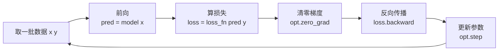

# PyTorch：动态图深度学习框架

> **免责声明**：本文是“河洛序”知识图谱 K2 批次的**初稿**，由 AI 辅助整理，仅供学习参考，不构成任何承诺或保证。版本信息截至 2026-10-14；文中示例已在 Python 3.15.0（数据结构与算法，纯标准库）或 Python 3.13 + 所列库版本（AI/ML 库与数学）下**实际运行**，输出为真实结果，但换机器、换版本时数字（尤其是耗时）会不同。
>
> 标注说明：**【有据可查】** 附官方文档 / 原始出处链接；**【社区共识】** 为业界普遍做法，没有唯一权威出处；**【待考察/推测】** 为未能核实或作者推断，请勿当作定论。

## 一句话定义

PyTorch 是目前最主流的**深度学习框架**：提供可在 CPU/GPU 上运行的张量（Tensor）、自动求导（autograd）、神经网络模块（`nn.Module`）和优化器，用写普通 Python 代码的方式定义和训练模型。

## 为什么重要

- **事实上的研究与大模型标准**：Hugging Face Transformers 从 v5 起只支持 PyTorch 后端（见 [[k2.ml.transformers]]），绝大多数开源大模型以 PyTorch 权重发布。
- **“定义即运行”（eager）易于调试**：可以在任意一行打断点、打印张量形状（见 [[k1.prog.breakpoint]]）。
- **从研究到部署**：`torch.compile` 编译加速，`torch.export` 导出模型。

## 原理 / 图解

【有据可查】官方教程“Learn the Basics”：<https://docs.pytorch.org/tutorials/beginner/basics/intro.html> ；autograd 机制：<https://docs.pytorch.org/docs/stable/notes/autograd.html> 。本文使用 torch 2.14.1 CPU 版（PyPI 发布于 2026-09-30）。

训练循环的五步（几乎所有 PyTorch 训练代码都是这个骨架）：



autograd 在前向时记录计算图，`backward()` 时按链式法则从损失反向计算每个参数的梯度（原理见 [[k2.math.gradient]]）：

$$
\frac{\partial L}{\partial w} = \frac{\partial L}{\partial \hat{y}} \cdot \frac{\partial \hat{y}}{\partial z} \cdot \frac{\partial z}{\partial w}
$$

## 可运行示例

autograd 求导 + 用小 MLP 分类“两个交错半圆” + 保存/加载（Python 3.13 + torch 2.14.1 CPU 实际运行）：

```python
# 文件：examples/02_pytorch.py
# PyTorch：张量 + 自动求导 + nn.Module + 训练循环。用一个小 MLP 拟合 XOR 风格的二维分类
import torch, torch.nn as nn
print("torch", torch.__version__, "| CUDA 可用:", torch.cuda.is_available())
torch.manual_seed(0)

# 1) 张量与自动求导
x = torch.tensor(3.0, requires_grad=True)
y = x ** 2 + 2 * x
y.backward()
print("y = x²+2x 在 x=3 的导数(autograd):", x.grad.item(), "(理论 2x+2 = 8)")

# 2) 数据：两个交错的半圆（非线性可分）
n = 400
t = torch.rand(n) * 3.1416
X = torch.cat([torch.stack([t.cos(), t.sin()], 1), torch.stack([1 - t.cos(), 0.5 - t.sin()], 1)]) + 0.1 * torch.randn(2 * n, 2)
Y = torch.cat([torch.zeros(n), torch.ones(n)]).long()
perm = torch.randperm(2 * n); X, Y = X[perm], Y[perm]
Xtr, Ytr, Xte, Yte = X[:600], Y[:600], X[600:], Y[600:]

# 3) 模型
class MLP(nn.Module):
    def __init__(self):
        super().__init__()
        self.net = nn.Sequential(nn.Linear(2, 32), nn.ReLU(), nn.Linear(32, 32), nn.ReLU(), nn.Linear(32, 2))
    def forward(self, x): return self.net(x)
model = MLP()
print("参数量:", sum(p.numel() for p in model.parameters()))

# 4) 训练循环：前向 → 损失 → 清梯度 → 反向 → 更新
opt = torch.optim.AdamW(model.parameters(), lr=1e-2)
loss_fn = nn.CrossEntropyLoss()
for epoch in range(1, 201):
    model.train()
    loss = loss_fn(model(Xtr), Ytr)
    opt.zero_grad(); loss.backward(); opt.step()
    if epoch in (1, 50, 200):
        model.eval()
        with torch.no_grad(): acc = (model(Xte).argmax(1) == Yte).float().mean().item()
        print(f"epoch {epoch:>3} 训练损失 {loss.item():.4f} 测试准确率 {acc:.3f}")

# 5) 保存与加载（推荐保存 state_dict）
import io
buf = io.BytesIO(); torch.save(model.state_dict(), buf); buf.seek(0)
m2 = MLP(); m2.load_state_dict(torch.load(buf, weights_only=True))
print("加载后输出一致:", torch.allclose(model(Xte[:5]), m2(Xte[:5])))
```

输出：

```text
torch 2.14.1+cpu | CUDA 可用: False
y = x²+2x 在 x=3 的导数(autograd): 8.0 (理论 2x+2 = 8)
参数量: 1218
epoch   1 训练损失 0.7214 测试准确率 0.505
epoch  50 训练损失 0.0722 测试准确率 0.995
epoch 200 训练损失 0.0018 测试准确率 1.000
加载后输出一致: True
```

- autograd 算出的导数 8.0 与手算一致。
- 只有 1218 个参数的网络，200 轮后测试准确率 100%——非线性激活（ReLU）让它能画出弯曲的决策边界。

## 常见误区

- **忘记 `zero_grad()`**：PyTorch 默认**累加**梯度，不清零会让梯度越来越大。
- **推理时不用 `model.eval()` 和 `torch.no_grad()`**：Dropout/BatchNorm 行为不对，且浪费显存记录计算图。
- **形状和设备不一致**：`RuntimeError: Expected all tensors to be on the same device`——模型和数据都要 `.to(device)`。
- **保存整个模型对象**：推荐保存 `state_dict`；加载时 `torch.load(..., weights_only=True)` 更安全（避免反序列化任意代码）。【有据可查】<https://docs.pytorch.org/docs/stable/generated/torch.load.html>
- **用 `.item()` 或 `print` 频繁同步 GPU**：在训练循环中会拖慢速度。

## 与 AI 开发的关系

- **大模型推理与微调的底座**：Transformers、PEFT、Diffusers、vLLM、Accelerate 等都构建在 PyTorch 上。
- **分布式训练**：DDP、FSDP 让模型跨多 GPU / 多机训练。【有据可查】<https://docs.pytorch.org/tutorials/beginner/dist_overview.html>
- **本地部署要谨慎**：CPU 版能跑通小模型和学习用例，但大模型推理/训练通常需要 GPU；个人场景下自购显卡往往不划算，可先用云端或 API。【社区共识】

## 延伸阅读

- PyTorch 官方教程：<https://docs.pytorch.org/tutorials/>
- autograd 机制说明：<https://docs.pytorch.org/docs/stable/notes/autograd.html>
- `torch.compile` 入门：<https://docs.pytorch.org/tutorials/intermediate/torch_compile_tutorial.html>
- 李沐等《动手学深度学习》（PyTorch 版，免费）：<https://zh.d2l.ai/>

## 无法核实 / 待考察点

- 【待考察/推测】torch 2.14 相对 2.13 的主要新特性未逐条核实。
- 【待考察/推测】本示例未在 GPU 上运行，GPU 下的速度与数值细节未验证。
