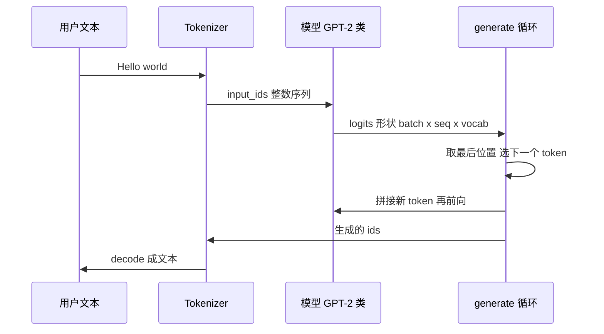

# Hugging Face Transformers：预训练模型的统一接口

> **免责声明**：本文是“河洛序”知识图谱 K2 批次的**初稿**，由 AI 辅助整理，仅供学习参考，不构成任何承诺或保证。版本信息截至 2026-10-14；文中示例已在 Python 3.15.0（数据结构与算法，纯标准库）或 Python 3.13 + 所列库版本（AI/ML 库与数学）下**实际运行**，输出为真实结果，但换机器、换版本时数字（尤其是耗时）会不同。
>
> 标注说明：**【有据可查】** 附官方文档 / 原始出处链接；**【社区共识】** 为业界普遍做法，没有唯一权威出处；**【待考察/推测】** 为未能核实或作者推断，请勿当作定论。

## 一句话定义

Transformers 是 Hugging Face 的开源库，为成千上万个预训练模型（文本、图像、语音、多模态）提供**统一的加载、推理与训练接口**：`AutoTokenizer` + `AutoModel...` + `generate` / `pipeline`。

## 为什么重要

- **“模型定义的事实标准”**：大量开源模型在 Hugging Face Hub 发布，并通过 Transformers 的模型定义被 vLLM、TGI、llama.cpp 转换工具等下游项目复用。【有据可查】官方博客 Transformers v5：<https://huggingface.co/blog/transformers-v5>
- **一行换模型**：只改模型名就能在不同架构之间切换。
- **与 PEFT、Accelerate、Datasets 协同**完成微调全流程（见 [[k2.ml.peft]]）。

## 原理 / 图解

【有据可查】Transformers v5.0.0 于 2026-01-26 发布到 PyPI；v5 **移除了 TensorFlow 与 JAX/Flax 支持，只保留 PyTorch 后端**，并移除 `load_in_4bit/load_in_8bit` 参数（改用 `quantization_config`）等：<https://github.com/huggingface/transformers/blob/main/MIGRATION_GUIDE_V5.md> 。本文使用 transformers 5.19.0（PyPI 发布于 2026-10-06）。

一次文本生成的数据流：



语言模型的训练目标是下一个 token 的交叉熵（见 [[k2.math.loss-function]]）。随机初始化时预测接近均匀分布，因此损失约为：

$$
L \approx -\ln\frac{1}{V} = \ln V,\qquad V=1000 \Rightarrow L \approx 6.908
$$

## 可运行示例

从配置**本地构造**一个只有 16.8 万参数的微型 GPT-2（随机权重，无需下载），检查 logits 形状、损失、贪心/采样生成；最后可选地从 Hub 下载测试用的 `hf-internal-testing/tiny-random-gpt2` 观察真实分词器（Python 3.13 + transformers 5.19.0 + torch CPU 实际运行）：

```python
# 文件：examples/05_transformers.py
# Transformers：预训练模型的统一接口。CPU 上用“随机初始化的微型 GPT-2”演示结构与生成流程
import torch, transformers
from transformers import GPT2Config, GPT2LMHeadModel
print("transformers", transformers.__version__)
torch.manual_seed(0)

# 1) 从配置构建一个微型模型（无需下载权重）
cfg = GPT2Config(vocab_size=1000, n_positions=64, n_embd=64, n_layer=2, n_head=4, bos_token_id=0, eos_token_id=0)
model = GPT2LMHeadModel(cfg).eval()
print(f"微型 GPT-2：{cfg.n_layer} 层、{cfg.n_head} 头、隐藏维度 {cfg.n_embd}，参数量 {model.num_parameters():,}")

# 2) 前向：输入 token id → 每个位置对词表的 logits
ids = torch.tensor([[11, 42, 7, 99]])
with torch.no_grad(): out = model(input_ids=ids, labels=ids)
print("logits 形状 (batch, 序列长度, 词表):", tuple(out.logits.shape))
print(f"随机模型的损失 {out.loss.item():.3f} ≈ ln(词表大小) = {torch.log(torch.tensor(1000.)).item():.3f}")

# 3) 生成：贪心解码 vs 采样
g = model.generate(ids, max_new_tokens=8, do_sample=False, pad_token_id=0)
s = model.generate(ids, max_new_tokens=8, do_sample=True, top_k=50, temperature=1.0, pad_token_id=0)
print("贪心生成的 token id:", g[0].tolist())
print("采样生成的 token id:", s[0].tolist())

# 4) 从 Hugging Face Hub 加载一个测试用的极小模型 + 分词器（需要网络）
try:
    from transformers import AutoTokenizer, AutoModelForCausalLM
    name = "hf-internal-testing/tiny-random-gpt2"
    tok = AutoTokenizer.from_pretrained(name); lm = AutoModelForCausalLM.from_pretrained(name)
    enc = tok("Hello world, this is", return_tensors="pt")
    print("分词结果:", tok.convert_ids_to_tokens(enc.input_ids[0]))
    gen = lm.generate(**enc, max_new_tokens=5, do_sample=False, pad_token_id=tok.eos_token_id)
    print("Hub 微型模型生成(随机权重，输出无意义):", repr(tok.decode(gen[0][enc.input_ids.shape[1]:])))
except Exception as e:
    print("Hub 加载跳过:", type(e).__name__, str(e)[:120])
```

输出（含库自身打印的提示与加载进度条）：

```text
[transformers] `loss_type=None` was set in the config but it is unrecognized. Using the default loss: `ForCausalLMLoss`.
transformers 5.19.0
微型 GPT-2：2 层、4 头、隐藏维度 64，参数量 168,192
logits 形状 (batch, 序列长度, 词表): (1, 4, 1000)
随机模型的损失 6.889 ≈ ln(词表大小) = 6.908
贪心生成的 token id: [11, 42, 7, 99, 99, 99, 99, 99, 99, 99, 591, 591]
采样生成的 token id: [11, 42, 7, 99, 51, 623, 537, 139, 139, 556, 227, 260]

Loading weights:   0%|          | 0/64 [00:00<?, ?it/s]
Loading weights: 100%|██████████| 64/64 [00:00<00:00, 13239.73it/s]
分词结果: ['H', 'ell', 'o', 'Ġw', 'orld', ',', 'Ġthis', 'Ġis']
Hub 微型模型生成(随机权重，输出无意义): 'jjjirir'
```

- 随机模型的损失 6.889 ≈ ln 1000 = 6.908，印证了上面的公式。
- 分词器把 "Hello" 拆成 `H` + `ell` + `o`，`Ġ` 表示前面有空格——这是 GPT-2 的字节级 BPE（分词原理与 [[k2.ds.trie]] 的前缀匹配相关）。
- 随机权重生成的是无意义字符，这是预期结果。

## 常见误区

- **照搬 v4 教程**：v5 移除了 TF/Flax 类（如 `TFAutoModel`）、`load_in_8bit` 参数等，旧代码可能报错；以迁移指南为准。
- **“模型能加载就能跑”**：7B 参数的模型 float16 权重约 14GB，普通笔记本内存/显存往往不够。本地部署请保守评估硬件，先用小模型或 API 验证。【社区共识】
- **`trust_remote_code=True` 随手开**：会执行模型仓库里的 Python 代码，只对信任的来源开启。【有据可查】<https://huggingface.co/docs/transformers/models#custom-models>
- **把访问令牌写进代码**：HF Token 应放环境变量（如 `HF_TOKEN=hf_****`）或用 `hf auth login`，不要提交到仓库。
- **忽视模型许可证**：不同模型的商用许可差别很大，使用前看模型卡（Model Card）。

## 与 AI 开发的关系

- **本地推理与评估**：快速试用开源模型、做离线批量推理。
- **微调**：`Trainer` 或自写循环 + PEFT/LoRA（见 [[k2.ml.peft]]）。
- **理解大模型内部**：logits、注意力、KV Cache、采样参数（temperature/top-p，见 [[k2.math.probability]]）都能在这里直接观察。

## 延伸阅读

- 官方文档：<https://huggingface.co/docs/transformers/index>
- v5 迁移指南：<https://github.com/huggingface/transformers/blob/main/MIGRATION_GUIDE_V5.md>
- v5 发布博客：<https://huggingface.co/blog/transformers-v5>
- Hugging Face LLM 课程：<https://huggingface.co/learn/llm-course>
- 原始 Transformer 论文 Attention Is All You Need：<https://arxiv.org/abs/1706.03762>

## 无法核实 / 待考察点

- 【待考察/推测】v5.x 各小版本（5.1–5.19）的累计变更未逐条核实。
- 【待考察/推测】示例中 `loss_type=None` 警告的具体触发条件与是否会在后续版本消失未核实。
