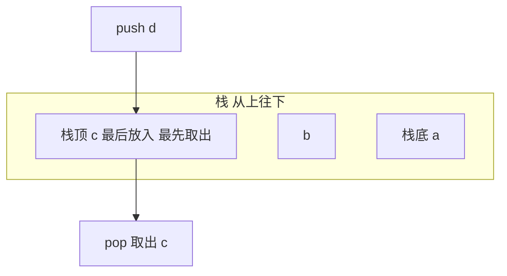

# 栈（Stack）

> **免责声明**：本文是“河洛序”知识图谱 K2 批次的**初稿**，由 AI 辅助整理，仅供学习参考，不构成任何承诺或保证。版本信息截至 2026-10-14；文中示例已在 Python 3.15.0（数据结构与算法，纯标准库）或 Python 3.13 + 所列库版本（AI/ML 库与数学）下**实际运行**，输出为真实结果，但换机器、换版本时数字（尤其是耗时）会不同。
>
> 标注说明：**【有据可查】** 附官方文档 / 原始出处链接；**【社区共识】** 为业界普遍做法，没有唯一权威出处；**【待考察/推测】** 为未能核实或作者推断，请勿当作定论。

## 一句话定义

栈是**后进先出（LIFO）**的容器：只能在一端（栈顶）放入（push）和取出（pop）。就像一摞盘子，最后放上去的最先拿走。

## 为什么重要

- **函数调用就是栈**：每次调用压入一个栈帧，返回时弹出；错误时看到的回溯（traceback）就是调用栈（见 [[k1.prog.stack-trace]]）。
- 括号匹配、表达式求值、撤销（Undo）、浏览器后退、深度优先搜索（见 [[k2.algo.dfs]]）都靠栈。

## 原理 / 图解



Python 中用 `list` 的 `append` / `pop()` 即可，二者都是摊还 $O(1)$。【有据可查】官方教程“将列表作为栈使用”：<https://docs.python.org/3/tutorial/datastructures.html#using-lists-as-stacks>

## 可运行示例

括号匹配、逆波兰表达式（RPN）求值、递归深度上限、用显式栈把递归改成循环（Python 3.15.0 实际运行）：

```python
# 文件：examples/10_stack.py
# 栈：后进先出 LIFO。Python 用 list 的 append/pop 即可
def balanced(s: str) -> bool:
    pairs, stack = {")": "(", "]": "[", "}": "{"}, []
    for ch in s:
        if ch in "([{": stack.append(ch)
        elif ch in pairs:
            if not stack or stack.pop() != pairs[ch]: return False
    return not stack
for s in ["{[()]}", "([)]", '{"a": [1, 2]}', "(("]:
    print(f"{s!r:16} 括号匹配: {balanced(s)}")

# 逆波兰表达式求值（计算器、编译器的经典用法）
def rpn(tokens):
    st = []
    for t in tokens:
        if t in "+-*/":
            b, a = st.pop(), st.pop()
            st.append({"+": a + b, "-": a - b, "*": a * b, "/": a / b}[t])
        else: st.append(float(t))
    return st[0]
print("(3 + 4) * 2 的逆波兰 3 4 + 2 * =", rpn("3 4 + 2 *".split()))

# 函数调用栈本身就是栈：递归太深会溢出
import sys
def depth(n): return 0 if n == 0 else 1 + depth(n - 1)
print("默认递归上限:", sys.getrecursionlimit())
try: depth(100_000)
except RecursionError as e: print("RecursionError:", e)

# 用显式栈把递归改成循环（DFS 常用）
def depth_iter(n):
    stack, d = [n], 0
    while stack:
        x = stack.pop()
        if x: d += 1; stack.append(x - 1)
    return d
print("显式栈处理 100000 层:", depth_iter(100_000))
```

输出：

```text
'{[()]}'         括号匹配: True
'([)]'           括号匹配: False
'{"a": [1, 2]}'  括号匹配: True
'(('             括号匹配: False
(3 + 4) * 2 的逆波兰 3 4 + 2 * = 14.0
默认递归上限: 1000
RecursionError: maximum recursion depth exceeded
显式栈处理 100000 层: 100000
```

递归 1000 层就触发 `RecursionError`（默认递归上限约为 1000），改用显式栈后处理 10 万层也没问题。【有据可查】`sys.getrecursionlimit`：<https://docs.python.org/3/library/sys.html#sys.getrecursionlimit>

## 常见误区

- **`pop(0)` 当栈用**：那是从底部取，变成队列且是 $O(n)$。
- **空栈 pop**：会抛 `IndexError`，要先判空。
- **随意调大 `sys.setrecursionlimit`**：可能导致解释器真正的 C 栈溢出而崩溃；深递归应改迭代。
- **混淆“栈”数据结构和“栈内存”**：前者是抽象结构，后者是程序运行时的内存区域，二者相关但不是一回事。

## 与 AI 开发的关系

- **解析模型输出**：检查 LLM 生成的 JSON/代码括号是否配对、提取嵌套结构，常用栈。
- **结构化生成**：约束解码（按 JSON 语法生成）内部维护类似下推自动机的栈状态。【待考察/推测】具体实现因库而异。
- **Agent 任务分解**：子任务的“进入/返回”天然是栈式结构。

## 延伸阅读

- Python 教程：列表作为栈 <https://docs.python.org/3/tutorial/datastructures.html#using-lists-as-stacks>
- 逆波兰表示法（维基百科）：<https://en.wikipedia.org/wiki/Reverse_Polish_notation>

## 无法核实 / 待考察点

- 【待考察/推测】Python 3.12 起解释器对 Python 函数调用不再消耗 C 栈，对递归上限行为的影响细节未逐条核实。
