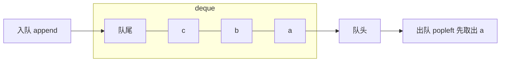

# 队列（Queue）

> **免责声明**：本文是“河洛序”知识图谱 K2 批次的**初稿**，由 AI 辅助整理，仅供学习参考，不构成任何承诺或保证。版本信息截至 2026-10-14；文中示例已在 Python 3.15.0（数据结构与算法，纯标准库）或 Python 3.13 + 所列库版本（AI/ML 库与数学）下**实际运行**，输出为真实结果，但换机器、换版本时数字（尤其是耗时）会不同。
>
> 标注说明：**【有据可查】** 附官方文档 / 原始出处链接；**【社区共识】** 为业界普遍做法，没有唯一权威出处；**【待考察/推测】** 为未能核实或作者推断，请勿当作定论。

## 一句话定义

队列是**先进先出（FIFO）**的容器：从队尾入队（enqueue），从队头出队（dequeue），像排队买票。双端队列（deque）两端都能进出。

## 为什么重要

- **广度优先搜索**的核心（见 [[k2.algo.bfs]]）。
- **任务调度与削峰**：请求排队、消息队列、线程/协程之间传递任务。
- **滑动窗口**：保留最近 N 条数据。

## 原理 / 图解



| Python 工具 | 适用场景 |
|---|---|
| `collections.deque` | 单线程，两端 $O(1)$，可设 `maxlen` |
| `queue.Queue` | 多线程，线程安全，可阻塞等待 |
| `asyncio.Queue` | 协程之间，非线程安全 |
| `heapq` / `queue.PriorityQueue` | 按优先级出队（见 [[k2.ds.heap]]） |

【有据可查】`queue` 模块文档：<https://docs.python.org/3/library/queue.html> ；`asyncio.Queue`：<https://docs.python.org/3/library/asyncio-queue.html>

## 可运行示例

deque 基本操作、`maxlen` 滑动窗口、多线程生产者/消费者、asyncio 队列（Python 3.15.0 实际运行）：

```python
# 文件：examples/11_queue.py
# 队列：先进先出 FIFO。用 collections.deque，不要用 list.pop(0)
from collections import deque
q = deque()
for job in ["任务A", "任务B", "任务C"]: q.append(job)
print("出队顺序:", [q.popleft() for _ in range(len(q))])

# 固定长度的滑动窗口（如最近 N 轮对话、最近 N 个指标）
window = deque(maxlen=3)
for loss in [2.0, 1.5, 1.2, 1.0, 0.9]:
    window.append(loss)
    print(f"新值 {loss} -> 窗口 {list(window)} 平均 {sum(window)/len(window):.2f}")

# 线程安全队列：生产者-消费者
import queue, threading
jobs, results = queue.Queue(maxsize=2), []
def worker():
    while (item := jobs.get()) is not None:
        results.append(item * item); jobs.task_done()
    jobs.task_done()
t = threading.Thread(target=worker); t.start()
for i in range(5): jobs.put(i)          # 队列满时 put 会阻塞 = 背压
jobs.put(None); jobs.join(); t.join()
print("消费者结果:", results)

# 优先队列（见“堆”）与 asyncio.Queue 也都是队列家族成员
import asyncio
async def main():
    aq = asyncio.Queue()
    for i in range(3): await aq.put(f"请求{i}")
    return [await aq.get() for _ in range(3)]
print("asyncio.Queue:", asyncio.run(main()))
```

输出：

```text
出队顺序: ['任务A', '任务B', '任务C']
新值 2.0 -> 窗口 [2.0] 平均 2.00
新值 1.5 -> 窗口 [2.0, 1.5] 平均 1.75
新值 1.2 -> 窗口 [2.0, 1.5, 1.2] 平均 1.57
新值 1.0 -> 窗口 [1.5, 1.2, 1.0] 平均 1.23
新值 0.9 -> 窗口 [1.2, 1.0, 0.9] 平均 1.03
消费者结果: [0, 1, 4, 9, 16]
asyncio.Queue: ['请求0', '请求1', '请求2']
```

## 常见误区

- **`list.pop(0)` 做队列**：$O(n)$，数据多时很慢。
- **多线程共享 deque 做复杂操作**：单个 `append`/`popleft` 是线程安全的，但“先判断再取”这类组合操作不是；跨线程用 `queue.Queue`。
- **在协程里用 `queue.Queue` 阻塞等待**：会阻塞整个事件循环，应使用 `asyncio.Queue`（见 [[k1.py.async-await]]）。
- **无界队列**：生产快于消费时内存无限增长，生产环境要设 `maxsize` 实现背压（backpressure）。

## 与 AI 开发的关系

- **LLM API 调用限流**：把请求放入有界队列，由固定数量的 worker 消费，控制并发、遵守服务商的速率限制（本文不讨论绕过限额）。
- **推理服务的批处理**：vLLM 等推理引擎维护请求等待队列，按调度策略组批。【有据可查】<https://docs.vllm.ai/en/latest/design/arch_overview.html>
- **对话记忆窗口**：`deque(maxlen=N)` 只保留最近 N 轮对话。

## 延伸阅读

- `collections.deque`：<https://docs.python.org/3/library/collections.html#collections.deque>
- `queue` 模块：<https://docs.python.org/3/library/queue.html>
- `asyncio.Queue`：<https://docs.python.org/3/library/asyncio-queue.html>

## 无法核实 / 待考察点

- 【待考察/推测】在 free-threaded（无 GIL）构建下 deque 单操作的线程安全保证是否完全一致，未查到官方逐条说明。
