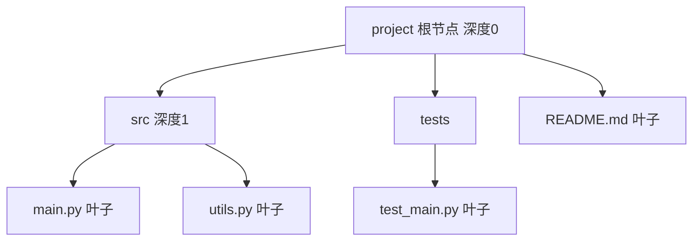

# 树（Tree）

> **免责声明**：本文是“河洛序”知识图谱 K2 批次的**初稿**，由 AI 辅助整理，仅供学习参考，不构成任何承诺或保证。版本信息截至 2026-10-14；文中示例已在 Python 3.15.0（数据结构与算法，纯标准库）或 Python 3.13 + 所列库版本（AI/ML 库与数学）下**实际运行**，输出为真实结果，但换机器、换版本时数字（尤其是耗时）会不同。
>
> 标注说明：**【有据可查】** 附官方文档 / 原始出处链接；**【社区共识】** 为业界普遍做法，没有唯一权威出处；**【待考察/推测】** 为未能核实或作者推断，请勿当作定论。

## 一句话定义

树是由节点和边组成的**层级结构**：有一个根节点，每个节点可以有多个子节点，除根以外每个节点恰好有一个父节点，并且没有环。

## 为什么重要

- **层级数据无处不在**：文件系统、HTML/DOM、JSON、组织架构、代码的语法树（AST）。
- 许多高效结构都是特化的树：二叉搜索树、堆、Trie、B 树（数据库索引）、决策树（机器学习模型）。

## 原理 / 图解



| 术语 | 含义 |
|---|---|
| 根（root） | 没有父节点的节点 |
| 叶子（leaf） | 没有子节点的节点 |
| 深度 / 高度 | 从根到该节点的边数 / 从根到最深叶子的层数 |
| 子树 | 任一节点及其所有后代 |

一棵有 $n$ 个节点的树恰好有 $n-1$ 条边。树天然适合**递归**：一棵树 = 根 + 若干棵子树。

## 可运行示例

用类表示文件树，递归打印、求高度与叶子数、查找路径；再看 Python 自带的语法树 `ast` 和 JSON 嵌套结构（Python 3.15.0 实际运行）：

```python
# 文件：examples/13_tree.py
# 树：有层级、无环的结构。文件系统、DOM、JSON、AST、组织架构都是树
from dataclasses import dataclass, field

@dataclass
class TreeNode:
    name: str
    children: list["TreeNode"] = field(default_factory=list)
    def add(self, *kids): self.children.extend(kids); return self

root = TreeNode("project").add(
    TreeNode("src").add(TreeNode("main.py"), TreeNode("utils.py")),
    TreeNode("tests").add(TreeNode("test_main.py")),
    TreeNode("README.md"))

def show(node, prefix=""):                   # 前序遍历：先处理自己再处理孩子
    print(prefix + node.name)
    for c in node.children: show(c, prefix + "  ")
show(root)

def height(n): return 1 + max((height(c) for c in n.children), default=0)
def count_leaves(n): return 1 if not n.children else sum(count_leaves(c) for c in n.children)
print("高度:", height(root), "| 叶子数:", count_leaves(root))

def path_to(n, target, path=()):
    path = path + (n.name,)
    if n.name == target: return "/".join(path)
    for c in n.children:
        if (p := path_to(c, target, path)): return p
print("查找路径:", path_to(root, "test_main.py"))

# Python 代码本身就是一棵树（AST）
import ast
tree = ast.parse("y = (a + b) * 2")
print(ast.dump(tree.body[0].value, indent=1)[:200])

# JSON 也是树
import json
doc = json.loads('{"model": {"name": "x", "layers": [{"type": "attn"}, {"type": "mlp"}]}}')
print("JSON 树深处取值:", doc["model"]["layers"][1]["type"])
```

输出：

```text
project
  src
    main.py
    utils.py
  tests
    test_main.py
  README.md
高度: 3 | 叶子数: 4
查找路径: project/tests/test_main.py
BinOp(
 left=BinOp(
  left=Name(id='a'),
  op=Add(),
  right=Name(id='b')),
 op=Mult(),
 right=Constant(value=2))
JSON 树深处取值: mlp
```

`ast.dump` 显示 `(a + b) * 2` 的语法树：乘法是根，左子树是加法——括号决定了树的形状，也决定了计算顺序。【有据可查】`ast` 模块：<https://docs.python.org/3/library/ast.html>

## 常见误区

- **深度与高度的定义不统一**：有的教材从 0 计、有的从 1 计，读题时先确认。
- **很深的树用递归遍历**：可能触发递归上限（见 [[k2.ds.stack]]），可改用显式栈。
- **把有共享子节点的结构当树处理**：一个节点有两个父节点就是图（DAG）了（见 [[k2.ds.graph]]），遍历时要防重复。

## 与 AI 开发的关系

- **决策树与随机森林**：sklearn 的树模型（见 [[k2.ml.sklearn]]）、XGBoost/LightGBM 的梯度提升树。
- **代码智能**：代码分析、重构工具和部分代码模型基于 AST 或 tree-sitter 语法树。【有据可查】<https://tree-sitter.github.io/tree-sitter/>
- **思维树（Tree of Thoughts）**：把 LLM 推理组织为树状搜索。【有据可查】<https://arxiv.org/abs/2305.10601>
- **文档切分**：按标题层级（Markdown 树）切分文档用于 RAG。

## 延伸阅读

- 维基百科：树（数据结构）<https://en.wikipedia.org/wiki/Tree_(abstract_data_type)>
- Python `ast` 模块：<https://docs.python.org/3/library/ast.html>
- 《算法导论》第 10、12 章。

## 无法核实 / 待考察点

- 暂无需要特别标注的不确定事实；术语计数方式请以所用教材为准。
