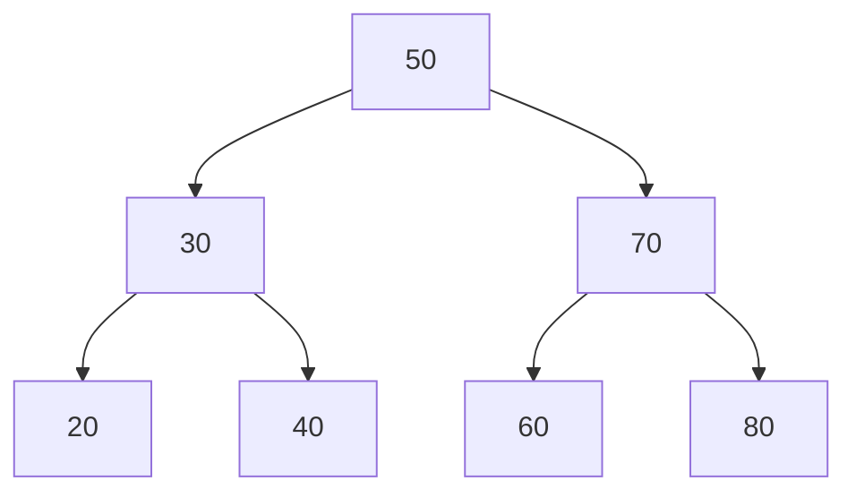

# 二叉树与二叉搜索树（BST）

> **免责声明**：本文是“河洛序”知识图谱 K2 批次的**初稿**，由 AI 辅助整理，仅供学习参考，不构成任何承诺或保证。版本信息截至 2026-10-14；文中示例已在 Python 3.15.0（数据结构与算法，纯标准库）或 Python 3.13 + 所列库版本（AI/ML 库与数学）下**实际运行**，输出为真实结果，但换机器、换版本时数字（尤其是耗时）会不同。
>
> 标注说明：**【有据可查】** 附官方文档 / 原始出处链接；**【社区共识】** 为业界普遍做法，没有唯一权威出处；**【待考察/推测】** 为未能核实或作者推断，请勿当作定论。

## 一句话定义

二叉树是每个节点**最多两个子节点**（左、右）的树。二叉搜索树（BST）进一步要求：**左子树的值都小于节点，右子树的值都大于节点**，因此查找时每一步可以排除一半。

## 为什么重要

- 是“二分”思想在数据结构上的体现：平衡时查找、插入、删除都是 $O(\log n)$。
- 红黑树、AVL 树、B 树（数据库索引）、堆（见 [[k2.ds.heap]]）都是它的变体或近亲。
- 四种遍历方式（前序、中序、后序、层序）是树类题目的基本功。

## 原理 / 图解



在上图中查找 60：50 → 往右 70 → 往左 60，共 3 步。高度为 $h$ 的二叉树最多有 $2^{h}-1$ 个节点，所以平衡 BST 的高度约为：

$$
h \approx \log_2 (n+1)
$$

| 遍历 | 顺序 | 上图结果 |
|---|---|---|
| 前序 | 根 左 右 | 50 30 20 40 70 60 80 |
| 中序 | 左 根 右 | 20 30 40 50 60 70 80（BST 中序必然有序） |
| 后序 | 左 右 根 | 20 40 30 60 80 70 50 |
| 层序 | 一层一层 | 50 30 70 20 40 60 80 |

## 可运行示例

实现 BST 的插入、查找、遍历，并对比**随机插入**和**有序插入** 1000 个键后的树高（Python 3.15.0 实际运行）：

```python
# 文件：examples/14_binary_tree.py
# 二叉树与二叉搜索树（BST）：左 < 根 < 右，平衡时查找 O(log n)
from dataclasses import dataclass
from typing import Optional
import random

@dataclass
class N:
    key: int
    left: Optional["N"] = None
    right: Optional["N"] = None

def insert(root, key):
    if root is None: return N(key)
    if key < root.key: root.left = insert(root.left, key)
    else: root.right = insert(root.right, key)
    return root
def inorder(r):  return inorder(r.left) + [r.key] + inorder(r.right) if r else []
def preorder(r): return [r.key] + preorder(r.left) + preorder(r.right) if r else []
def height(r):   return 1 + max(height(r.left), height(r.right)) if r else 0
def search(r, k, steps=1):
    if r is None: return None
    if k == r.key: return steps
    return search(r.left if k < r.key else r.right, k, steps + 1)

root = None
for k in [50, 30, 70, 20, 40, 60, 80]: root = insert(root, k)
print("中序遍历(有序!):", inorder(root))
print("前序遍历:", preorder(root))
print("高度:", height(root), "| 查找 60 用了", search(root, 60), "步")

# 插入顺序决定形状：有序插入会退化成链表
import sys; sys.setrecursionlimit(10_000)
rnd, seq = None, None
keys = list(range(1000)); shuffled = keys[:]; random.Random(0).shuffle(shuffled)
for k in shuffled: rnd = insert(rnd, k)
for k in keys: seq = insert(seq, k)
print(f"1000 个键：随机插入高度 {height(rnd)}，有序插入高度 {height(seq)}（退化成链表）")
print("理想平衡高度 ≈ log2(1000) ≈ 10 → 这就是需要红黑树/AVL 等自平衡树的原因")

# 层序遍历（BFS）
from collections import deque
def level_order(r):
    out, q = [], deque([r])
    while q:
        level = [q.popleft() for _ in range(len(q))]
        out.append([n.key for n in level])
        q.extend(c for n in level for c in (n.left, n.right) if c)
    return out
print("层序遍历:", level_order(root))
```

输出：

```text
中序遍历(有序!): [20, 30, 40, 50, 60, 70, 80]
前序遍历: [50, 30, 20, 40, 70, 60, 80]
高度: 3 | 查找 60 用了 3 步
1000 个键：随机插入高度 21，有序插入高度 1000（退化成链表）
理想平衡高度 ≈ log2(1000) ≈ 10 → 这就是需要红黑树/AVL 等自平衡树的原因
层序遍历: [[50], [30, 70], [20, 40, 60, 80]]
```

关键结果：随机插入树高 21，**有序插入树高 1000**——树退化成链表，查找变成 $O(n)$。这就是需要红黑树、AVL 树等**自平衡**结构的原因。

## 常见误区

- **以为 BST 总是 $O(\log n)$**：只有平衡时才是；有序数据直接插入会退化。
- **二叉树 ≠ 二叉搜索树**：前者只限制子节点个数，后者还要求有序性。
- **只比较节点与直接子节点来验证 BST**：必须保证整棵左子树都小于根，常见错误是只看一层。
- **Python 没有内置平衡树**：需要有序集合时可用 `bisect` 维护有序列表，或第三方库 `sortedcontainers`。【有据可查】<https://grantjenks.com/docs/sortedcontainers/>

## 与 AI 开发的关系

- **决策树**：分类与回归树（CART）就是二叉树，每个内部节点是一个“特征 ≤ 阈值？”的判断。【有据可查】<https://scikit-learn.org/stable/modules/tree.html>
- **向量检索**：KD 树、Ball 树把空间二分，用于低维最近邻搜索（sklearn `KDTree`）；高维向量库更多使用 HNSW 等图索引。
- **哈夫曼树**：BPE 之前的经典编码方法，见 [[k2.algo.greedy]]。

## 延伸阅读

- 维基百科：二叉搜索树 <https://en.wikipedia.org/wiki/Binary_search_tree>
- VisuAlgo 二叉搜索树动画：<https://visualgo.net/en/bst>
- 《算法导论》第 12、13 章（BST 与红黑树）。

## 无法核实 / 待考察点

- 【待考察/推测】随机插入的树高 21 是一次随机实验结果；理论上随机 BST 的期望高度约为 $4.311\ln n$ 量级（文献结论，未在本文中复现推导）。
