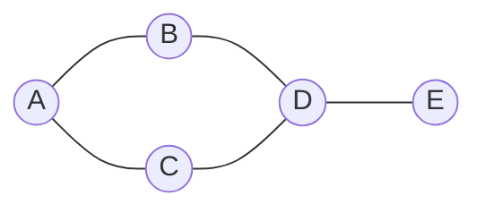

# 图（Graph）

> **免责声明**：本文是“河洛序”知识图谱 K2 批次的**初稿**，由 AI 辅助整理，仅供学习参考，不构成任何承诺或保证。版本信息截至 2026-10-14；文中示例已在 Python 3.15.0（数据结构与算法，纯标准库）或 Python 3.13 + 所列库版本（AI/ML 库与数学）下**实际运行**，输出为真实结果，但换机器、换版本时数字（尤其是耗时）会不同。
>
> 标注说明：**【有据可查】** 附官方文档 / 原始出处链接；**【社区共识】** 为业界普遍做法，没有唯一权威出处；**【待考察/推测】** 为未能核实或作者推断，请勿当作定论。

## 一句话定义

图由**顶点（节点）**和连接它们的**边**组成，用来表示“谁和谁有关系”。边可以有方向（有向图）、可以有权重（加权图）。树是一种特殊的图：连通且无环。

## 为什么重要

- 社交网络、地图导航、网页链接、依赖关系、知识图谱、计算图——几乎所有“关系”都能建模成图。
- BFS、DFS、最短路径、拓扑排序等经典算法都在图上运行（见 [[k2.algo.bfs]]、[[k2.algo.dijkstra]]）。

## 原理 / 图解



两种存储方式：

| 方式 | 空间 | 判断 u-v 是否相邻 | 遍历 u 的邻居 | 适合 |
|---|---|---|---|---|
| 邻接矩阵 | $O(V^2)$ | $O(1)$ | $O(V)$ | 稠密图、需要矩阵运算 |
| 邻接表 | $O(V+E)$ | $O(\deg u)$ | $O(\deg u)$ | 稀疏图（现实中大多数） |

无向图中所有顶点度数之和等于边数的两倍（握手定理）：

$$
\sum_{v \in V} \deg(v) = 2\lvert E\rvert
$$

**有向无环图（DAG）**可以做拓扑排序：把任务排成“依赖总在前面”的顺序。【有据可查】Python 3.9+ 标准库 `graphlib.TopologicalSorter`：<https://docs.python.org/3/library/graphlib.html>


## 可运行示例

邻接表与邻接矩阵、度数统计、用 `graphlib` 对机器学习流水线做拓扑排序并检测环（Python 3.15.0 实际运行）：

```python
# 文件：examples/15_graph.py
# 图：节点 + 边。表示方式：邻接表（稀疏图首选）与邻接矩阵（稠密图）
from collections import defaultdict

edges = [("A", "B"), ("A", "C"), ("B", "D"), ("C", "D"), ("D", "E")]
adj = defaultdict(list)
for u, v in edges:            # 无向图：两个方向都加
    adj[u].append(v); adj[v].append(u)
print("邻接表:", dict(adj))

nodes = sorted(adj)
idx = {n: i for i, n in enumerate(nodes)}
mat = [[0] * len(nodes) for _ in nodes]
for u, v in edges: mat[idx[u]][idx[v]] = mat[idx[v]][idx[u]] = 1
print("邻接矩阵:")
print("   " + " ".join(nodes))
for n, row in zip(nodes, mat): print(f"{n}  " + " ".join(map(str, row)))
print("各节点度数:", {n: len(adj[n]) for n in nodes})

# 有向图 + 拓扑排序：任务依赖、pip 依赖解析、计算图都靠它
from graphlib import TopologicalSorter
deps = {"train": {"tokenize", "download"}, "tokenize": {"download"}, "eval": {"train"}, "report": {"eval", "train"}}
print("拓扑序（先做谁）:", list(TopologicalSorter(deps).static_order()))
from graphlib import CycleError
try: list(TopologicalSorter({"a": {"b"}, "b": {"a"}}).static_order())
except CycleError as e: print("检测到环:", e.args[1])

# 空间对比：n 个节点、m 条边
n, m = 10_000, 50_000
print(f"n={n}, m={m}: 邻接矩阵需 {n*n:,} 个格子，邻接表约 {2*m:,} 个条目")
```

输出：

```text
邻接表: {'A': ['B', 'C'], 'B': ['A', 'D'], 'C': ['A', 'D'], 'D': ['B', 'C', 'E'], 'E': ['D']}
邻接矩阵:
   A B C D E
A  0 1 1 0 0
B  1 0 0 1 0
C  1 0 0 1 0
D  0 1 1 0 1
E  0 0 0 1 0
各节点度数: {'A': 2, 'B': 2, 'C': 2, 'D': 3, 'E': 1}
拓扑序（先做谁）: ['download', 'tokenize', 'train', 'eval', 'report']
检测到环: ['a', 'b', 'a']
n=10000, m=50000: 邻接矩阵需 100,000,000 个格子，邻接表约 100,000 个条目
```

上面度数之和 2+2+2+3+1 = 10 = 2 × 5 条边，验证了握手定理；1 万个点、5 万条边的稀疏图，邻接矩阵要 1 亿个格子，邻接表只要约 10 万个条目。

## 常见误区

- **稀疏图用邻接矩阵**：内存爆炸。
- **遍历图忘记 visited 集合**：有环时会死循环（树不需要，图需要）。
- **有环图做拓扑排序**：不存在合法顺序，`graphlib` 会抛 `CycleError`。
- **无向图只存一个方向的边**：导致遍历不完整。

## 与 AI 开发的关系

- **计算图**：PyTorch autograd 在前向时构建 DAG，反向传播就是在这张图上按拓扑逆序应用链式法则（见 [[k2.ml.pytorch]]）。
- **Agent 工作流编排**：LangGraph 等框架用图描述多步骤、带分支与循环的 Agent 流程。【有据可查】<https://langchain-ai.github.io/langgraph/>
- **GraphRAG / 知识图谱**：把实体关系建成图辅助检索。【有据可查】<https://github.com/microsoft/graphrag>
- **HNSW 向量索引**：分层“小世界”图实现近似最近邻搜索。【有据可查】<https://arxiv.org/abs/1603.09320>
- **图神经网络（GNN）**用邻接矩阵做消息传递（与 [[k2.math.matrix]] 相关）。

## 延伸阅读

- `graphlib` 文档：<https://docs.python.org/3/library/graphlib.html>
- NetworkX（Python 图分析库）：<https://networkx.org/documentation/stable/>
- 维基百科：图（抽象数据类型）<https://en.wikipedia.org/wiki/Graph_(abstract_data_type)>

## 无法核实 / 待考察点

- 【待考察/推测】LangGraph 文档站点地址可能随版本迁移，链接以校验当日为准。
