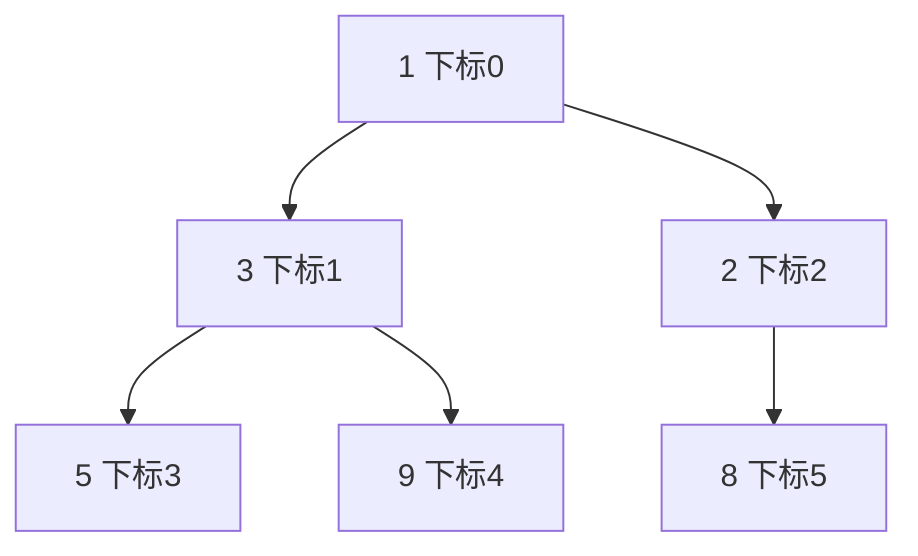

# 堆（Heap）与优先队列

> **免责声明**：本文是“河洛序”知识图谱 K2 批次的**初稿**，由 AI 辅助整理，仅供学习参考，不构成任何承诺或保证。版本信息截至 2026-10-14；文中示例已在 Python 3.15.0（数据结构与算法，纯标准库）或 Python 3.13 + 所列库版本（AI/ML 库与数学）下**实际运行**，输出为真实结果，但换机器、换版本时数字（尤其是耗时）会不同。
>
> 标注说明：**【有据可查】** 附官方文档 / 原始出处链接；**【社区共识】** 为业界普遍做法，没有唯一权威出处；**【待考察/推测】** 为未能核实或作者推断，请勿当作定论。

## 一句话定义

（二叉）堆是一棵**完全二叉树**，满足“父节点 ≤ 子节点”（最小堆）。堆顶永远是最小值，取最小值 $O(1)$，插入和弹出 $O(\log n)$。它是**优先队列**的标准实现。

## 为什么重要

- **随时取出“最重要的那个”**：任务调度、事件模拟、Dijkstra 最短路径（见 [[k2.algo.dijkstra]]）。
- **Top-K 问题**：从海量数据里找最大的 K 个，不必全部排序。
- **多路归并**：合并多个有序文件/列表。

## 原理 / 图解

堆用**数组**存储（无需指针）：下标 $i$ 的子节点在 $2i+1$、$2i+2$，父节点在 $\lfloor (i-1)/2 \rfloor$。堆性质：

$$
a\left[\left\lfloor \tfrac{i-1}{2} \right\rfloor\right] \le a[i]
$$



上图对应数组 `[1, 3, 2, 5, 9, 8]`。插入时新元素放末尾再“上浮”，弹出时把末尾元素移到堆顶再“下沉”，每次最多走树高 $\log_2 n$ 步。

【有据可查】Python `heapq` 模块：<https://docs.python.org/3/library/heapq.html> 。Python 3.14 起新增公开的最大堆函数 `heapify_max`、`heappush_max`、`heappop_max` 等（文档标注 Added in version 3.14）。

## 可运行示例

堆的数组表示、依次弹出、`nlargest`、用 `(优先级, 计数, 任务)` 元组做优先队列、`heapq.merge` 合并有序序列、3.14+ 最大堆（Python 3.15.0 实际运行）：

```python
# 文件：examples/16_heap.py
# 堆：完全二叉树 + 父节点 ≤ 子节点（最小堆）。取最小 O(1)，插入/弹出 O(log n)
import heapq, random

h = []
for x in [5, 3, 8, 1, 9, 2]:
    heapq.heappush(h, x)
print("堆的数组表示:", h, "| 堆顶(最小):", h[0])
print("依次弹出:", [heapq.heappop(h) for _ in range(len(h))])

# 数组下标关系：节点 i 的孩子是 2i+1, 2i+2
h = [1, 3, 2, 5, 9, 8]
ok = all(h[i] <= h[c] for i in range(len(h)) for c in (2*i+1, 2*i+2) if c < len(h))
print("满足堆性质:", ok)

# Top-K：从 100 万个数里找最大的 5 个，不用全排序
nums = [random.Random(0).random() for _ in range(5)] + list(range(1_000_000))
print("最大的 5 个:", heapq.nlargest(5, nums))

# 优先队列：任务调度（优先级, 序号, 任务），序号保证同优先级按先来后到
pq, seq = [], 0
for prio, task in [(2, "写日志"), (0, "处理告警"), (1, "回复用户"), (0, "重启服务")]:
    heapq.heappush(pq, (prio, seq, task)); seq += 1
print("调度顺序:", [heapq.heappop(pq)[2] for _ in range(len(pq))])

# 合并多个有序序列（归并 K 个有序文件/分片结果）
print("合并有序列表:", list(heapq.merge([1, 4, 9], [2, 3, 10], [0, 5])))

# Python 3.14+ 提供最大堆函数
if hasattr(heapq, "heappush_max"):
    mh = []
    for x in [5, 3, 8]: heapq.heappush_max(mh, x)
    print("最大堆（3.14+ heappush_max）堆顶:", mh[0])
```

输出：

```text
堆的数组表示: [1, 3, 2, 5, 9, 8] | 堆顶(最小): 1
依次弹出: [1, 2, 3, 5, 8, 9]
满足堆性质: True
最大的 5 个: [999999, 999998, 999997, 999996, 999995]
调度顺序: ['处理告警', '重启服务', '回复用户', '写日志']
合并有序列表: [0, 1, 2, 3, 4, 5, 9, 10]
最大堆（3.14+ heappush_max）堆顶: 8
```

## 常见误区

- **以为堆是有序数组**：`[1, 3, 2, 5, 9, 8]` 只保证父 ≤ 子，并不整体有序；按顺序要逐个 `heappop`。
- **元组优先级相同时比较任务对象报错**：加一个自增计数器作为第二字段打破平局。
- **3.14 之前用最大堆**：只能把数值取负 `-x` 存入最小堆；3.14+ 才有 `heappush_max` 等。
- **K 很大时用 `nlargest`**：K 接近 n 时直接 `sorted` 更快，文档也有说明。

## 与 AI 开发的关系

- **Top-k 采样与检索**：从词表 logits 中选概率最高的 k 个 token，或从向量相似度中取最相似的 k 篇文档；张量库通常用 `torch.topk` 等专门实现。
- **束搜索（beam search）**：每步保留得分最高的若干候选。
- **推理请求调度**：按优先级或截止时间调度请求。
- **A\* 搜索与规划**：Agent 规划算法常用优先队列。

## 延伸阅读

- `heapq` 文档（含优先队列实现说明）：<https://docs.python.org/3/library/heapq.html>
- VisuAlgo 二叉堆动画：<https://visualgo.net/en/heap>
- `queue.PriorityQueue`（线程安全版）：<https://docs.python.org/3/library/queue.html#queue.PriorityQueue>

## 无法核实 / 待考察点

- 【待考察/推测】`torch.topk` 在 CPU/GPU 上的内部算法（是否基于堆或基数选择）未核实。
