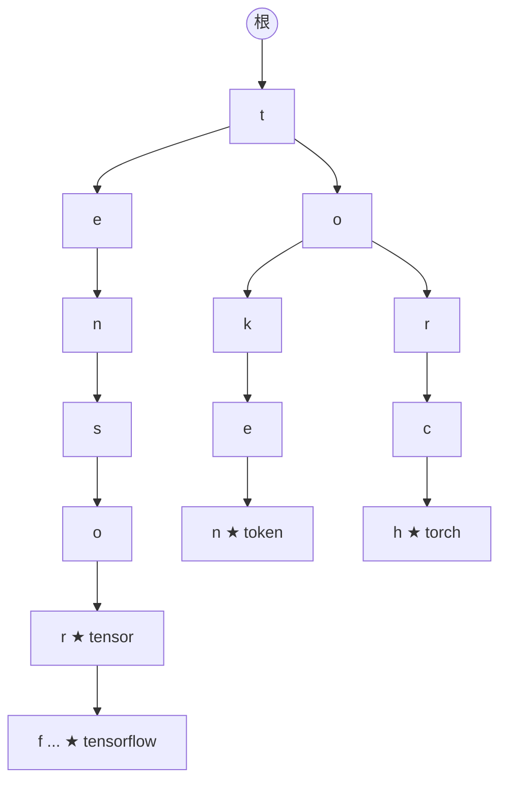

# Trie（前缀树 / 字典树）

> **免责声明**：本文是“河洛序”知识图谱 K2 批次的**初稿**，由 AI 辅助整理，仅供学习参考，不构成任何承诺或保证。版本信息截至 2026-10-14；文中示例已在 Python 3.15.0（数据结构与算法，纯标准库）或 Python 3.13 + 所列库版本（AI/ML 库与数学）下**实际运行**，输出为真实结果，但换机器、换版本时数字（尤其是耗时）会不同。
>
> 标注说明：**【有据可查】** 附官方文档 / 原始出处链接；**【社区共识】** 为业界普遍做法，没有唯一权威出处；**【待考察/推测】** 为未能核实或作者推断，请勿当作定论。

## 一句话定义

Trie 是专为**字符串前缀**设计的树：从根到某节点的路径拼起来就是一个前缀，共享前缀的单词共享同一段路径。查找一个长度为 $L$ 的词只需 $O(L)$，与词典大小无关。

## 为什么重要

- **自动补全、拼写检查、敏感词匹配、路由表（IP 最长前缀匹配）**的经典实现。
- **分词器**：最长前缀匹配（MaxMatch）类分词以及部分 tokenizer 的词表查找都用到前缀结构。

## 原理 / 图解

存入 `tensor`、`tensorflow`、`token`、`torch` 后的局部结构（★ 表示一个完整词结束）：



| 操作 | 哈希集合 | Trie |
|---|---|---|
| 精确查找 | 平均 $O(L)$（算哈希） | $O(L)$ |
| 列出某前缀的所有词 | 必须扫描全部词 | 走到前缀节点后只遍历子树 |
| 最长前缀匹配 | 尝试所有长度 | 一路向下走即可 |

## 可运行示例

用嵌套字典实现 Trie：插入、查找、自动补全、统计共享前缀节省的节点数、最长前缀匹配分词（Python 3.15.0 实际运行）：

```python
# 文件：examples/17_trie.py
# Trie（前缀树）：按字符逐层存储字符串，前缀查询只和前缀长度有关
class Trie:
    def __init__(self): self.root = {}
    END = "$"
    def insert(self, word, freq=1):
        node = self.root
        for ch in word: node = node.setdefault(ch, {})
        node[self.END] = node.get(self.END, 0) + freq
    def _walk(self, prefix):
        node = self.root
        for ch in prefix:
            if ch not in node: return None
            node = node[ch]
        return node
    def contains(self, w): n = self._walk(w); return bool(n and self.END in n)
    def complete(self, prefix, k=3):
        node, out = self._walk(prefix), []
        def dfs(n, path):
            for ch, child in n.items():
                if ch == self.END: out.append((child, prefix + path))
                else: dfs(child, path + ch)
        if node: dfs(node, "")
        return [w for _, w in sorted(out, reverse=True)[:k]]

t = Trie()
for w, f in [("tensor", 50), ("tensorflow", 30), ("tensorboard", 10), ("token", 80), ("tokenizer", 60), ("torch", 90)]:
    t.insert(w, f)
print("包含 token:", t.contains("token"), "| 包含 tok:", t.contains("tok"))
print("自动补全 'to':", t.complete("to"))
print("自动补全 'tensor':", t.complete("tensor"))

def count_nodes(n): return sum(1 + count_nodes(c) for k, c in n.items() if k != Trie.END)
words = ["tensor", "tensorflow", "tensorboard", "token", "tokenizer", "torch"]
print(f"共享前缀：6 个词共 {sum(map(len, words))} 个字符，Trie 只用了 {count_nodes(t.root)} 个节点")

# 分词器里的最长前缀匹配（类似 WordPiece/BPE 词表查找的思路）
vocab = Trie()
for piece in ["un", "unhappi", "happi", "ness", "u", "n", "h", "a", "p", "i", "e", "s"]: vocab.insert(piece)
def greedy_tokenize(word):
    out, i = [], 0
    while i < len(word):
        node, best = vocab.root, None
        for j in range(i, len(word)):
            node = node.get(word[j])
            if node is None: break
            if Trie.END in node: best = j + 1
        if best is None: out.append("[UNK]"); i += 1
        else: out.append(word[i:best]); i = best
    return out
print("最长前缀匹配分词 unhappiness ->", greedy_tokenize("unhappiness"))
```

输出：

```text
包含 token: True | 包含 tok: False
自动补全 'to': ['torch', 'token', 'tokenizer']
自动补全 'tensor': ['tensor', 'tensorflow', 'tensorboard']
共享前缀：6 个词共 46 个字符，Trie 只用了 26 个节点
最长前缀匹配分词 unhappiness -> ['unhappi', 'ness']
```

`unhappiness` 被切成 `['unhappi', 'ness']`：贪心地每次取词表中最长的前缀。这说明了最长匹配“快但不一定符合语言直觉”的特点（对照 [[k2.algo.greedy]]）。

## 常见误区

- **Trie 一定省内存**：共享前缀多时省，但每个节点有字典开销，Python 实现往往比 `set` 更占内存；工业实现用双数组 Trie 等压缩结构。
- **忘记标记“词结束”**：否则无法区分 `tok`（前缀）和 `token`（完整词）。
- **把 BPE 分词等同于最长前缀匹配**：GPT 系列的 BPE 按合并规则优先级分词，不是简单的最长匹配；WordPiece 推理时才近似最长前缀匹配。【有据可查】Hugging Face 分词算法概述：<https://huggingface.co/docs/transformers/tokenizer_summary>

## 与 AI 开发的关系

- **分词器原理**：理解 token 是如何从字符串切出来的（见 [[k2.ml.transformers]]）。
- **约束解码**：只允许生成某个候选集合中的字符串（如枚举值、函数名）时，可用 Trie 限制每一步允许的 token。【待考察/推测】具体库的实现方式各不相同。
- **内容过滤**：多模式字符串匹配（Aho–Corasick 自动机）建立在 Trie 之上。【有据可查】<https://en.wikipedia.org/wiki/Aho%E2%80%93Corasick_algorithm>

## 延伸阅读

- 维基百科：Trie <https://en.wikipedia.org/wiki/Trie>
- Hugging Face 分词器概述：<https://huggingface.co/docs/transformers/tokenizer_summary>
- Hugging Face LLM 课程：WordPiece 分词 <https://huggingface.co/learn/llm-course/chapter6/6>

## 无法核实 / 待考察点

- 【待考察/推测】Hugging Face `tokenizers`（Rust）库内部对 WordPiece 词表查找是否使用 Trie 结构，未查阅源码核实。
