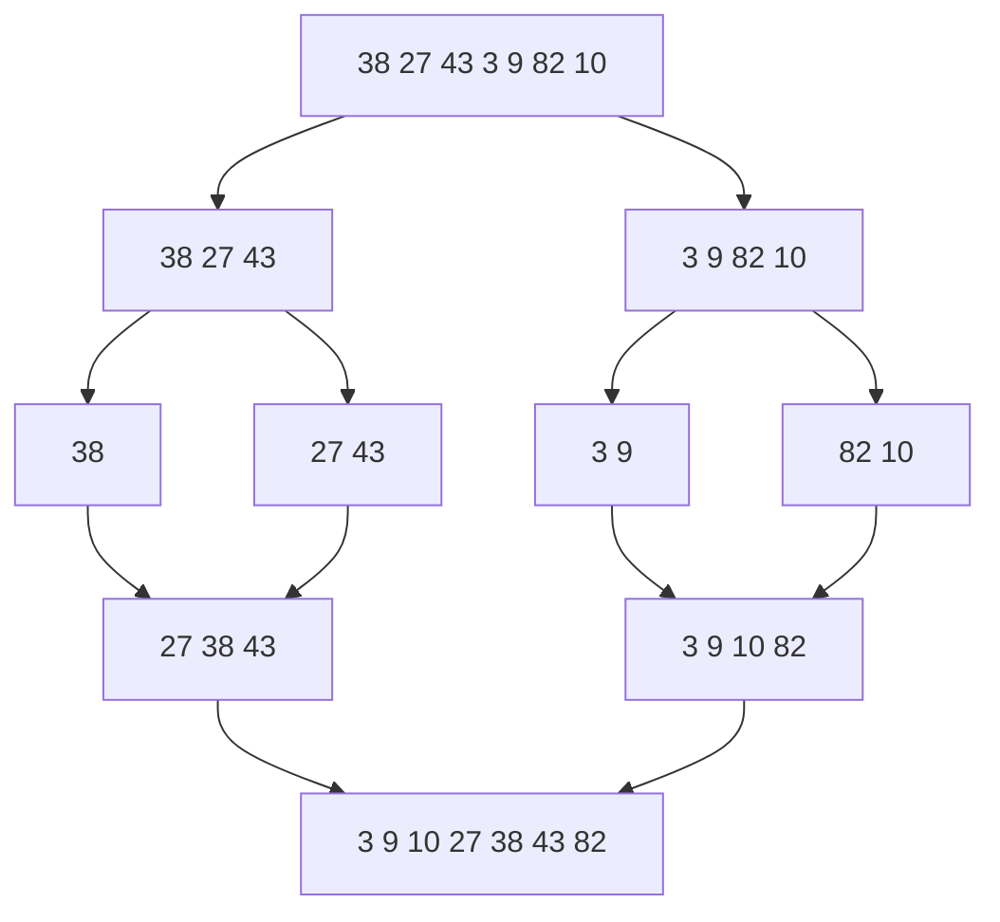

# 归并排序（Merge Sort）

> **免责声明**：本文是“河洛序”知识图谱 K2 批次的**初稿**，由 AI 辅助整理，仅供学习参考，不构成任何承诺或保证。版本信息截至 2026-10-14；文中示例已在 Python 3.15.0（数据结构与算法，纯标准库）或 Python 3.13 + 所列库版本（AI/ML 库与数学）下**实际运行**，输出为真实结果，但换机器、换版本时数字（尤其是耗时）会不同。
>
> 标注说明：**【有据可查】** 附官方文档 / 原始出处链接；**【社区共识】** 为业界普遍做法，没有唯一权威出处；**【待考察/推测】** 为未能核实或作者推断，请勿当作定论。

## 一句话定义

归并排序把数组**一分为二、分别排序、再把两个有序数组合并**。无论输入如何都是 $O(n\log n)$，而且是**稳定**的（相等元素保持原顺序），代价是需要 $O(n)$ 额外空间。

## 为什么重要

- **稳定且性能有保证**：Python `sorted`、Java 对象数组排序使用的 Timsort 是归并排序与插入排序的混合。
- **外部排序**：数据大到内存放不下时，先分块排序写入磁盘，再多路归并——数据库与大数据系统的常规做法。
- “合并两个有序序列”本身是高频子问题。

## 原理 / 图解

【有据可查】归并排序由 John von Neumann 于 1945 年提出（Knuth《计算机程序设计艺术》第 3 卷记载）：<https://en.wikipedia.org/wiki/Merge_sort> 。CPython 的 `list.sort` 是 Timsort，3.11 起其归并策略改为 **powersort**：<https://github.com/python/cpython/blob/main/Objects/listsort.txt>



递推式与快排平均情况相同，但**对任何输入都成立**：

$$
T(n) = 2T(n/2) + O(n) = O(n \log n)
$$

## 可运行示例

带合并过程打印的归并排序、稳定性演示、用 `heapq.merge` 做 K 路归并（Python 3.15.0 实际运行）：

```python
# 文件：examples/20_mergesort.py
# 归并排序：分成两半分别排好，再合并。稳定、始终 O(n log n)、需 O(n) 额外空间
def merge(left, right):
    out, i, j = [], 0, 0
    while i < len(left) and j < len(right):
        if left[i] <= right[j]: out.append(left[i]); i += 1    # <= 保证稳定
        else: out.append(right[j]); j += 1
    return out + left[i:] + right[j:]

trace = []
def merge_sort(a, depth=0):
    if len(a) <= 1: return a
    mid = len(a) // 2
    l, r = merge_sort(a[:mid], depth + 1), merge_sort(a[mid:], depth + 1)
    m = merge(l, r); trace.append(("  " * depth) + f"合并 {l} + {r} -> {m}")
    return m

print("结果:", merge_sort([38, 27, 43, 3, 9, 82, 10]))
print("\n".join(trace))

# 稳定性：相同分数的人保持原来的先后顺序
people = [("小明", 90), ("小红", 85), ("小刚", 90), ("小丽", 85)]
def merge_sort_key(a, key):
    if len(a) <= 1: return a
    mid = len(a) // 2
    l, r = merge_sort_key(a[:mid], key), merge_sort_key(a[mid:], key)
    out, i, j = [], 0, 0
    while i < len(l) and j < len(r):
        if key(l[i]) <= key(r[j]): out.append(l[i]); i += 1
        else: out.append(r[j]); j += 1
    return out + l[i:] + r[j:]
print("按分数稳定排序:", merge_sort_key(people, key=lambda p: p[1]))

# 外部排序思想：每块各自排好，再用堆做 K 路归并（大文件、分布式结果合并）
import heapq, random
rng = random.Random(1)
chunks = [sorted(rng.sample(range(100), 5)) for _ in range(3)]
print("3 个已排序分块:", chunks)
print("K 路归并:", list(heapq.merge(*chunks)))
```

输出：

```text
结果: [3, 9, 10, 27, 38, 43, 82]
    合并 [27] + [43] -> [27, 43]
  合并 [38] + [27, 43] -> [27, 38, 43]
    合并 [3] + [9] -> [3, 9]
    合并 [82] + [10] -> [10, 82]
  合并 [3, 9] + [10, 82] -> [3, 9, 10, 82]
合并 [27, 38, 43] + [3, 9, 10, 82] -> [3, 9, 10, 27, 38, 43, 82]
按分数稳定排序: [('小红', 85), ('小丽', 85), ('小明', 90), ('小刚', 90)]
3 个已排序分块: [[8, 17, 32, 72, 97], [15, 57, 60, 63, 97], [12, 26, 48, 62, 83]]
K 路归并: [8, 12, 15, 17, 26, 32, 48, 57, 60, 62, 63, 72, 83, 97, 97]
```

稳定性：“小红”和“小丽”都是 85 分，排序后保持原来的先后顺序——这让“先按姓名排，再按分数排”的多级排序成立。【有据可查】Python 排序指南“排序稳定性”：<https://docs.python.org/3/howto/sorting.html#sort-stability-and-complex-sorts>

## 常见误区

- **合并时用 `<` 而不是 `<=`**：取右边的相等元素会破坏稳定性。
- **每层都切片复制**：Python 的 `a[:mid]` 会复制，教学可以，大数据要用下标或库函数。
- **以为 `sorted` 就是归并排序**：它是 Timsort（自适应、利用已有的有序片段），对部分有序数据接近 $O(n)$。
- **递归太深**：归并排序深度只有 $\log n$，一般不会触发递归上限，这点优于退化的快排。

## 与 AI 开发的关系

- **大规模数据处理**：对 TB 级语料按键排序、合并分片结果（MapReduce 的 shuffle 阶段本质是归并）。
- **多路结果合并**：多个检索器各自返回按分数排好的结果，用 K 路归并得到全局排序（RAG 混合检索）。
- **稳定排序保证可复现**：数据集按长度分桶排序时，稳定排序保证同长度样本顺序不变。

## 延伸阅读

- Python 排序指南：<https://docs.python.org/3/howto/sorting.html>
- CPython `listsort.txt`（Timsort/powersort 说明）：<https://github.com/python/cpython/blob/main/Objects/listsort.txt>
- 维基百科：Timsort <https://en.wikipedia.org/wiki/Timsort>

## 无法核实 / 待考察点

- 【待考察/推测】powersort 合并策略引入的确切版本记为 3.11（据 CPython 社区资料），本文未逐条查 changelog。
