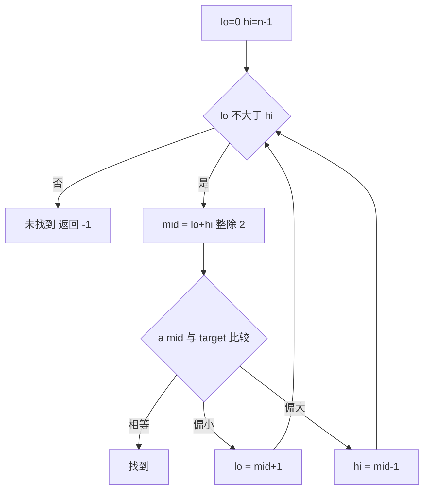

# 二分搜索（Binary Search）

> **免责声明**：本文是“河洛序”知识图谱 K2 批次的**初稿**，由 AI 辅助整理，仅供学习参考，不构成任何承诺或保证。版本信息截至 2026-10-14；文中示例已在 Python 3.15.0（数据结构与算法，纯标准库）或 Python 3.13 + 所列库版本（AI/ML 库与数学）下**实际运行**，输出为真实结果，但换机器、换版本时数字（尤其是耗时）会不同。
>
> 标注说明：**【有据可查】** 附官方文档 / 原始出处链接；**【社区共识】** 为业界普遍做法，没有唯一权威出处；**【待考察/推测】** 为未能核实或作者推断，请勿当作定论。

## 一句话定义

二分搜索在**有序**序列里找目标：每次与中间元素比较，排除一半，所以最多 $\lceil \log_2 (n+1) \rceil$ 步。100 万个元素最多约 20 步。

## 为什么重要

- 是 $O(\log n)$ 的代表算法，B 树索引、Git 的 `git bisect`（二分定位引入 bug 的提交）等都用到它。
- **“二分答案”**：只要“答案是否可行”具有单调性，就可以二分搜索答案本身，比如找最大可行 batch size、最小学习率阈值。

## 原理 / 图解



每一步把搜索区间减半，$k$ 步后剩 $n/2^k$ 个元素，当它小于 1 时结束：

$$
\frac{n}{2^k} < 1 \Rightarrow k > \log_2 n,\qquad \log_2 10^6 \approx 19.93
$$

【有据可查】Python 标准库 `bisect`：<https://docs.python.org/3/library/bisect.html>

## 可运行示例

手写二分并统计步数、`bisect` 求插入位置与成绩分档、“二分答案”求显存约束下的最大 batch size、以及在无序列表上二分的错误结果（Python 3.15.0 实际运行）：

```python
# 文件：examples/21_binary_search.py
# 二分搜索：在有序序列中每次排除一半，O(log n)
import bisect

def binary_search(a, target):
    lo, hi, steps = 0, len(a) - 1, 0
    while lo <= hi:
        steps += 1
        mid = (lo + hi) // 2
        if a[mid] == target: return mid, steps
        if a[mid] < target: lo = mid + 1
        else: hi = mid - 1
    return -1, steps

a = list(range(0, 2_000_000, 2))          # 100 万个偶数
for t in [0, 777_778, 1_999_998, 3]:
    print(f"找 {t:>9}: 结果下标 {binary_search(a, t)[0]:>7}，用了 {binary_search(a, t)[1]} 步")
print("log2(1,000,000) ≈ 20 → 最多约 20 步")

# 标准库 bisect：找插入位置；保持列表有序地插入
scores = [60, 70, 80, 90]
print("85 应插入下标:", bisect.bisect_left(scores, 85))
grades = "FDCBA"
print("成绩等级:", [grades[bisect.bisect_right(scores, s)] for s in [55, 60, 75, 99]])

# "答案二分"：在单调的条件上二分 —— 找最大可用 batch size
def fits_in_memory(batch):                 # 假设：显存需求随 batch 单调增长
    return 1.2 + 0.37 * batch <= 24.0      # GB
lo, hi = 1, 1024
while lo < hi:
    mid = (lo + hi + 1) // 2
    if fits_in_memory(mid): lo = mid
    else: hi = mid - 1
print("不超过 24GB 的最大 batch size:", lo)

# 常见错误：在无序数据上二分
print("无序列表 [5, 1, 3, 9, 2] 上二分找 1:", binary_search([5, 1, 3, 9, 2], 1), "← 1 明明存在却返回 -1")
```

输出：

```text
找         0: 结果下标       0，用了 19 步
找    777778: 结果下标  388889，用了 20 步
找   1999998: 结果下标  999999，用了 20 步
找         3: 结果下标      -1，用了 20 步
log2(1,000,000) ≈ 20 → 最多约 20 步
85 应插入下标: 3
成绩等级: ['F', 'D', 'C', 'A']
不超过 24GB 的最大 batch size: 61
无序列表 [5, 1, 3, 9, 2] 上二分找 1: (-1, 2) ← 1 明明存在却返回 -1
```

- 100 万个元素最多 20 步，与 $\log_2 10^6 \approx 20$ 一致。
- 最后一行：**在无序列表上二分**，1 明明存在却返回 -1——二分的前提是有序。
- batch size 例子中的显存模型是虚构的线性函数，只用于演示“单调可行性 + 二分”。

## 常见误区

- **边界写错导致死循环或漏查**：`while lo <= hi` 配 `hi = mid - 1`，或 `while lo < hi` 配 `hi = mid`，两套写法不能混用。
- **数据无序就二分**：结果是错的且不报错（见示例）。
- **以为 `(lo+hi)//2` 会溢出**：Python 整数不会溢出，但在 C/Java 中应写 `lo + (hi-lo)//2`。
- **重复元素时想要“第一个/最后一个”**：用 `bisect_left` / `bisect_right` 而不是普通二分。

## 与 AI 开发的关系

- **找最大 batch size / 最长上下文**：在“能否不 OOM”具有单调性时二分尝试（实际显存还受碎片、并发影响，结果仅供参考）。
- **超参数粗搜索**：对数尺度上二分学习率、阈值等（前提是指标对参数单调）。
- **分位数与阈值**：在排好序的分数上用 `bisect` 求某个分数的百分位，或按阈值切分召回结果。
- **`git bisect` 定位模型效果回退的提交**。【有据可查】<https://git-scm.com/docs/git-bisect>

## 延伸阅读

- `bisect` 文档：<https://docs.python.org/3/library/bisect.html>
- 维基百科：二分搜索 <https://en.wikipedia.org/wiki/Binary_search>
- `git bisect` 文档：<https://git-scm.com/docs/git-bisect>

## 无法核实 / 待考察点

- 暂无需要特别标注的不确定事实。示例中的显存公式为虚构，不代表任何真实模型。
